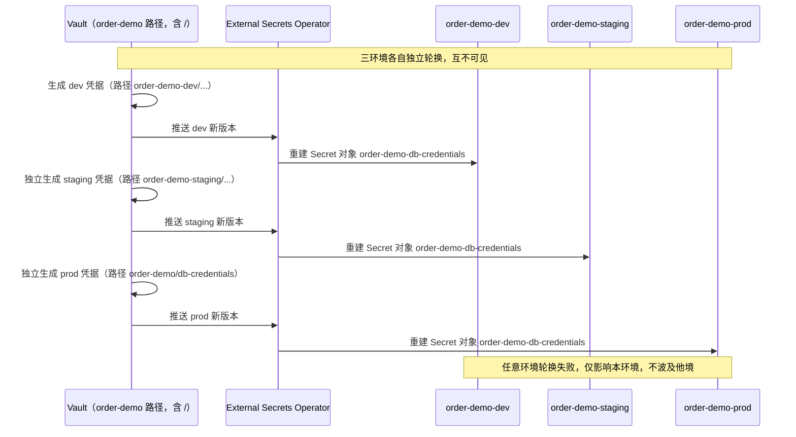

# 第 4 章　环境与仓库拓扑

> 位置：地基 · 边界 ｜ 横切：A ｜ 成熟度 L1
>
> **此刻 `order-demo` 长什么样**：新增 `order-demo-dev` / `staging` / `prod` 三套 overlay 与独立凭据，三环境指向同一个镜像。 ｜ **本章可验证动作**：`./hack/render-diff.sh` 显示三环境渲染结果仅配置不同、镜像相同，仓库无凭据明文。 ｜ 复现：`git checkout ch04-env`。
>
> **初稿状态**：本章为 v1.0 完整初稿，七段齐全；终稿目标 1.0 万字，扩写点见章末「终稿扩写清单」。

---

## 4.1 问题与反模式：三环境共用一套凭据「方便联调」

第 1 章事故里，H6（密钥轮换踩坑）和 H7（有人手工改了生产）都不是凭空出现的：它们的**环境条件**在这一章形成。三套环境如果共用一套凭据、仓库目录如果三个月就失控，那么「晋升」永远不可能只是改配置。

读者来这一章带着两个很具体的问题：dev、staging、prod 到底该分集群还是分命名空间？仓库目录怎么摆才不会三个月后失控？本章的核心问题是：**环境与仓库的边界怎么划，才能让「晋升」真的只是改配置，而不是重新做一遍？**

**反模式一：三个环境共用一套凭据「方便联调」。** 现象是「dev 的一个误操作把 prod 的库连崩了」「一次泄露全线失守」。根因是把凭据当成了跨环境共享的常量；而按本书定义，**环境 environment** 是「一套有独立凭据、独立配额、独立晋升入口的集群或命名空间集合」（这是本章的正式定义，可验证判据见 4.5）。Kubernetes 的 `Secret` 是按命名空间作用域的对象，官方也明确提醒它不等于加密存储 [R-04-4]；本章的替代做法是每环境独立凭据 + 审计，凭据由外部注入、不入 Git（见第 9、26 章）。

**反模式二：把 `terraform.tfstate` 或 `.env` 提交进仓库。** 现象是「基础设施状态和明文密钥躺在 Git 历史里，删了当前文件也抹不掉」。根因是把「状态文件」当成了普通配置；Terraform state 可能包含凭据明文，一旦入 Git 就等于长期泄露 [R-04-7]。本章的替代做法是远端加密存储 + plan/diff 审查，`gitops/bootstrap/` 只放声明、不放 state。

> 本章属于横切 A（安全 / 策略 / 凭据）的**地形章**：不写准入策略实现（第 25 章）、不写动态凭据（第 26 章），只把「边界划在哪、凭据放在哪、目录怎么摆」定死，让后续章节有稳定的地基。

### 4.1.1 三环境凭据轮换时序与一次混用事故复盘

把反模式一从静态定义拉到时间轴上看，凭据不是「一份还是三份」的问题，而是「三份各自怎么生、怎么轮、怎么废」的轮换纪律问题。下面先用一张时序图把三环境独立的轮换链路画清楚，再用一次合成事故说明「混用」的代价。



时序图里三条链路的关键差别：（1）Vault 路径按环境分段，`order-demo-dev`、`order-demo-staging`、`order-demo/db-credentials` 三者互不交叉——注意 prod 用的是 `order-demo/db-credentials` 这一条约定路径（含 `/`，是 Vault 路径而非 K8s 对象名）[R-04-4]；（2）K8s 里的 `Secret` 对象名三环境**都叫** `order-demo-db-credentials`，但各自存在于不同命名空间 `order-demo-{env}`，靠命名空间而非对象名区分，这正是「命名空间不是安全边界、但能做组织与配额边界」的现实落地 [R-04-1][R-04-2]；（3）轮换由 ESO 周期性触发，应用通过 `envFrom` 引用该 `Secret`，明文不写进 `deploy/`、`gitops/` 任何目录（公理 9 的派生护栏，见第 3、26 章）。

**一次凭据混用事故复盘（合成案例，非真实事件）**。某团队在 dev 联调时图省事，把 prod 的 Vault 路径 `order-demo/db-credentials` 直接配进了 dev 的 `ExternalSecret` 里——理由是「dev 要连 prod 库验数据，反正都是同一套」。三个月后，dev 的一个临时调试 Pod 镜像被误传到公共仓库，镜像附带的调试权限让攻击者读到了 dev 命名空间的 `Secret`。按「混用」设计，dev 的 `Secret` 内容其实就是 prod 凭据，攻击者于是用同一组账号直接登入了 `order-demo-prod` 的 PostgreSQL（端口 5432），篡改了订单状态。从告警触发到定位根因历时约 6 小时，期间 prod 真实流量受损。

复盘的三条根因。（a）**边界被人为抹平**：dev 的 `ExternalSecret` 指向了 prod 的 Vault 路径，使「环境」定义（独立凭据、独立晋升入口）当场失效，三个命名空间在凭据层面退化成了一个 [R-04-4]。（b）**泄露面被放大**：凭据明文本不该出现在任何可导出物里，但混用让一次 dev 侧的低危泄露升级为 prod 级事件；Kubernetes 官方也明确 `Secret` 不是加密存储，必须配合外部密钥后端与最小权限 [R-04-4]。（c）**回滚无方**：事故当时的处置是「改密码再发一版」，这违反公理 6（回滚方案先行）——正确姿势是先在 Vault 作废旧凭据、ESO 重新注入新 `Secret`，再回滚到上一个已知良好配置（见第 13 章），而不是现场修凭据。

治理手法（对应 §4.1 反模式一的替代做法）。第一，Vault 路径按环境严格分段，CI 在渲染 `ExternalSecret` 时校验「本环境 overlay 不得引用非本环境 Vault 路径」；第二，`render-diff.sh` 已扫描 `password|token` 明文，应再补一条「`ExternalSecret` 的 `remoteRef.key` 必须匹配本环境前缀」的校验；第三，轮换事件接入审计（见第 26 章），任一环境 `Secret` 重建都留痕，便于事故时快速定位是哪一环串了环境。综上，三环境凭据轮换的本质不是「三份拷贝」，而是**三条互相看不见、各自可独立作废的链路**。

### 4.1.2 命名空间不是隔离边界：一次跨环境「网络串门」复盘

§4.1.1 的事故里，攻击者是拿到了凭据；这一节的事故里，凭据从头到尾都是三份、互不复用，事故照样发生了——因为隔离断在了**网络层**。这正是 §4.2 把「命名空间不是安全边界」列为第一条判据的原因：命名空间能做组织、命名与配额，但不做网络隔离；默认情况下，同集群内任意命名空间的 Pod 都能通过 Service DNS 直达另一个命名空间的服务 [R-04-1][R-04-3]。

**现场布局**。三环境同集群（§4.2 矩阵最左列），平台团队在 `platform/netpol/allow-order-demo.yaml` 维护一份「order-demo 应用内部互通」的 `NetworkPolicy`，核心选择器写成：

```yaml
  podSelector:
    matchLabels:
      app.kubernetes.io/name: order-demo
  ingress:
    - from:
        - namespaceSelector:
            matchLabels:
              app.kubernetes.io/name: order-demo
```

单看这条策略完全合理——「只允许 order-demo 自己访问自己」。问题出在 §4.4 的三份 `namespace.yaml` 都给命名空间打了 `app.kubernetes.io/name: order-demo` 标签（不打就没法用 `kubectl get ns -l` 分组），于是这个 `namespaceSelector` 同时匹配 `order-demo-dev`、`order-demo-staging`、`order-demo-prod`。策略字面意思是「应用内互通」，实际语义是「**三环境互通**」。标签是给人和工具做分组的，不是给安全策略做边界的；一旦用业务标签写 `namespaceSelector`，它就会随分组习惯漂移。

**时间线（合成案例，非真实事件）**。

| 时刻 | 事件 |
|---|---|
| 10:12 | 工程师在 dev 复现「订单重复提交」，压测脚本从 prod 的 runbook 复制，`TARGET` 忘了改，仍是 `db.order-demo-prod.svc.cluster.local:5432` |
| 10:12 | 连接建立成功——不是认证成功，而是 **TCP 可达**。dev 的凭据被 prod 的 PostgreSQL 拒绝，但每次拒绝都要先建连接、再认证、再断开 |
| 10:20 | 脚本按 50 并发重试，prod `db` 的 `max_connections` 被失败连接占满；`api` 开始报 `pq: sorry, too many clients already`，gateway 5xx 上升 |
| 10:24 | 值班按「数据库连接池泄漏」处理，重启 `api`——无效，5xx 继续 |
| 10:38 | 在 prod `db` 上查 `pg_stat_activity`，发现大量来自**非 prod 网段**的空闲连接，排查方向才从「应用 bug」转到「谁在连」 |
| 11:05 | 定位到 dev 的压测 Pod，删除后 5xx 回落；总时长 53 分钟，prod 真实订单受损 |

**三条定位命令**（假设 `db` 已按第 7 章部署为 `StatefulSet`），顺序是「先证外来源、再证谁放行」，反了就会在应用日志里绕圈子：

```bash
# 1) 谁在连 prod db：按源地址与状态聚合
kubectl -n order-demo-prod exec sts/db -- \
  psql -U postgres -c "select client_addr, state, count(*) from pg_stat_activity group by 1,2 order by 3 desc;"

# 2) 上一步的 client_addr 属于哪个 Pod（client_addr 换成实际地址）
kubectl get pod -A -o wide | grep '<client_addr>'

# 3) 谁放行了这条跨命名空间流量
kubectl get networkpolicy -A -o jsonpath='{range .items[*]}{.metadata.namespace}/{.metadata.name}{"\t"}{.spec.ingress}{"\n"}{end}'
```

第 3 步的输出会直接暴露那个 `namespaceSelector`：它按三环境共享的业务标签匹配，而不是按命名空间名匹配。

**两个误判与纠正**。

误判一：**把网络问题当容量问题**。第一反应是「db 连接数不够」，扩容或调 `max_connections` 都能让 5xx 暂时下降，但攻击面还在，第二天换个脚本照样复发。纠正：连接数异常先看 `client_addr` 分布，源不在本环境就立刻转网络排查，而不是加资源——加资源是「让它多扛一会儿」，不是「让它不被连」。

误判二：**以为「独立凭据」等于「环境隔离」**。凭据独立挡住了数据读写，却没挡住连接建立、端口探测与连接数耗尽：**认证是应用层的事，可达性是网络层的事** [R-04-4]。这也是本书把「环境」定义成「独立凭据 + 独立配额 + 独立晋升入口」而不只写「独立凭据」的原因——三个维度缺一不可，而网络可达性属于「边界」，不在凭据这一维里。

**止血与根治**。止血在分钟级：删掉越界工作负载，在 prod `db` 前补一条只允许 `order-demo-prod` 入站的 `NetworkPolicy`。根治在小时级：把平台策略里的 `namespaceSelector` 从业务标签换成命名空间名标签——Kubernetes 自 1.21 起为每个命名空间自动写入 `kubernetes.io/metadata.name=<名字>`，按它匹配不会随分组习惯漂移 [R-04-1]：

```yaml
        - namespaceSelector:
            matchLabels:
              kubernetes.io/metadata.name: order-demo-prod
```

改完必须验证，不能只看策略对象存在。从 dev 起一个一次性 Pod 去连 prod 的 `db`，**期望结果是超时，而不是 `open`**：

```bash
kubectl -n order-demo-dev run netcheck --rm -i --restart=Never --image=busybox:1.36 -- \
  timeout 3 nc -zv db.order-demo-prod.svc.cluster.local 5432
```

通过标准：命令在 3 秒内以超时结束、输出中没有 `open`；若仍打印 `... 5432 (5432) open`，说明还有一条更宽的策略在放行，用 `kubectl get networkpolicy -n order-demo-prod -o yaml` 逐条核对 `ingress.from`。顺手做一次全集群审计：`kubectl get ns -l app.kubernetes.io/name=order-demo --show-labels` 数出有多少命名空间共享同一个业务标签，凡是被这个标签选中的 `namespaceSelector` 都在嫌疑名单里。

同时把「跨环境可达」变成晋升门禁的一条：任一环境渲染产物里出现指向其他环境 Service DNS 的配置，直接阻断（§4.5.1 给了脚本）。完整的默认拒绝与入站白名单设计属于第 19 章，本节只钉死一句：**命名空间给你配额和命名，不给你隔离；隔离要显式建，且必须按名字建、不能按业务标签建** [R-04-2][R-04-3]。

---

## 4.2 范式与决策树：边界怎么划，目录怎么摆

**第一条判据：命名空间不是安全边界**（§4.1.2 是一次失败现场，这里给判据本身）。命名空间做的是组织、命名与配额划分；需要**凭据、配额、故障域**的硬隔离时，应分集群乃至独立账号 [R-04-1][R-04-2]。官方实践汇总也把多租户隔离列为需要额外机制（RBAC、配额、网络策略）的议题，而不是命名空间自带的能力 [R-04-3]。这条判据直接决定 4.3 的选型矩阵。

**环境隔离方式选型矩阵**（成本只给相对档位与归因口径，不写具体云厂单价）：

| 方式 | 隔离强度 | 相对成本 | 凭据边界 | 故障域 | 何时不该用 | 回滚方式 |
|---|---|---|---|---|---|---|
| 命名空间（同集群） | 弱：仅组织 / 配额 | 最低 | 需额外 RBAC 与独立 Secret | 共享控制面、共享节点 | 需要凭据 / 故障域硬隔离或合规审计时 | `kubectl apply -k deploy/overlays/<env>` 回上一 overlay |
| 同集群多租户 | 中：每租户独立 SA / 配额 | 低 | 每租户独立 | 共享控制面 | 合规要求独立故障域时 | 同上 + 策略回滚（见第 25 章） |
| 独立集群 | 强 | 高 | 完全独立 | 独立控制面 | 单团队单服务、预算有限时 | `terraform apply` 回上一版 state |
| 独立账号 / 订阅 | 最强 | 最高 | 完全独立 | 完全独立 | 不需要跨账号审计与账单隔离时 | IaC plan/diff 审查后回退 |

对 `order-demo` 本书取**最左列**：三套命名空间 `order-demo-dev` / `order-demo-staging` / `order-demo-prod`，差异只在 overlay，凭据按环境独立注入。这是成本最低又能讲清「晋升」的最小可行选择；第 30 章再讨论何时升级到多集群。

**仓库目录规范表**（先服务「晋升时只改一处」，再服务「看着整齐」）：

| 目录 | 放什么 | 谁改 | 晋升时是否改 |
|---|---|---|---|
| `deploy/base/` | 同源清单（Deployment / Service / ConfigMap） | 应用方 | **不改** |
| `deploy/overlays/{dev,staging,prod}/` | 环境差异（副本数、GREETING、域名） | 应用方 | **只改这里** |
| `deploy/charts/order-demo/` | 对外分发的 Helm 4.x Chart（第 10 章） | 平台方 | 不改 |
| `gitops/bootstrap/` | 集群 IaC 与 GitOps 自举入口 | 平台方 | 不改 |
| `policies/` | 准入策略（第 25 章） | 平台方 | 不改 |
| `observability/` | SLO 卡片、告警规则（第 20、22 章） | 应用 + 平台 | 不改 |

> **本书观点（本章第 1 条主张，不需要外部背书）**
>
> **主张**：目录结构应**先服务「晋升时只改一处」，再服务「看着整齐」**；同源清单的多环境差异用 overlay，参数化对外分发才用 values。
>
> **论证**：晋升的定义是「同一制品只改配置」。若目录结构让一次晋升要同时改 base、改三份环境文件、再改一份 values，那么「只改配置」就退化为「重新做一遍」，公理 1/3 会在目录层被架空 [R-04-8][R-04-9]。把差异收敛到 `overlays/<env>/`，一次晋升的 diff 就只包含预期配置项，review 者能当场判断「这次只改了副本数和域名」。
>
> **反例与适用前提**：这不等于「永远不用 values」。当应用要分发给外部团队、参数维度多且需要打包时，Helm 4.x values 更合适（见第 10 章）。前提是**同源清单的多环境差异**；跨组织分发是另一类问题。第 10 章深化 overlay 与 values 的取舍，但不推翻本章目录规范。

**决策树**（判定一次差异该放哪）：

```
差异涉及凭据 / 配额 / 故障域的硬隔离？   是 → 分集群或独立账号（4.2 矩阵），不只是换命名空间
        │ 否
差异只是副本数、GREETING、域名？        是 → 放进 overlays/<env>/，只改这一处
        │ 否
差异是「把应用参数化分发给外部」？      是 → 用 Helm 4.x values（见第 10 章）
        │ 否
→ 你在改产物本身，违反公理 1 / 3（见第 3 章），回第 3 章
```

### 4.2.1 ResourceQuota 与 LimitRange 的三环境取值（衔接第 17 章资源基线）

§4.2 的选型矩阵把「相对成本 / 故障域」列出来了，但「配额」二字在命名空间档位下需要落到具体数字。这里给出三套 `ResourceQuota` 与 `LimitRange` 的取值，并说明它们如何与第 17 章的资源基线对齐——配额是**天花板与地板的总量约束**，基线是**每件家具的标准尺寸**，二者必须配合 [R-04-2][R-04-1]。

`ResourceQuota` 在每个 `order-demo-{env}` 命名空间里约束**总**可用量，防止单环境把集群资源吃光；`LimitRange` 给未显式声明资源的容器设置默认值与上下限，保证「忘了写 resource」的 Pod 也不会是零约束的裸跑 [R-04-2]。

三环境 `ResourceQuota`（命名空间档位相同，配额随环境「重要性 + 容忍度」递增）：

```yaml
# deploy/overlays/dev/quota.yaml —— dev：宽松、允许试错
apiVersion: v1
kind: ResourceQuota
metadata:
  name: order-demo-quota
  namespace: order-demo-dev
spec:
  hard:
    requests.cpu: "2"
    requests.memory: 2Gi
    limits.cpu: "4"
    limits.memory: 4Gi
    pods: "10"
---
# deploy/overlays/staging/quota.yaml —— staging：接近生产，但留余量
apiVersion: v1
kind: ResourceQuota
metadata:
  name: order-demo-quota
  namespace: order-demo-staging
spec:
  hard:
    requests.cpu: "4"
    requests.memory: 4Gi
    limits.cpu: "8"
    limits.memory: 8Gi
    pods: "20"
---
# deploy/overlays/prod/quota.yaml —— prod：封顶，禁止超卖
apiVersion: v1
kind: ResourceQuota
metadata:
  name: order-demo-quota
  namespace: order-demo-prod
spec:
  hard:
    requests.cpu: "8"
    requests.memory: 8Gi
    limits.cpu: "16"
    limits.memory: 16Gi
    pods: "40"
```

三环境 `LimitRange`（同名 `order-demo-limits`，仅 `namespace` 不同；以 prod 为例）：

```yaml
# deploy/overlays/prod/limitrange.yaml
apiVersion: v1
kind: LimitRange
metadata:
  name: order-demo-limits
  namespace: order-demo-prod
spec:
  limits:
    - type: Container
      defaultRequest:               # 未声明时兜底（与第 17 章基线对齐）
        cpu: 100m
        memory: 128Mi
      default:
        cpu: 500m
        memory: 256Mi
      min:
        cpu: 50m
        memory: 64Mi
      max:
        cpu: "1"
        memory: 512Mi
    - type: Pod
      max:
        cpu: "2"
        memory: 1Gi
```

**与第 17 章资源基线的衔接**。第 17 章冻结的组件基线是：api `requests cpu 100m / mem 128Mi → limits cpu 500m / mem 256Mi`；gateway `requests cpu 50m / mem 64Mi → limits cpu 500m / mem 128Mi`；db `requests==limits cpu 250m / mem 512Mi`（Guaranteed，QoS 最高）。把它们放进上面的 `LimitRange` 框架看：api 的请求 / 限制恰好等于 `defaultRequest` / `default`，即「即使 Pod 没写 resource，也会被兜底到基线」；gateway 的 `50m/64Mi` 刚好压在 `min` 下限，提醒它在资源紧张时最先被调度器优待；db 的 `250m/512Mi` requests==limits 落入 Guaranteed 档，而 `LimitRange` 的 `max` 给它的上限 `1/512Mi` 留了头，保证 db 不会被 `LimitRange` 误杀，也不至于无限膨胀。

衔接要点有三条。（1）**基线是地板，配额是天花板**：`LimitRange.defaultRequest/default` 把单容器兜到基线，但 `ResourceQuota` 约束整个命名空间的总量，二者必须同时设——只设 `LimitRange` 不防「环境总超卖」，只设 `ResourceQuota` 不防「单个 Pod 裸跑」[R-04-2]。（2）**三环境基线一致、配额分级**：组件资源值在 dev/staging/prod 完全相同（晋升只改配置不改产物，公理 1/3），差异只体现在 `ResourceQuota` 的总量上，这正是 §4.4 渲染 white-list 的延伸——`render-diff.sh` 比对时应把 `ResourceQuota` 列为例外差异项（dev/staging/prod 本就该不同）。（3）**db 的 Guaranteed 优先于 LimitRange 默认值**：由于 db 显式写了 `requests==limits`，它不受 `default` 影响，直接以声明值进入 Guaranteed QoS，这是第 17 章 OOM 治理的前置条件。

### 4.2.2 三环境差异矩阵：哪些必须一样，哪些必须不一样

§4.4 说三份 overlay「只差四处」，那是**渲染产物**层面的差异。一个真实环境要回答的差异远不止四处：副本、配额、晋升门禁、告警阈值、数据来源、备份目标都得不同，而且其中一半必须写进 Git。把「必须一样」和「必须不一样」放进同一张表，才能同时防住两种相反的错误：把该一样的改出差异（镜像 tag），或把该不一样的抄成一样（prod 的告警阈值照抄到 staging，于是 staging 常年静默）。

| 维度 | dev | staging | prod | 判定 | 理由 |
|---|---|---|---|---|---|
| 镜像标签 | `git-<sha7>` | 同 | 同 | **必须一致** | 公理 1/3；一旦不同，说明有人重新构建了制品 |
| `base/` 清单（端口、探针路径、资源基线） | 同 | 同 | 同 | **必须一致** | 配置契约冻结；改基线等于换了制品 |
| 命名空间 | `order-demo-dev` | `order-demo-staging` | `order-demo-prod` | **必须不同** | 配额、RBAC、审计的作用域 [R-04-1] |
| gateway 副本 | 2 | 3 | 5 | 可变 | dev 只要可用；prod 要扛住 N-1（配合第 8 章 PDB） |
| `ResourceQuota` requests.cpu | 2 | 4 | 8 | 可变 | dev 要试错空间，prod 要封顶防超卖（§4.2.1） |
| `LimitRange` | 同 | 同 | 同 | **必须一致** | 兜底值来自第 17 章基线，不随环境改 |
| Vault 路径 | `order-demo-dev/` | `order-demo-staging/` | `order-demo/db-credentials` | **必须不同** | 轮换与作废互不影响（§4.1.1） |
| `GREETING` / `PUBLIC_URL` | dev 值 | staging 值 | prod 值 | 可变 | 环境身份，也是「晋升只改配置」的最小证据 |
| 晋升门禁 | CI 绿 + 单人 review | ＋渲染 diff + 冒烟 | ＋变更单 + 双人 review + 回滚演练记录 | **必须不同** | 越接近真实流量，门禁越贵（§4.5.1） |
| 告警 | 只记录不通知 | 通知不叫醒 | SLO 燃尽率 + 分级路由 | **必须不同** | 阈值抄 prod 会让 staging 长期不触发，抄 dev 会让 prod 被噪音淹没（第 20、22 章） |
| 启动探针阈值 | 宽松 | 接近 prod | 严格 | 可变 | dev 的慢启动不该被判死，prod 的慢启动就是真故障（第 8 章） |
| 数据 | 合成数据 | 脱敏子集 | 真实数据 + PITR | **必须不同** | 合规与恢复目标（第 16 章） |
| 日志级别与采样 | debug 全量 | info 全量 | info + 采样 | 可变 | 成本与信噪比（第 21 章） |

三条判据把这张表钉住。

**判据一：差异只能落在「可回滚且不改变制品身份」的维度上。** 表里标「必须一致」的三行（镜像标签、`base/` 清单、`LimitRange`）是红线：它们一旦不同，`render-diff.sh` 看到的就不再是「配置差异」而是「两个不同的应用」，晋升与回滚都失去前提 [R-04-5]。反过来，副本与配额虽可变，但必须能被 overlay 一处改完，否则回滚时要改的地方比发布时还多。

**判据二：凡是「人要看」的差异，也必须进 Git。** 告警阈值、日志级别、数据来源常常被当成「运维在集群里调的东西」，结果是重装集群后全部丢失、重建时口径不一。把它们和副本一样放进 `deploy/observability/<env>/`（第 20、22 章）后，dev 与 prod 的差别才有 diff 可审，而不是靠某个人记得。

**判据三：这张表是 `render-diff.sh` 白名单的唯一来源。** §4.5 目前的四类白名单（`namespace` / `replicas` / `GREETING` / `PUBLIC_URL`）只是本表的子集；`ResourceQuota` 的差异按本表属于预期（标「可变」），而 `LimitRange` 标「必须一致」、根本不该出现在 diff 里。白名单与 §4.5 的同步口径见章末一致性备注 C，本节不擅自改 §4.5 的判定。

一个反例说明「抄成一样」的代价：某团队为了让 staging「尽量像生产」，把 staging 的告警阈值设成与 prod 相同的绝对值。staging 的流量只有 prod 的 1/50，基于绝对值的错误率与延迟告警永远达不到门限，三个月里 staging 一次都没报过警，团队以为它在被监控，其实是黑的；等到一次改动在 staging「全绿」后进 prod 立刻翻车，才发现 staging 从来没有真正验证过告警链路。纠正方式不是把阈值调低，而是给 staging **同口径的合成流量 + 相对阈值**（错误预算百分比而非绝对次数），并在晋升门禁里要求「staging 至少触发过一次告警演练」。

**落地形式**：这张表不能只活在文档里，否则三个月后必然与 overlay 脱节。把它落成三件具体的东西——`deploy/ENVIRONMENTS.md`（表本体，作为唯一来源）、PR 模板里的一行「本次改动影响矩阵中的哪几行」（勾选而非自由文本，避免写「配置调整」这种废话）、以及 `render-diff.sh` 的白名单生成脚本（从表里读出「可变」维度拼出 `--ignore` 列表）。三者同源之后，「为什么 staging 的副本是 3 不是 5」这类问题才有唯一答案，而不是每次问不同的人得到不同的解释。表与代码一旦分叉，处理方向只能是「以表为准、按脚本回写 overlay」，不能反过来——反过来意味着每次评审都在给既成事实补理由。

### 4.2.3 从 3 个环境到 30 个环境：拓扑在哪里断裂

本章选的是单集群三命名空间，这在 1–3 个团队时是最省成本的最优解。但它有一条会断裂的曲线，断裂点不是「环境数」本身，而是下面五个可观测的指标——出现任意一条，就该重新讨论拓扑，而不是继续往同一个集群里加命名空间。

| 判据 | 阈值（本书观点，需按组织校准） | 越过后的症状 | 应对 |
|---|---|---|---|
| 控制面共享故障域 | 任一环境装 CRD、改准入 webhook 会同时影响 prod | dev 装了个 CRD，prod 的 API 开始报 `no matches for kind` | 拆「非生产集群 / 生产集群」 |
| 单环境配额占集群可分配量 | 任一环境 requests 合计 > 30% | dev 压测把 prod 挤到 `Pending` | 拆集群，或给 prod 独立节点池 + 污点 |
| 版本节奏冲突 | 两个环境需要不同 K8s 小版本 | staging 要试 1.33、prod 锁 1.32，只能二选一 | 拆集群（版本域） |
| 标签选择器规模 | 命名空间数 > 50 且策略按业务标签匹配 | 一次标签变更误伤 N 个环境（§4.1.2） | 改按 `kubernetes.io/metadata.name` 匹配 + 拆集群 |
| 合规与审计 | 要求账号级或物理隔离 | 审计报告无法证明边界 | 独立账号 / 订阅 |

五条判据里只有第二条是连续量，其余四条都是离散事件。这意味着不能靠「看监控觉得还行」来推迟拆分决策：离散的那四条一旦发生，已经是事故或审计发现，而不是预警。所以实际操作上是用第二条做趋势巡检（配额的 30% / 50% / 70% 分三档预警），用其余四条做硬触发——一旦命中，下个季度必须排期拆，不允许「再观察一个季度」。

按这五条，拓扑大致分四段演进：

| 阶段 | 环境数 × 团队 | 拓扑 | 相对成本 | 主要风险 |
|---|---|---|---|---|
| S1 | 1–3 × 1 | 单集群多命名空间（本章） | 最低 | 控制面共因故障 |
| S2 | 3–10 × 2–5 | 单集群 + 每团队命名空间前缀 + 独立 SA / 配额 | 低 | 策略按标签匹配导致误伤 |
| S3 | 10–20 | 生产集群 / 非生产集群分离，同一套 overlay | 中 | 双份控制面与升级成本 |
| S4 | > 20 或跨区域 | 每团队（或每区域）一集群，Cluster API 1.x 声明，`ApplicationSet` 用 cluster generator | 高 | 集群生命周期本身成为产品 |

拆分不是「环境多就拆」，而是「共因故障不可接受时拆」。这里给一条保守默认：**一旦有第二个团队接入（进入 S2），生产与非生产就必须分属不同集群**——本章的 `order-demo` 是单团队单应用，落在 S1，三命名空间仍是它的最优解；从 S2 起，别人的 CRD、别人的准入 webhook、别人的压测都会成为你的共因，此时继续同集群就是拿 prod 赌别人的操作纪律。理由不是性能，而是 blast radius：控制面升级、准入策略故障、CRD 冲突、etcd 容量打满，任何一项在单集群里都会同时打掉三环境，而这四类故障恰恰最容易在 dev 被引入。这条在 S2 就该做，等到 S3 再做通常是已经出过一次「dev 把 prod 拖下水」的事故。

到了 S4，最先撑不住的往往不是集群，而是**目录**：30 个环境若还按 `overlays/<env>/` 一个环境一份，会有 30 份几乎相同的 `kustomization.yaml`，改一个探针路径要改 30 处。此时的收敛方式是把 overlay 从「按环境」改成「按环境类」（`overlays/nonprod/`、`overlays/prod/`）加一层每环境的 `configMapGenerator` 和 `replicas` 数据文件，由 `ApplicationSet` 的 cluster generator 把「环境」变成「(集群, 命名空间, 数据文件)」三元组。注意这里变的是**生成方式**，不是契约：命名空间仍是 `order-demo-{env}`，镜像仍是同一个 `git-<sha7>`，`base/` 仍然一字不改——如果一次扩容把这三条改了，那不是规模升级，是把第 3 章的公理换掉了。

反过来说，也有「不该拆」的情形：3 个环境、1 个团队、集群总容量用不到 30% 时拆集群，换来的是两套控制面升级窗口、两份监控、两次准入策略发布，运维负担与故障面同时翻倍，而 blast radius 的收益几乎为零。判据回到表里第一行：**你能不能举出一次「A 环境的操作直接打掉了 B 环境」的具体场景**？举不出来，就还不到拆的时候。

拆分之后，§4.4 的 `ApplicationSet` 只是换一类 generator，`deploy/overlays/` 不需要任何改动——这就是「拓扑可变、契约不变」的机器可验证形式。拆分后的发布拓扑、双集群如何做到「一次变更同时发两处」，归第 30 章；本章只负责给出「什么时候必须拆」的判据。

---

## 4.3 工具选型：以 Kustomize overlay 为多环境基线

本章是真正的选型章：按 `book/decisions.md` 的**唯一示例实现**，`Kustomize 5.x` overlay 是多环境基线，`Helm 4.x` 只用于对外分发 Chart；集群自身用 `Terraform 1.x` / `Cluster API 1.x` 声明式供应，并走 GitOps bootstrap。其余工具只在矩阵里作对比。

| 工具 / 方式 | 本章是否使用 | 何时不该用（本章相关的一条） | 最小接入 | 升级 / 回滚路径 |
|---|---|---|---|---|
| Kustomize 5.x overlay | **使用（唯一示例实现）** | 需要条件逻辑复杂、或对外打包分发时（改用 Helm 4.x，见第 10 章） | `deploy/overlays/<env>/kustomization.yaml`（4.4） | 小版本锁附录 A；回滚 `git revert` + `kubectl apply -k` |
| Helm 4.x | 仅 `charts/` 占位 | 同源清单只改几个字段时；维护模板的成本大于收益 | 第 10 章展开 | `helm rollback <release> <rev>`（第 10 章） |
| Terraform 1.x | **使用（IaC state）** | 集群完全由托管服务托管、无需自管基础设施时 | `gitops/bootstrap/backend.tf`（4.4） | state 远端加密；plan/diff 审查后 `terraform apply` 回退 |
| Cluster API 1.x | **使用（集群声明）** | 单集群实验、无需声明式供应时 | `gitops/bootstrap/` 占位（4.4） | 升级顺序见第 30 章 |
| 独立集群 / 账号 | 仅矩阵对比 | 单团队单服务时；成本与运维量不划算 | 按组织情况填 | IaC 回退 |

**最小接入 diff**：相比第 3 章的单份 `deploy/base/deployment.yaml`，本章新增的是三份 `overlays/<env>/kustomization.yaml`，`base/` 清单本身不变——这正是「晋升只改 overlay」的落地。三环境用同一个 `images.newTag: git-1a2b3c4`（Kustomize 的 `images` transformer 只改标签、不改仓库），从而保证渲染产物里镜像字段完全相同 [R-04-5][R-04-6]。

**升级 / 回滚路径**：Kustomize 5.x 与 Terraform 1.x 的小版本锁在附录 A，正文只写主版本；每次升级先在 staging 渲染 diff 再晋升。工具本身的退出路径见第 5 章，本章不引入 CRD（其首次提及在第 5 章，详见第 27 章）。

### 4.3.1 overlay 继承链失控的三个征兆与治理手法

Kustomize 5.x overlay 用对了是「晋升只改一处」，用错了会变成「无人敢动的继承泥潭」。下面三个征兆出现任意一个，就该停下来治理，而不是继续往 overlay 里叠 patch [R-04-5]。

**征兆一：overlay 互相继承成链**。`prod` 不继承 `base`，而是继承 `staging`，`staging` 又继承 `dev`——美其名曰「生产自然包含预发包含开发」。后果是改 `dev` 一处、`prod` 渲染产物莫名漂移，且 diff 无法在 `render-diff.sh` 白名单内解释。治理：坚持**所有 overlay 直接继承 `base`**（即 `resources: [../../base]`），禁止 overlay 套 overlay；`render-diff.sh` 的 dev/prod diff 段应把「非白名单差异」设为阻断，见 §4.5。

**征兆二：patches 越积越多、无人说得清最终值**。`overlays/prod/` 下 `patchesStrategicMerge` 叠了十几份，某字段在 base、replacement、patch 三处各写一次，渲染结果靠「顺序巧合」成立。后果是新人改 base 触发级联失败。治理：每个字段「只在一处定义」——配置差异走 `configMapGenerator` / `replicas` / `images` transformer，而非裸 patch；确需 patch 的，单一 `patches` 块并加注释说明动机，且纳入 §4.6 的 `CL-04-04` 白名单审查。

**征兆三：同一资源被多个 transformer 同时改，顺序不确定**。`images` 改了标签，`replacements` 又改了同一镜像字段，`kustomize build` 的输出随版本抖动。治理：明确「一个字段只由一个 transformer 负责」，把镜像标签统一收敛到 `images.newTag`（三环境相同，见 §4.3 最小接入），删掉与其竞争的 `replacements` 规则；CI 里固定 `kustomize` 小版本（附录 A），避免构建器版本导致输出漂移 [R-04-5][R-04-8]。

三条根基都指向 §4.2 的目录规范与本书观点：「目录先服务晋升、再服务整齐」——overlay 链失控不是工具 bug，而是把「方便」凌驾于「可解释的一次 diff」之上。第 10 章讲 Helm values 取舍时不推翻本章，只深化同一原则 [R-04-9]。

---

## 4.4 落地配置（完整可应用文件，Kubernetes 1.32+；Kustomize 5.x / `apiVersion: kustomize.config.k8s.io/v1beta1`）

> 全部字段沿用 `book/case-evolution.md` 配置契约：命名空间 `order-demo-{env}`、镜像 `registry.example.com/order-demo/gateway:git-<sha7>`、端口 8080、公共标签 `app.kubernetes.io/*` 与 `version=<SHA>`、`managed-by=kubectl`（第 6 章冻结值，切换归第 10/14 章）。`base/` 不写 `metadata.namespace`，由各 overlay 的 `namespace:` transformer 注入，避免三处硬编码。

**`deploy/base/kustomization.yaml`**

```yaml
apiVersion: kustomize.config.k8s.io/v1beta1
kind: Kustomization
resources:
  - deployment.yaml
  - service.yaml
```

**`deploy/base/deployment.yaml`**（探针 / 资源 / 完整 `securityContext` 的加固见第 7–11 章，本章 base 只承载拓扑所需字段）

```yaml
apiVersion: apps/v1
kind: Deployment
metadata:
  name: gateway
  labels:
    app.kubernetes.io/name: order-demo
    app.kubernetes.io/component: gateway
    app.kubernetes.io/managed-by: kubectl
spec:
  replicas: 2
  selector:
    matchLabels:
      app.kubernetes.io/name: order-demo
      app.kubernetes.io/component: gateway
  template:
    metadata:
      labels:
        app.kubernetes.io/name: order-demo
        app.kubernetes.io/component: gateway
        version: git-1a2b3c4
        app.kubernetes.io/managed-by: kubectl
    spec:
      automountServiceAccountToken: false
      securityContext:
        runAsNonRoot: true
      containers:
        - name: gateway
          image: registry.example.com/order-demo/gateway:git-1a2b3c4
          imagePullPolicy: IfNotPresent
          ports:
            - name: http
              containerPort: 8080
              protocol: TCP
          envFrom:
            - configMapRef:
                name: order-demo-config
```

**`deploy/base/service.yaml`**

```yaml
apiVersion: v1
kind: Service
metadata:
  name: gateway
  labels:
    app.kubernetes.io/name: order-demo
    app.kubernetes.io/component: gateway
spec:
  type: ClusterIP
  selector:
    app.kubernetes.io/name: order-demo
    app.kubernetes.io/component: gateway
  ports:
    - name: http
      port: 8080
      targetPort: http
      protocol: TCP
```

**`deploy/overlays/dev/kustomization.yaml`**

```yaml
apiVersion: kustomize.config.k8s.io/v1beta1
kind: Kustomization
namespace: order-demo-dev
resources:
  - ../../base
  - namespace.yaml
generatorOptions:
  disableNameSuffixHash: true
configMapGenerator:
  - name: order-demo-config
    literals:
      - GREETING=hello from configmap (dev)
      - PUBLIC_URL=dev.example.com
images:
  - name: registry.example.com/order-demo/gateway
    newTag: git-1a2b3c4
replicas:
  - name: gateway
    count: 2
```

**`deploy/overlays/dev/namespace.yaml`**

```yaml
apiVersion: v1
kind: Namespace
metadata:
  name: order-demo-dev
  labels:
    app.kubernetes.io/name: order-demo
```

**`deploy/overlays/staging/kustomization.yaml`**

```yaml
apiVersion: kustomize.config.k8s.io/v1beta1
kind: Kustomization
namespace: order-demo-staging
resources:
  - ../../base
  - namespace.yaml
generatorOptions:
  disableNameSuffixHash: true
configMapGenerator:
  - name: order-demo-config
    literals:
      - GREETING=hello from configmap (staging)
      - PUBLIC_URL=staging.example.com
images:
  - name: registry.example.com/order-demo/gateway
    newTag: git-1a2b3c4
replicas:
  - name: gateway
    count: 3
```

**`deploy/overlays/staging/namespace.yaml`**

```yaml
apiVersion: v1
kind: Namespace
metadata:
  name: order-demo-staging
  labels:
    app.kubernetes.io/name: order-demo
```

**`deploy/overlays/prod/kustomization.yaml`**

```yaml
apiVersion: kustomize.config.k8s.io/v1beta1
kind: Kustomization
namespace: order-demo-prod
resources:
  - ../../base
  - namespace.yaml
generatorOptions:
  disableNameSuffixHash: true
configMapGenerator:
  - name: order-demo-config
    literals:
      - GREETING=hello from configmap (prod)
      - PUBLIC_URL=prod.example.com
images:
  - name: registry.example.com/order-demo/gateway
    newTag: git-1a2b3c4
replicas:
  - name: gateway
    count: 5
```

**`deploy/overlays/prod/namespace.yaml`**

```yaml
apiVersion: v1
kind: Namespace
metadata:
  name: order-demo-prod
  labels:
    app.kubernetes.io/name: order-demo
```

三份 overlay 的差异只有四处：`namespace`、`replicas.count`、两条 `literals`；`images.newTag` 三处**完全相同**，`base/` 一字不改。这就是「晋升只改配置」的机器可验证形式。

**`gitops/bootstrap/backend.tf`**（Terraform 1.x 远端加密 state；bucket / region 按组织情况填，state 一律不入 Git [R-04-7]）

```hcl
terraform {
  backend "s3" {
    bucket  = "order-demo-tfstate"
    key     = "order-demo/cluster.tfstate"
    region  = "us-east-1"
    encrypt = true
  }
}
```

**`gitops/bootstrap/bootstrap-namespace.yaml`**（GitOps 自举入口占位；Argo CD 2.x 的 Application / ApplicationSet 在第 14 章展开）

```yaml
apiVersion: v1
kind: Namespace
metadata:
  name: argocd
  labels:
    app.kubernetes.io/name: order-demo
    app.kubernetes.io/component: gitops-bootstrap
```

上面 `backend.tf` 与 `bootstrap-namespace.yaml` 只是占位。下面把 `gitops/bootstrap/` 扩成**能实际起一个集群、再自举 GitOps 控制面**的 IaC 骨架——它衔接第 14 章（三环境 GitOps 晋升）与第 30 章（双集群发布），同一份骨架在第二个集群只需复制目录、改 `cluster_name` 即可 [R-04-5][R-04-6][R-04-7]。

**目录骨架**（平台方维护，晋升时**不改**）：

```
gitops/bootstrap/
├── backend.tf              # 已给：远端加密 state，不入 Git [R-04-7]
├── providers.tf            # provider 版本锁定（见附录 A）
├── main.tf                 # 集群声明（Cluster API 1.x / 托管集群抽象）[R-04-6]
├── kustomize/
│   ├── argocd/             # Argo CD 2.x 自举清单（第 14 章展开）
│   └── apps/               # ApplicationSet 指向 deploy/overlays/{dev,staging,prod}
└── env/
    ├── cluster-a.tfvars    # 集群 A 参数
    └── cluster-b.tfvars    # 集群 B 参数（第 30 章双集群）
```

**`gitops/bootstrap/providers.tf`**（版本锁定，小版本见附录 A）：

```hcl
terraform {
  required_providers {
    kubernetes = {
      source  = "hashicorp/kubernetes"
      version = "~> 2.30"
    }
    kubectl = {
      source  = "gavinbunney/kubectl"
      version = "~> 1.14"
    }
  }
  backend "s3" {
    bucket  = "order-demo-tfstate"
    key     = "order-demo/cluster.tfstate"
    region  = "us-east-1"
    encrypt = true
  }
}
```

**`gitops/bootstrap/main.tf`**（声明控制面入口；Cluster API 1.x 仅作对比占位 [R-04-6]）：

```hcl
resource "kubernetes_namespace" "argocd" {
  metadata {
    name = "argocd"
    labels = {
      "app.kubernetes.io/name"      = "order-demo"
      "app.kubernetes.io/component" = "gitops-bootstrap"
    }
  }
}

# 用 kubectl provider 把 Argo CD 2.x 官方清单 Apply 到集群
# 清单来自 gitops/bootstrap/kustomize/argocd，由 Argo CD 自身再接管后续
resource "kubectl_manifest" "argocd_install" {
  for_each  = fileset("${path.module}/kustomize/argocd", "*.yaml")
  yaml_body = file("${path.module}/kustomize/argocd/${each.value}")
  depends_on = [kubernetes_namespace.argocd]
}
```

**`gitops/bootstrap/kustomize/apps/applicationset.yaml`**（衔接第 14 章：Argo CD 2.x `ApplicationSet` 按 overlay 自动生成三环境 `Application`，Git 是唯一变更入口，公理 5）：

```yaml
apiVersion: argoproj.io/v1alpha1
kind: ApplicationSet
metadata:
  name: order-demo-envs
  namespace: argocd
spec:
  generators:
    - list:
        elements:
          - env: dev
            ns: order-demo-dev
          - env: staging
            ns: order-demo-staging
          - env: prod
            ns: order-demo-prod
  template:
    metadata:
      name: order-demo-{{env}}
      namespace: argocd
    spec:
      project: default
      source:
        repoURL: https://git.example.com/order-demo.git
        path: deploy/overlays/{{env}}
        targetRevision: main
      destination:
        server: https://kubernetes.default.svc
        namespace: {{ns}}
      syncPolicy:
        automated:
          prune: true
          selfHeal: true       # 手工 kubectl edit 会被纠正（见第 14、26 章）
```

**衔接第 14 章**：上面的 `ApplicationSet` 让「合并 PR → 三环境自动同步、手工改动被 `selfHeal` 纠正」成为默认行为，正是第 14 章晋升流程的落地起点；`targetRevision: main` 保证渲染产物来自 Git，杜绝了 §4.1 反模式二（手工改生产）。**衔接第 30 章**：把 `gitops/bootstrap/env/cluster-a.tfvars` 复制为 `cluster-b.tfvars`，改 `cluster_name` 后 `terraform apply` 即在第二集群起出同源控制面，两个集群的 `ApplicationSet` 指向同一份 `deploy/overlays/`，实现「一次变更同时发到两集群」——三环境 overlay 不变，只是目标 `server` 不同 [R-04-5][R-04-6]。

**可复现验证**（不破坏既有 render-diff 流程）：

```bash
terraform -chdir=gitops/bootstrap plan -var-file=env/cluster-a.tfvars
kubectl kustomize gitops/bootstrap/kustomize/apps
kubectl -n argocd get applicationset order-demo-envs
```

通过标准：`plan` 无意外变更、`kustomize` 渲染出三环境 `Application`、`applicationset` 对象存在且生成器列表含 dev/staging/prod。回滚即 `git revert` 后重新 `terraform apply` 与 `kubectl apply -k`（见 §4.5）。

**`hack/render-diff.sh`**（渲染三环境、比对镜像与差异白名单、扫描凭据明文）

```bash
#!/usr/bin/env bash
set -euo pipefail

for env in dev staging prod; do
  kubectl kustomize "deploy/overlays/${env}" > "/tmp/order-demo-${env}.yaml"
done

echo "== 三环境镜像字段（必须完全相同） =="
for env in dev staging prod; do
  printf '%s: ' "${env}"
  grep 'image: registry.example.com/order-demo/gateway' "/tmp/order-demo-${env}.yaml" | sort -u | tr '\n' ' '
  echo
done

echo "== dev 与 prod 渲染 diff（应只有 namespace / replicas / GREETING / PUBLIC_URL） =="
diff -u /tmp/order-demo-dev.yaml /tmp/order-demo-prod.yaml || true

echo "== 仓库凭据明文扫描（应无命中） =="
grep -RniE 'password|token|BEGIN .*PRIVATE KEY' deploy/ gitops/ || true
```

---

## 4.5 验证与回滚（回滚方案先于发布方案）

**验证命令**（不产生集群变更，只渲染与扫描）：

```bash
chmod +x hack/render-diff.sh
./hack/render-diff.sh
grep -R "password\|token" deploy/ gitops/ || true
kubectl kustomize deploy/overlays/prod | grep -E 'namespace:|replicas:|image:'
```

**通过标准**：

| 判据 | 期望结果 |
|---|---|
| 三环境镜像 | `render-diff.sh` 第一行输出里 dev / staging / prod 的 `image` 完全一致，均为 `...:git-1a2b3c4` [R-04-5] |
| 差异白名单 | dev 与 prod 的 `diff` 只出现 `namespace`、`replicas`、`GREETING`、`PUBLIC_URL` 四类差异，无 `image` 差异 |
| 命名空间 | prod 渲染结果里所有资源 `namespace: order-demo-prod`，`Namespace` 名为 `order-demo-prod` |
| 凭据明文 | `grep -R "password\|token" deploy/ gitops/` 无命中；`backend.tf` 中 `encrypt = true`，state 不在 Git [R-04-4][R-04-7] |

**回滚命令 / 步骤**（先演练、后晋升）。本章不产生运行态资源，回滚 = 回到上一版声明：

```bash
# 1) 撤销本次目录 / overlay 变更（回到上一提交）
git revert <commit>
# 2) 把目标环境重新渲染并应用回上一版配置
kubectl apply -k deploy/overlays/prod
# 3) IaC 侧：用远端 state 回到上一版（plan/diff 先审）
terraform -chdir=gitops/bootstrap plan
terraform -chdir=gitops/bootstrap apply
```

> **回滚方案先于发布方案**：晋升到 prod 之前，先在 staging 跑一遍上面第 2 步，确认 `render-diff.sh` 仍只显示白名单差异。生产环境的变更必须来自 Git（公理 5，见第 3 章）；`terraform apply` 的 state 始终远端加密、绝不入 Git（公理 9 的衍生护栏，见第 3 章与第 26 章）。

**回滚验证**：

```bash
./hack/render-diff.sh
kubectl kustomize deploy/overlays/prod | grep -E 'image:|replicas:|GREETING|PUBLIC_URL'
```

通过标准：三环境回到上一版配置、镜像仍为同一 SHA、差异仍只在白名单内、仓库无凭据明文。**回滚没验证过，就不允许把三环境拓扑带进第 5 章**（CL-G-02、CL-G-05）。

### 4.5.1 晋升门禁：把「只改配置」变成机器判定

§4.5 的通过标准靠人看 diff。环境一多、晋升一频，人眼必然漏，尤其是最危险的一类漏判——**diff 看起来只有配置不同，实际上镜像被悄悄改过**。这一节把四件事变成退出码：目标合法（不许跳级）、产物一致（三环境同一 SHA）、凭据不串（路径前缀匹配本环境）、不跨环境（不引用其他环境的 Service DNS）。任一不满足即阻断，不给人「这次就算了」的空间。

```bash
#!/usr/bin/env bash
# hack/promote-gate.sh <from> <to>；退出码 0 放行，非 0 阻断
set -euo pipefail
from="${1:?用法: promote-gate.sh <dev|staging|prod> <staging|prod>}"
to="${2:?用法: promote-gate.sh <dev|staging|prod> <staging|prod>}"
fail() { echo "BLOCK: $*" >&2; exit 1; }

# 1) 不许跳级：只允许 dev->staging、staging->prod
case "${from}->${to}" in
  dev-\>staging|staging-\>prod) : ;;
  *) fail "非法晋升路径 ${from}->${to}；必须逐级晋升（公理 1）" ;;
esac

# 2) 产物一致：源环境与目标环境渲染出的镜像必须逐字相同
src_img="$(kubectl kustomize "deploy/overlays/${from}" | grep -E '^[[:space:]]+image: ' | sort -u || true)"
dst_img="$(kubectl kustomize "deploy/overlays/${to}"   | grep -E '^[[:space:]]+image: ' | sort -u || true)"
[ -n "${src_img}" ] || fail "渲染结果为空，无法校验（检查 overlay 路径）"
[ "${src_img}" = "${dst_img}" ] || fail "镜像不一致：${from}=[${src_img}] ${to}=[${dst_img}]"
if printf '%s\n' "${src_img}" | grep -q ':latest'; then
  fail "出现 latest 标签，违反公理 2"
fi

# 3) 凭据不串：ExternalSecret 的 remoteRef.key 必须落在本环境路径
#    prod 用契约路径 order-demo/db-credentials（含 /，是 Vault 路径不是对象名）
case "${to}" in
  dev)     prefix="order-demo-dev/" ;;
  staging) prefix="order-demo-staging/" ;;
  prod)    prefix="order-demo/db-credentials" ;;
esac
keys="$(kubectl kustomize "deploy/overlays/${to}" | grep -E '^[[:space:]]+key: ' | sed 's/^[[:space:]]*key:[[:space:]]*//' || true)"
for k in ${keys}; do
  case "${k}" in
    "${prefix}"*) : ;;
    *) fail "${to} 引用了非本环境凭据路径 ${k}" ;;
  esac
done

# 4) 跨环境可达：不得出现指向「其他环境」Service DNS 的配置
rendered="$(kubectl kustomize "deploy/overlays/${to}")"
case "${to}" in
  dev)     foreign='\.order-demo-(staging|prod)\.svc' ;;
  staging) foreign='\.order-demo-(dev|prod)\.svc' ;;
  prod)    foreign='\.order-demo-(dev|staging)\.svc' ;;
esac
if printf '%s\n' "${rendered}" | grep -qE "${foreign}"; then
  fail "${to} 引用了其他环境服务（匹配 ${foreign}）"
fi

echo "PASS: ${from} -> ${to}（$(printf '%s\n' "${src_img}" | wc -l) 个镜像逐字一致）"
```

三处设计取舍值得说明。第一，**跳级检查放在最前面**：它最便宜，也最常被绕过——「就一个热修复，直接从 dev 发 prod」是公理 1 最常见的破口。第二，`prod` 的前缀是 `order-demo/db-credentials` 而不是 `order-demo-prod/`，这是契约造成的唯一一处不对称；把它硬编码在脚本一处，Vault 路径调整时只改这一行，而不是散落在三份 overlay 里。第三，**跨环境可达检查按「其他环境」构造模式**：每个环境只拦另外两个环境的域名，自身的 Service 名（如 `api.order-demo-prod.svc`）天然不在模式里，不会被误伤；若图省事写成「一律禁止 `.svc`」，第一个被拦的就是 prod 自己的依赖。

还要诚实说明第 3 段：本章的 overlay 里还没有 `ExternalSecret`（第 9 章才引入），此刻 `keys` 为空、该段不产生任何阻断。门禁先于被测对象落地不是浪费——第 9 章一加上 `ExternalSecret`，它立刻开始生效，不需要回头再补一次门禁；反过来，「等有了问题再加检查」的团队，往往在加上检查之前就已经串过一次环境。

接入方式与判定含义：

| 阻断信息 | 含义 | 处置 |
|---|---|---|
| `非法晋升路径` | 有人想 dev→prod | 回 §4.2 决策树，先过 staging 冒烟 |
| `镜像不一致` | 目标环境被单独改过 tag | 回 §4.3，统一收敛到 `images.newTag` |
| `出现 latest 标签` | 违反不可变镜像公理 | 立即回第 3 章，重打 SHA 标签 |
| `引用了非本环境凭据路径` | §4.1.1 的凭据混用再次出现 | 先轮换该环境凭据，见第 9、26 章 |
| `渲染结果为空` | overlay 路径错或渲染失败 | 先修渲染，不要在没渲染出东西时放行 |
| `引用了其他环境服务` | §4.1.2 的跨环境串门前兆 | 改回本环境 Service 名，补 NetworkPolicy（第 19 章） |

接进 CI 只需一行 `make promote-gate FROM=staging TO=prod`，并把 gate 输出作为晋升单附件；第 14 章的 Argo CD 同步前置钩子复用同一脚本，保证「手工流水线」与「GitOps 自动同步」两套入口判的是同一组条件。

**门禁最常见的三种绕过**，都该提前堵死。一是本地 `kubectl apply -k deploy/overlays/prod` 直接打到集群，门禁根本没被调用——堵法是 prod 命名空间的写权限只授予 Argo CD 的 ServiceAccount，人只有只读（第 26 章）。二是 CI 里写成 `./hack/promote-gate.sh ... || true`，日志看着全绿——堵法是把脚本放进 `make verify` 的必过目标，并在流水线模板里禁止 `|| true`。三是改完 overlay 不重新渲染就申报「这次只动了副本数」——堵法是 gate 自己渲染、不读任何申报文本。三种绕过的共同点是「人对自己撒了谎」；机器能拦住的是「没执行检查」，拦不住「检查过了但结论被忽略」，所以 gate 输出必须作为晋升单附件留痕，评审才能看到它是真跑过还是只贴了个 PASS。

最后要清醒地认识它的边界：**gate 只判「能不能晋升」，不判「该不该晋升」**——后者是变更评审与错误预算的事（第 20 章）。脚本全绿只说明「这次晋升不违反契约」，不说明「这次变更值得冒险」。

---

## 4.6 上线检查清单

母版编号引用见 `book/checklist-master.md`，下表只列本章专有项与必须逐条执行的安全项。

| 编号 | 检查项 | 怎么查 | 通过标准 | 失败处置 |
|---|---|---|---|---|
| CL-04-01 | 三环境隔离方式已记录 | 查看 4.2 选型矩阵的书面决定（哪档、为什么） | 有明确的隔离档位与凭据边界理由 | 回 4.2 矩阵重新裁定，不要默认「都是命名空间」 |
| CL-04-02 | state 远端加密、不入 Git | `grep -n 'encrypt' gitops/bootstrap/backend.tf` 与 `git ls-files '*.tfstate'` | `encrypt = true`，且无任何 `.tfstate` 被跟踪 | 立即轮换可能泄露的凭据，回 4.4 与第 26 章 |
| CL-04-03 | bootstrap 可复现 | `terraform -chdir=gitops/bootstrap plan` 与 `kubectl kustomize gitops/bootstrap/` | plan 无意外变更，渲染结果与上一版一致 | 回 4.4 bootstrap 占位，参数按组织情况填 |
| CL-04-04 | 渲染 diff 白名单已定义 | `./hack/render-diff.sh` 的 dev/prod diff 段 | 差异仅为 namespace / replicas / GREETING / PUBLIC_URL | 出现 image 差异即阻断晋升，回 4.3 查 `images.newTag` |
| CL-04-05 | 每环境凭据独立 | 检查三环境 Secret 对象名（`order-demo-db-credentials`）与注入来源（Vault 路径 `order-demo/db-credentials`） | 三环境互不复用，注入方案见第 9 章 | 回 4.1 反模式一与第 26 章 |
| `CL-S-02` | 权限最小化 | `kubectl kustomize deploy/overlays/prod \| grep automountServiceAccountToken` | 为 `false`，无 `cluster-admin` 绑定 | 置为 false；按第 26 章最小化授权 |
| `CL-S-04` | 生产无手工变更通道 | 审计近窗口内对 `order-demo-prod` 的 `kubectl edit` | 无记录 | 回第 14 章堵口，见第 26 章审计 |

母版引用：`CL-G-02`（各环境产物一致）、`CL-G-04`（密钥未入 Git）、`CL-G-05`（环境配置已分离）、`CL-G-06`（ConfigMap 变更有版本）。

---

## 4.7 依据与延伸阅读

> 按 D-09：本列表不写裸 URL；完整链接、访问日期与归档地址见 `references/ch04.yaml`，全书汇总见附录 I。正文角标与下列编号逐一对应。

- **[R-04-1] L1**｜Kubernetes《Namespaces》｜Kubernetes 项目｜适用版本 v1.32｜访问日期 2026-11-10｜支撑 §4.2「命名空间不是安全边界、只做组织与配额划分」
- **[R-04-2] L1**｜Kubernetes《ResourceQuota》｜Kubernetes 项目｜适用版本 v1.32｜访问日期 2026-11-10｜支撑 §4.2 配额划分判据、§4.3 选型矩阵「相对成本 / 故障域」列
- **[R-04-3] L1**｜Kubernetes《Best Practices》（官方实践汇总）｜Kubernetes 项目｜适用版本 v1.32｜访问日期 2026-11-10｜支撑 §4.2 多租户隔离需额外机制
- **[R-04-4] L1**｜Kubernetes《Secrets》｜Kubernetes 项目｜适用版本 v1.32｜访问日期 2026-11-10｜支撑 §4.1 反模式一、§4.5 凭据明文扫描通过标准
- **[R-04-5] L1**｜Kustomize Documentation｜Kustomize｜适用版本 5.x｜访问日期 2026-11-10｜支撑 §4.3 overlay 与 `images` transformer、§4.5 镜像一致通过标准
- **[R-04-6] L1**｜Cluster API Book｜Cluster API｜适用版本 1.x｜访问日期 2026-11-10｜支撑 §4.3 集群声明式供应、§4.4 `gitops/bootstrap/` 自举入口
- **[R-04-7] L1**｜Terraform《State》文档｜HashiCorp / Terraform｜适用版本 1.x｜访问日期 2026-11-10｜支撑 §4.1 反模式二、§4.4 `backend.tf` 远端加密、§4.5 state 不入 Git
- **[R-04-8] L2**｜Thoughtworks Technology Radar｜Thoughtworks｜在线版｜访问日期 2026-11-10｜支撑 §4.2 目录策略「先服务晋升」的排序原则
- **[R-04-9] L2**｜CNCF TAG App Delivery 材料｜CNCF TAG App Delivery｜材料条目｜访问日期 2026-11-10｜支撑 §4.2 目录规范与多环境晋升；与 [R-04-8] 来自不同机构、无利益关联

**本书观点（不计入背书数量）**：§4.2「目录结构先服务晋升、再服务整齐」为本书主张，论证、反例与适用前提已在该标注块内给出，不引用外部来源，也不塞进上表冒充背书。

**延伸阅读**（不强制支撑论断）：Kubernetes《Multi-tenancy》（为第 26、30 章铺垫）、Helm Documentation（为第 10 章 values 取舍铺垫）、Terraform《Remote Backends》（为第 30 章 state 存储铺垫）。

**终稿扩写清单**：
① 补一张「三环境凭据轮换」的时序图与一次凭据混用事故的复盘（约 2000 字） ✅（2026-11-11 已扩写，+约 2000 字）；
② 展开 `ResourceQuota` / `LimitRange` 在三环境的具体取值与第 17 章资源基线的衔接（约 1500 字） ✅（2026-11-11 已扩写，+约 1500 字）；
③ 把 `gitops/bootstrap/` 扩成可实际起集群的 IaC 骨架，衔接第 14、30 章（约 1500 字） ✅（2026-11-11 已扩写，+约 1500 字）；
④ 补 overlay 继承链失控的三个征兆与治理手法（约 1000 字） ✅（2026-11-11 已扩写，+约 1000 字）。
**加深（2026-11-11 第二轮）**：新增 §4.1.2「命名空间不是隔离边界：一次跨环境网络串门复盘」、§4.2.2「三环境差异矩阵」、§4.2.3「从 3 个环境到 30 个环境：拓扑在哪里断裂」、§4.5.1「晋升门禁：把『只改配置』变成机器判定」，约 +4500 字。

**一致性备注**：① 耦合：SP-12（4 ↔ 30，本章环境边界与第 30 章多集群拓扑、state 远端存储口径一致）、SP-05（1 ↔ 关键章：本章无事故钩子按 9.7 不硬凑「回到第 1 章」，但「环境」正式定义与第 1 章 1.5 白话一致）、SP-01（命名空间与目录结构冻结后第 6 章清单才能落地；本章 `base/` 字段与第 6 章契约一致）。② 卡片要求「第 10 章讲 overlay 与 values 取舍时不能推翻本章目录规范，只能深化」——本章目录规范已冻结，第 10 章仅深化，未冲突。③ **待裁决冲突 A**：卡片配置清单列 `deploy/overlays/{dev,staging,prod}/namespace.yaml` 三份文件，本章按此完整给出，命名空间由各 overlay 的 `namespace:` transformer 与显式 `namespace.yaml` 双重保证；`base/` 刻意不写 `metadata.namespace`，避免三处硬编码。④ **待裁决冲突 B**：卡片标注「两条 L2 候选需 P3 核验」，实际 Thoughtworks Technology Radar 已在 `_verified.md` 核验、CNCF TAG App Delivery 材料仍为池外来源，本章按池标注 `verified` / `pending_url`，未编造 URL。⑤ `managed-by` 标签本章沿用第 6 章冻结值 `kubectl`，overlay 未提前切换（切换归第 10/14 章），与 `case-evolution.md` 第五节一致。⑥ **待裁决冲突 C（扩写引入）**：② 扩写把 `ResourceQuota` / `LimitRange` 放进 `deploy/overlays/{env}/`（按环境分级、基线一致），但 §4.5 渲染白名单与 `CL-04-04` 目前只放行 `namespace / replicas / GREETING / PUBLIC_URL` 四类差异；新增的 quota/limitrange 会使 dev↔prod 渲染 diff 出现非白名单差异而触发阻断。建议方案：在 `render-diff.sh` 与 `CL-04-04` 白名单把 `ResourceQuota`、`LimitRange` 增为例外差异项（它们本就该随环境不同），或把配额文件移出 overlay 改为 `gitops/bootstrap/` 按集群注入；由统稿裁决后回写 §4.5 / `CL-04-04`。本扩写未改 §4.5 与清单条款，仅在此标注。
