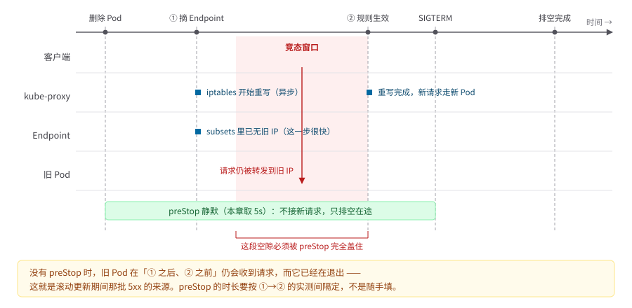

# 第 8 章　探针与优雅上下线

> 位置：主线 · 定义 ｜ 横切：B 可回滚 ｜ 成熟度 L1
>
> **此刻 `order-demo` 长什么样**：接入 `/healthz` `/readyz` `/startup`（仅 api）、preStop、PDB。 ｜ **本章可验证动作**：滚动更新期间连续请求零 5xx。 ｜ 复现：`git checkout ch08-probes`。

---

## 8.1 问题与反模式：为什么加了探针反而更糟

第 7 章给 `order-demo` 补齐了四类工作负载，但那份清单有一个致命的空白：**集群完全不知道一个 Pod 是「活着」还是「能接客」**。这两个问题看着像一回事，实际差了整整一次事故。第 6 章靠 `kubectl rollout status` 和一次 `curl` 判 Ready，那是人肉判断；一旦进入自动滚动更新，控制器手里只剩一个 `Running`——而进程刚启动、还没连上数据库、还在跑 migration 的 Pod，照样是 `Running`。**合成案例**（本书统一采用虚构合成案例，见第 1 章）：某团队为了让「发布卡住」能被发现，照着网上抄了三份探针——路径、阈值、命名都抄了，唯独没抄「为什么」。最要命的一步，是把数据库连通性检查塞进了 `livenessProbe`。周五下午，数据库只抖了 400 毫秒，短到你连告警都来不及看一眼，全部 `api` 副本的 liveness 却同时失败，kubelet 按语义重启了整个副本集；重启中的 Pod 又因依赖未恢复再次失败，形成重启级联。数据库那边早就缓过来了，你的服务还在原地重启。与此同时 `gateway` 的滚动更新停在一个「新 Pod 永远不 Ready」的版本上——新版本把 `/readyz` 写成了永远返回 200，`progressDeadlineSeconds` 到期后 Deployment 报 `ProgressDeadlineExceeded`，但旧 Pod 已被摘流，值班同学面对的是「一半流量 5xx、一半 Pod 在 CrashLoop」的现场。

这就是本章要处理的落差：**探针不是「健康检查」，而是三条语义完全不同的控制回路** [R-08-1][R-08-2]。三者长得几乎一样——都是「定期发一个 HTTP 请求、看返回码」——所以最容易被当成三个可以互换的开关。其实它们是三个岗位：readiness 是门卫，只决定「能不能放你进去接客」，判错了你进不来、但人还活着；liveness 是急诊医生，判断「还救不救得回来」，判错了直接动手；startup 是产房门口那块「请勿打扰」的牌子，挂着的时候前两位都不许插手，牌子撤早了，医生会冲进去把正在出生的孩子当死人处理。落到字段上：readiness 回答「要不要把这个 Pod 放进 Service 的 Endpoint」，失败只摘流、不重启；liveness 回答「进程是不是卡死了、要不要重启」，失败直接杀容器；startup 回答「慢启动期间要不要先别让前两者插手」，失败次数用尽才交给 liveness。把依赖检查放进 liveness，等于把「下游抖一下」翻译成「全副本重启」，把局部故障放大成系统故障 [R-08-1][R-08-8]。

三个高频反模式，按「现象 → 根因 → 本章替代做法」展开：

**反模式一：liveness 检查下游依赖。** 现象是数据库或缓存一抖，所有 Pod 同时重启，重启期间依赖又没恢复，形成级联 [R-08-8][R-08-9]。根因是把「我这个进程还活着吗」和「我的依赖可用吗」混成一个判断：依赖抖动时重启无助于恢复，只会把故障扩散到整个副本集 [R-08-1]。本章的替代做法是：liveness 只检查进程自身（`/healthz` 返回即表示事件循环没死锁），依赖可用性交给 readiness（`/readyz` 可以查依赖，但要设合理阈值与超时），二者失败后果不同，绝不能复用同一个端点 [R-08-1][R-08-2]。

**反模式二：readiness 永不失败，「发布卡住」发现不了。** 现象是滚动更新长时间不结束，`kubectl get pods` 看着都 `Running`，请求却时有 5xx。根因是 readiness 写成无条件 200，控制器无法区分「新版本还没好」和「新版本好了」；同时没设 `progressDeadlineSeconds`，Deployment 会无限期等下去 [R-08-1][R-08-5]。本章的替代做法是 readiness 检查真实依赖并给出 `failureThreshold` / `periodSeconds` / `timeoutSeconds` 的合理组合，同时给 Deployment 设 `progressDeadlineSeconds`，让「卡住」变成一个带超时、可被 `rollout status` 明确报出的状态，而不是靠人盯 [R-08-1]。

**反模式三：没有 preStop、直接 SIGTERM。** 现象是发布期间 5xx 突增，抓包发现一批在途请求被砍断。根因是 Endpoint 摘除与容器收到 SIGTERM 之间存在竞态：kubelet 删 Pod 和 kube-proxy 更新转发规则是并行的，进程可能在自己还接流量时就被终止 [R-08-4][R-08-6]。本章的替代做法是「先摘流、再排空」：用 `preStop` 让进程在收到 SIGTERM 后先静默一段（本章取 5 秒），配合 `terminationGracePeriodSeconds: 30` 给在途请求留出完成窗口，再用连续请求脚本验证 5xx 为零 [R-08-4]。

> **本章为什么是 H3 的主责章**：第 1 章事故里「滚动更新卡住、新 Pod 永远不 Ready」这一失效点，根子就在 readiness 的语义被写错 [R-08-1]。H4「liveness 误杀引发重启级联」的根因同样在本章讲清楚，但它的处置与速查表主责章是第 23 章（见第 23 章），本章只负责把探针基线一次性钉对。

### 8.1.1 真实复盘：依赖抖动触发 liveness 重启级联（时间线与定位）

> 以下时间线以公开 postmortem 合集中反复出现的「liveness 误用 → 重启级联」模式还原 [R-08-11]，用于展示「依赖抖一下」到「整副本重启」的完整传导链与定位手法。它综合了多份公开复盘（Zalando 等探针误用经验 [R-08-9]、SRE 重启放大器论证 [R-08-8]）的共性，**不指认某一次具体事故**，也与第 1 章的合成案例区分开。

**时间线（T 为故障起点，单位秒）**

- **T+0**：`api` 的 `livenessProbe` 被配置为 `httpGet` 一个会连数据库的内部端点（反模式一，见 8.1）。此时一个网络分区让 PostgreSQL 出现约 400ms 的抖动：连接建立慢、首次查询超时。
- **T+10**：liveness 的 `periodSeconds: 10` 触发第一次探测，因数据库连接等待超过 `timeoutSeconds: 2` 而失败。`failureThreshold: 3` 尚未耗尽，Pod 仍被当作健康。
- **T+30**：连续 3 次探测失败，`failureThreshold` 用尽，kubelet 判定容器「卡死」，发 SIGKILL 并重启。注意：此时数据库已经恢复了。但重启的理由从来不是「进程坏了」，而是「依赖刚才慢了半秒」——这相当于邻居家装修太吵，你把自己的房子拆了重建。
- **T+35～T+55**：重启后的 `api` 副本启动，要重新建连接池、跑 `init-schema`。在它通过 readiness 之前，Service 不给它流量；但问题是**所有 6 个副本几乎在同一窗口内都触发了同样的失败**——它们共用同一份错误的 liveness 配置，且都依赖同一个抖动的数据库。
- **T+60**：6 个副本中已有 4 个处于 `CrashLoopBackOff` 或重启后未 Ready。`gateway` 把流量打到剩余 2 个健康副本，它们瞬时过载，自身也开始出现延迟，触发 `gateway` 连锁告警。
- **T+90**：值班收到「5xx 突增 + 大量 Pod 重启」告警，第一反应是新版本发布有问题，于是 `kubectl rollout undo deployment/api`——但退回的 Pod 仍带着错误的 liveness 配置（回滚只退 Pod 模板，而那份错误配置恰是上一个版本也有的），重启级联并未停止。
- **T+150**：有人注意到 `kubectl describe pod` 里反复出现 `Liveness probe failed: ... connection refused to db`，才把怀疑对象从「代码」转向「探针」。
- **T+200**：定位根因——liveness 查了依赖。临时止血：把 liveness 改回只查 `/healthz`（进程自身，见 8.4），`kubectl apply` 后副本在一个窗口内陆续恢复 Ready，级联结束。

**那 200 秒里被跳过的一步**（按公开复盘的共性还原，非某次事故原话）

> **T+90 值班**：5xx 突增，api 一堆重启，我先把 api 退回上一个版本。
> **同事**：要不要先看下 events？万一是探针……
> **值班**：回滚最快，先退，退完再看。
> （两分钟后）
> **值班**：还在重启。
> **同事**：退回去也这样？
> **值班**：那可能就是代码的问题了。

这段对话里没有一句错话。「回滚最快」是真的，`rollout undo` 也是标准动作，甚至「退完再看」都算克制。它唯一的问题是：**回滚只能退到另一个版本，而那个版本犯着一模一样的错误**——错误配置已经在两个版本里躺了很久，谁都没注意，因为它从来不报错。

这也解释了 T+150 那个转折为什么来得那么晚：**120 秒里所有人都在看代码，没有一个人看配置。** 不是疏忽，而是「发布出问题」这个前提本身太有说服力——它把所有人的注意力锁在同一层，而真正的证据一直躺在 `describe pod` 的事件流里。

事故里最贵的往往不是错误决策，而是那些正确、熟练、却解决不了当前问题的动作。它们消耗的是时间，而时间是这段窗口里唯一真正稀缺的东西。

**定位过程（可复用的四步）**

1. **看事件，不猜代码**：`kubectl get events --sort-by=.lastTimestamp | grep -i 'probe\|unhealthy'` 直接确认是 probe 失败而非 OOM/退出码。重启级联的 signature 是大量 `Unhealthy` 事件 + 同一时间戳密集的 `Created`/`Started`。
2. **区分「谁死」**：`kubectl describe pod` 的 `Last State: Terminated, Reason: Error` 若退出码是 137（SIGKILL），且重启前日志无 panic，基本可排除应用崩溃，聚焦探针。
3. **查配置，而不是看日志**：`kubectl get deploy api -o yaml | grep -A6 livenessProbe` 看 liveness 的 `httpGet.path` 是否指向会查依赖的端点。这一步把「数据库抖」与「进程重启」之间的因果钉死。
4. **止血路径**：把 liveness 端点切回 `/healthz`、`rollout restart`，必要时按 8.5 方案 B 退回无探针基线重发正确参数。真正的修复是把依赖可用性交给 readiness（[R-08-1]），让「依赖慢」只摘流、不重启（[R-08-2]）。

**复盘留下的两点教训**：其一，liveness 失败动作是「重启」，它只能修复进程自身故障，修不了下游抖动；把依赖检查放进 liveness，等于把局部延迟翻译成全副本重启（[R-08-8]）。其二，回滚不等于修复——若错误配置已存在多个版本，回滚只是换一个同样错误的版本；探针基线必须用 8.6 的 CL-08-01 在每次发布前核对（[R-08-1]）。

### 8.1.2 探针误配负面清单：12 条「症状 → 根因 → 正确写法」

8.1 的三个反模式只覆盖了最高频的错误。实践中探针误配的形态远不止三种，而且多数不会当场爆炸——它们以「偶发摘流」「莫名其妙的重启」「扩容后越扩越慢」这类慢性症状陪你度过每一个发布日，等你想查的时候，事件流里已经滚过去三万条记录。下面这份负面清单把 12 条常见误配一次列全，每条按「症状 → 根因 → 正确写法」给出可判定描述；发布前用 CL-08-01 逐条对照，比事后翻事件流便宜得多。其中第 1 条即 8.1 反模式一，列入清单只为防漏检，不再展开。

**1. liveness 检查下游依赖**。症状：依赖一抖全副本重启，形成级联。根因与替代做法见 8.1 反模式一（[R-08-1][R-08-9]）。正确写法：liveness 只打 `/healthz`，依赖交给 `/readyz`。

**2. liveness 路径填错或端点不存在**。症状：新版本一发布，所有 Pod 立刻进入 `CrashLoopBackOff`，`describe pod` 里是 `HTTP probe failed with statuscode: 404` 或 `connection refused`。根因：路径拼写错、应用根本没实现该端点、或端点注册在启动后期——探针打的端口上没有这个路由。正确写法：探针路径写进 CI 的冒烟断言——镜像构建后在本地起容器 `curl -fsS http://127.0.0.1:<port>/healthz` 必须返回 200 才允许打标签发布；`kubectl apply` 前用 `kubectl apply --dry-run=server` 至少拦住字段级错误。

**3. 无 startupProbe 时 `initialDelaySeconds` 过短**。症状：Pod 起来几秒就被杀，重启计数持续增长，但手动 `kubectl exec ... curl /healthz` 又是 200。根因：liveness 在进程还没完成监听绑定之前就开始探测，`connection refused` 逐次计入 `failureThreshold`，宽限耗尽即重启——重启后依然来不及监听，循环往复（[R-08-1]）。正确写法：慢启动交给 startupProbe 接管（本例 `api` 约 60 秒窗口，见 8.4），`initialDelaySeconds` 只作快速启动组件的兜底，不承担「等 migration 跑完」的职责。

**4. `timeoutSeconds` 小于应用 P99 响应时间**。症状：每天高峰期随机出现 Pod 摘流或重启，事件里是 `Readiness probe failed: ... probe timed out`，而人肉 `curl` 该端点毫秒级返回。根因：探针的执行时机撞上 GC、JIT 编译、锁竞争，P99 超过了 `timeoutSeconds`；探针超时不看平均值，只看单次是否超时（[R-08-1]）。正确写法：`timeoutSeconds ≥ P99(端点延迟) × 2`，且必须小于 `periodSeconds`（否则两次探测重叠，kubelet 行为不可预期）；端点延迟用发布前压测的分位数数据定，不拍脑袋取 1 秒。

**5. `failureThreshold` 过紧（如取 1）**。症状：readiness 一抖就摘流、liveness 一抖就重启，偶发单次超时直接变成用户可见的 5xx。根因：`failureThreshold: 1` 没有任何退避，一次网络毛刺就触发完整失败动作（[R-08-9]）。正确写法：liveness 至少取 3；判据是**容忍窗口**要覆盖「一次抖动的自然恢复时间」：`periodSeconds × failureThreshold ≥ 抖动恢复时长`。比如下游重连通常 20 秒内自愈，`periodSeconds: 5 × failureThreshold: 4` 给 20 秒窗口就够，不必靠放大 timeout 来容忍抖动。

**6. readiness 探得比实际负载更重**。症状：流量高峰扩容后「越扩越慢」，`/readyz` 自身延迟抬升，数据库连接数逼近上限。根因：readiness 每个周期都执行一次真实的重量级依赖查询（例如跑一条全表聚合 SQL 验证 db 可用），N 个副本 × `1/periodSeconds` 次/秒的探测频率叠加，探针自己成了常态负载的一部分。正确写法：readiness 只查「轻依赖信号」——连接池是否可借出连接、本地健康缓存是否过期；重量级校验交给应用内部的熔断与退避逻辑，探针端点的单次成本必须与业务请求同一量级甚至更低。

**7. 探针端口写裸数字且串到别的监听者**。症状：Pod 长期 Ready，流量却 5xx；或 readiness 永远通过，但业务端口其实已经挂了。根因：`port: 8081` 这类裸数字写错——探针打到了 metrics 端口、sidecar 端口或另一个容器的端口上，探的是「别人的健康」。正确写法：一律引用端口名（8.4 的 `port: http`，与 `containerPort` 的 `name` 同源），端口改名时探针随之编译期报错，不会静默探错对象 [R-08-1]。

**8. 探针与业务共用线程池或连接池**。症状：压测 QPS 上不去，加副本无效；或高峰期探针自身变慢、连锁触发误摘。根因：`/healthz` 与业务请求复用同一个工作线程池/连接数上限，探针请求排队排到业务后面，业务忙时探针必然超时——探针结果不再反映进程死活，只反映队列长度。正确写法：探针端点走独立处理路径（独立 goroutine/线程、不获取业务锁、不占用业务连接池），这也是「liveness 判进程自身」的技术前提之一（见 8.2 本书观点）。

**9. 高副本数下用重型 `exec` 探针**。症状：节点 CPU 异常偏高，`describe pod` 里大量 `Liveness probe failed: command timed out`，且错误随副本数增长而增多。根因：每次探测都 fork 一个 shell 进程再执行重脚本，`periodSeconds: 5` 下 50 个副本意味着每秒 10 次进程创建 + 脚本运行，探针的开销反超被监控的业务本身（[R-08-9]）。正确写法：优先 `httpGet` / `tcpSocket`；确需 `exec` 时脚本必须满足三条——无外部 I/O、无 shell 解释器嵌套、单次执行 < 100ms，且探针逻辑在应用内实现一个轻量端点取代脚本。

**10. `successThreshold` 取大于 1**。症状：依赖抖动恢复后，流量迟迟不挂回来，摘流时间远长于故障时间。根因：`successThreshold: 3` 要求连续 3 次探测都成功才重新进 Endpoint，回挂延迟被拉到 `3 × periodSeconds`；liveness 的 `successThreshold` 则被 K8s 强制为 1，配置了别的值会被直接拒绝（[R-08-1]）。正确写法：readiness 保持 `successThreshold: 1`（8.4 取值）；需要防抖时收紧 `periodSeconds` 让恢复更快被发现，而不是用连续成功次数拖慢回挂。

**11. readiness 与 liveness 路径互换（复制粘贴错序）**。症状：双故障叠加——依赖抖动时 liveness 也失败引发重启级联；进程真死锁时 readiness 仍 200，死 Pod 继续接流量。根因：YAML 里两个探针块顺序对调后路径跟着错位，`--dry-run` 与 schema 校验都拦不住（字段全是合法的）。正确写法：CL-08-01 的 jsonpath 断言路径映射（liveness=`/healthz`、readiness=`/readyz`）必须进发布流水线，不靠肉眼比对。

**12. `tcpSocket` 探针被当作「业务健康」**。症状：应用线程池打满、请求大量超时，但 Pod 始终 Ready、始终不被摘流。根因：`tcpSocket` 只证明内核 accept 队列还活着，进程 hang 在业务逻辑里时 TCP 三次握手照常成功——探针通过的结论与「能处理请求」之间没有因果关系。正确写法：HTTP 服务一律 `httpGet` 打到语义端点；`tcpSocket` 只留给无 HTTP 协议的场景（如纯 TCP 代理），且必须意识到它判的是「端口开着」而非「服务可用」（[R-08-2]）。

这 12 条的共同根因可以收敛成一句话：**探针是控制回路的输入，不是体检报告**。写每一条探针配置时，先回答「它失败时控制器会做什么动作」，再回头决定端点、路径与阈值——判断放在哪个回路里，比端点怎么写更重要（[R-08-1][R-08-2]）。

**写错到底长什么样**。上面 12 条是「症状 → 根因」，读的时候容易点头，回到自己的 YAML 却不知道该改哪一行。下面把最高频的三处摆成可直接对照的样子：左边删掉的是真实存在的写法，右边加上的是修法，每处只差一到两个字段。

第一处，把「容忍抖动」的职责压给了 `timeout` 和「一次就动手」：

```diff
 livenessProbe:
   httpGet:
     path: /healthz
     port: http
-  timeoutSeconds: 1
+  timeoutSeconds: 2
   periodSeconds: 10
-  failureThreshold: 1
+  failureThreshold: 3
```

后果：`timeoutSeconds: 1` 让一次 GC 停顿或锁竞争就判定进程死亡；`failureThreshold: 1` 把退避窗口压成零，单次毛刺直接触发重启。判据是两条不等式：`timeoutSeconds ≥ P99(端点) × 2`，`periodSeconds × failureThreshold ≥ 抖动恢复时长`。只调前者会让探测变慢，只调后者会让你晚 20 秒才发现真死——两行必须一起看。

第二处，用 `initialDelaySeconds` 硬扛慢启动，而不是交给 `startupProbe`：

```diff
+# 慢启动交给 startupProbe，liveness 不再兼任
+startupProbe:
+  httpGet:
+    path: /startup
+    port: http
+  periodSeconds: 2
+  failureThreshold: 30
 livenessProbe:
   httpGet:
     path: /healthz
     port: http
-  initialDelaySeconds: 120
+  initialDelaySeconds: 10
```

后果：`initialDelaySeconds: 120` 本质是「赌它 120 秒内能起来」。赌输一次，liveness 在 migration 跑到一半时杀掉容器，重启后 migration 从头再来，而这次它会跑得更慢——延时并没有换来安全，只是把循环周期从 30 秒拉长到 2 分钟。`startupProbe` 到期前 liveness 完全不生效，这才是「还不知道起没起来」时的正确状态。

第三处，探针端口写裸数字：

```diff
 readinessProbe:
   httpGet:
     path: /readyz
-    port: 8081
+    port: http
```

后果：裸数字的麻烦不在于「现在写错了」——那种情况会当场 `connection refused`，你立刻就知道了。麻烦在于**它写错的时候不报错**。同一个 Pod 里往往不止一个监听者（sidecar 代理、metrics 端点、甚至同 Pod 的另一个容器），`8081` 一旦落在其中任何一个上，探针照样拿到 200——它证明的是「那个监听者还活着」，而 `api` 自己的业务端口挂掉时，Pod 依然 Ready、依然接流量，你在 `describe pod` 里看到的是一切正常。写成端口名之后，`containerPort` 的 `name` 与探针 `port` 不一致会被 `--dry-run=server` 直接拒绝，端口改名也从「静默探错对象」变成「清单渲染就报错」。

---

## 8.2 范式与决策树：三类探针、四条件下线、零停机四个条件

本章要回答的决策问题是：**探针到底在判断什么，以及「零停机发布」需要哪几个条件同时成立？** 换成值班时真正会问的那句话就是：我明明配了探针，为什么发布期间还是有人在骂？

**探针语义对照表**（「该查什么 / 不该查什么」是本章最需要背下来的一张表）：

| 探针类型 | 失败后果 | 该查什么 | 不该查什么 | 典型参数（本章取值） |
|---|---|---|---|---|
| `livenessProbe` | 重启容器 | 进程自身是否卡死：`/healthz` 返回 200 | 数据库、缓存、下游 HTTP —— 查了会把局部故障放大成重启级联 [R-08-1][R-08-9] | `initialDelaySeconds: 10`、`periodSeconds: 10`、`timeoutSeconds: 2`、`failureThreshold: 3` |
| `readinessProbe` | 从 Endpoint 摘除，不重启 | 能否接客：`/readyz` 可查依赖，但要有退避 | 无条件 200；也不该做启动期一次性初始化 [R-08-1][R-08-2] | `initialDelaySeconds: 5`、`periodSeconds: 5`、`timeoutSeconds: 2`、`failureThreshold: 3`、`successThreshold: 1` |
| `startupProbe`（仅 `api`） | 用尽 `failureThreshold` 后才让 liveness 接管 | 慢启动是否完成：`/startup` | 快速返回的常驻健康检查；不该给 `gateway` 配（契约里只有 `api` 有）[R-08-1] | `periodSeconds: 2`、`failureThreshold: 30`（允许约 60 秒慢启动）、`timeoutSeconds: 2` |

参数不是抄来的模板值：`api` 启动要跑 migration，`startupProbe` 的 `failureThreshold: 30 × periodSeconds: 2` 给出约 60 秒保护窗口，窗口内 liveness 不生效，避免「还没启动完就被重启」[R-08-1]；具体数值须按 `api` 实测启动时间调整，写进附录 A 的版本矩阵。

这张表值得贴在发布看板上。它其实在回答三个完全不同的问题：**还活着吗（liveness）、能接客吗（readiness）、起得来吗（startup）。** 三个问题里只有一个该动手重启，另外两个只需要「暂时别派活给我」——把它们混成一个「健康检查」，就是 8.1 那场事故的起点。

**下线时序**（Pod 被删除或滚动更新替换时，四步严格有序）[R-08-4][R-08-6]：

```
1. 控制器决定替换 Pod → Pod 进入 Terminating，同时从 Service Endpoint 摘除
        │
2. kubelet 执行 preStop（本章 preStop.sleep.seconds: 5）── 进程先静默、不再接新请求
        │   （这一步专门覆盖「Endpoint 摘除与转发规则更新」之间的竞态）
        ▼
3. kubelet 发 SIGTERM → 应用在 terminationGracePeriodSeconds: 30 内排空在途请求
        │
        ▼
4. 宽限用尽 → SIGKILL
```

### 8.2.1 下线时序 × Endpoint 更新：竞态时序图与抓包证据

「先摘流再退出」之所以必要，是因为 Endpoint 摘除与转发规则（iptables/ipvs）更新是**两条并行的链路**，中间有肉眼可见的空隙（[R-08-6]）。下面这张时序图把空隙标出来：



空隙在「① Endpoint 已剔除」到「② iptables 真正重写完成」之间：若没有 `preStop` 静默，旧 Pod 在 ① 之后、② 之前仍会收到转发来的在途请求，而此时它可能已经准备退出，于是请求被砍断成 5xx（[R-08-4]）。

**抓包证据**（在旧 Pod 内 `tcpdump`，滚动更新期间采集）：

```bash
# 旧 Pod 内抓 8080，看「Endpoint 已摘」之后是否还有入向请求
kubectl -n order-demo-dev exec <旧pod> -- \
  tcpdump -n -i any 'tcp port 8080' -tttt 2>/dev/null | head -40
```

典型输出（无 preStop 时）：

```
14:02:11.003 IP client → old-pod:8080  Flags [S]   # ① 之后仍有新连接进来
14:02:11.004 IP old-pod → client      Flags [.ack]
14:02:11.880 IP old-pod → client      RST      # ② 之前 Pod 已被 SIGTERM，连接被 RST
```

`[S]` 出现在 Endpoint 摘除时间戳之后、`RST` 出现在 SIGTERM 之前，就是竞态实锤。加上 `preStop.sleep: 5` 后再抓，这段窗口内旧 Pod 不再建立新连接，`RST` 消失，5xx 归零（验证脚本见 8.4 `rolling-5xx-test.sh`）。这也正是「旧 Pod 在 Endpoint 摘除后才退出」那条零停机条件的来源（[R-08-6]）。

> **PDB 的边界必须写清**：`PodDisruptionBudget`（`minAvailable: 1`）只保护**自愿中断**——节点 drain、集群升级这类由驱逐 API 发起的动作会被 PDB 拦住；它不保护 OOMKilled、节点宕机、也不保护滚动更新本身 [R-08-3]。把 PDB 当成「高可用兜底」是常见误读，真正的容量兜底是 `maxSurge: 1` 与副本数（容量账在第 13 章算）[R-08-3][R-08-7]。

**零停机四条件检查表**（四个条件必须同时成立，缺一不可；条件数量与第 13 章的容量账保持一致，不增减）[R-08-7][R-08-10]：

| # | 条件 | 怎么证明 | 由哪一段负责 |
|---|---|---|---|
| 1 | 新版本 readiness 为真才接流 | 滚动期间连续请求无 5xx，且 `get endpoints` 里只出现已 Ready 的 Pod | 8.4 `readinessProbe` |
| 2 | 旧版本能优雅排空 | `preStop` + `terminationGracePeriodSeconds: 30` 存在，在途请求完成 | 8.4 `lifecycle.preStop` |
| 3 | 容量足够（maxSurge） | `maxSurge: 1`、`maxUnavailable: 0`，高峰期仍有一个额外副本 | 第 6 章策略字段，容量账见第 13 章 |
| 4 | 回滚路径可用 | `rollout undo` 演练通过且 `verify.sh` 仍 200 | 8.5 回滚演练 |

由这四张表可以直接得到一棵判「发布能不能算零停机」的决策树：

```
滚动期间连续请求 5xx 是否为 0？          否 → 先查 readiness 是否永不失败 / preStop 是否缺失（8.4）
        │ 是
新 Pod 是否在 startup 保护后才被 liveness 接管？ 否 → 补 startupProbe（8.4）
        │ 是
旧 Pod 是否在 Endpoint 摘除后才退出？      否 → 补 preStop 与终止宽限（8.4）
        │ 是
PDB 是否只在自愿中断时生效、未被误当兜底？  否 → 修正认知，容量账回第 13 章（8.2）
        │ 是
→ 四条件成立，可以带着探针基线进入第 9 章
```

> **本书观点（本章第 4 条结论，不需要外部背书）**
>
> **主张**：`livenessProbe` 里检查数据库是高频反模式；正确的分界线是「liveness 只判断进程自身，依赖可用性交给 readiness」，二者的失败后果不同，因此绝不复用同一个端点。
>
> **论证**：liveness 的失败动作是重启容器。重启能修复的是「进程内部状态损坏、死锁、事件循环卡住」这类与副本自身绑定、且换一个进程实例就能重置的故障；它修复不了「下游数据库不可用」——新起来的进程同样连不上，于是重启变成放大器：故障副本数不变、重启风暴却额外消耗调度与镜像拉取资源，并把原本局部的延迟传导成全副本不可用 [R-08-1][R-08-8]。readiness 的失败动作只是摘流，可逆、无副作用，正好用来表达「依赖暂时不可用，先别给我流量，等恢复了再挂回来」。把判断放在哪条回路里，取决于**失败动作是否可逆**，而不是取决于「这段代码写起来像不像健康检查」。
>
> **反例与前提**：这条主张的前提是应用能区分「自身健康」与「依赖健康」两个端点，且 `/healthz` 不依赖外部 I/O。若应用是单进程、单依赖、且依赖不可用等价于服务不可用（例如纯代理），那么 readiness 查依赖、liveness 查进程仍成立，只是两者的阈值要一起放宽。真正的反例是「进程会进入一种既不响应也不自行退出的僵死态」——此时依赖检查式 liveness 反而能触发重启，但这是个例，应改用进程内的看门狗或超时退出，而不是把数据库塞进 liveness。误杀后的现场定位与止血见第 23 章 CrashLoop 速查表，公开复盘类材料只用于支撑反模式的方法论、不用于证明某次虚构事故真实发生 [R-08-11]。

### 8.2.2 三类探针判据矩阵：失败后果、参数推导依据与 PDB/HPA 交互

8.2 开头的语义对照表回答了「该查什么」；本节把它推进一层，回答三个落地时必答的问题：**失败动作波及多大范围、参数按什么依据取值、探针结果如何反过来影响 PDB 与 HPA 的行为**。HPA 的选型与容量推导在见第 18 章，这里只钉住「探针参数是 HPA 稳定性的隐藏输入」这一耦合关系。

**判据矩阵**：

| 维度 | `livenessProbe` | `readinessProbe` | `startupProbe` |
|---|---|---|---|
| 判什么 | 进程自身是否卡死 | 是否能接客 | 慢启动是否完成 |
| 失败动作 | 重启容器（不可逆，丢失进程内存态） | 从 Endpoint 摘除（可逆，随时回挂） | 窗口内压制前两者；用尽后交 liveness 处置 |
| 失败波及范围 | 单个 Pod 重启，若配置共享错误则扩散到全副本集 | 单个 Pod 摘流，副本集容量瞬时下降 `(1 - 1/replicas)` | 单个 Pod 的启动期 |
| 失败是否计入可用性 | 重启期间该副本不接流量，用户侧可见为容量下降 | 摘流期间不接流量，容量账同上 | 启动期无流量，用户无感 |
| 参数取值依据 | `periodSeconds × failureThreshold` ≥ 进程恢复时间（重启后自检完成）；`timeoutSeconds ≥ P99 × 2` 且 < `periodSeconds` | 容忍窗口 ≥ 下游抖动自愈时间；回挂延迟 = `successThreshold × periodSeconds`，取 1 | 窗口 = P99 启动时间 × 1.5（见 8.4.2 实测：峰值 41s → 窗口 60s） |
| 恢复依赖谁 | 新进程重新走完启动（含 startup 窗口） | 下一次探测成功即回挂，秒级 | 无「恢复」概念，一次成功即移交 |

**与 PDB 的交互：PDB 的「可用」定义就是 readiness**。这是最容易被忽略的一条耦合：`PodDisruptionBudget` 计算 `ALLOWED DISRUPTIONS` 时，一个 Pod 是否算「健康」的判据正是它的 readiness [R-08-3]。由此推出两个可判定的结论：

1. readiness 参数过紧 → 高峰期部分副本被周期性摘流（不 Ready）→ 这些副本在 PDB 眼里不健康 → `ALLOWED DISRUPTIONS` 降为 0 → 节点 drain、集群升级被阻塞，运维侧表现为「驱逐卡住」，根因却在探针。处置顺序：先查 `kubectl get pdb` 的 `ALLOWED DISRUPTIONS` 是否为 0，再查摘流中的 Pod 数量是否超过 `replicas - minAvailable`。
2. 反过来，PDB 不看探针参数本身的松紧——放宽 `failureThreshold` 能减少误摘，从而间接恢复 PDB 的可用预算。**修 PDB 卡住的问题，往往要改的是探针，而不是 PDB**（[R-08-3]）。

**与 HPA 的交互：摘流副本从指标里消失**。HPA 在计算平均负载时会把不 Ready 的副本从分子与分母中同时剔除。推论有三条：

1. readiness 误摘高峰期多个副本后，剩余副本的平均负载被抬高，HPA 可能据此继续扩容——扩出来的新副本又带着同样的过紧探针，迟迟不 Ready，再次被剔除，形成「扩容追赶一个被探针扭曲的幻影负载」的震荡。判据：HPA 目标值持续未达标、但 Pod 数已到上限且大量副本不 Ready 时，先修探针参数再谈扩容策略（见第 18 章）。
2. liveness 重启风暴期间，重启中的副本指标缺失，同样扭曲 HPA 的观测窗口。8.1 复盘里「剩余 2 个副本瞬时过载」的现场若叠加 HPA，会看到期望副本数飙升——这不是容量不足，是探针在给 HPA 喂脏数据（[R-08-8]）。
3. startupProbe 决定了「扩容生效延迟」的下限：新副本从调度到接流 ≈ 镜像拉取 + init 容器 + startup 窗口实际耗时 + 回挂延迟。HPA 的行为参数（如稳定窗口）必须大于这个延迟，否则扩容判定永远滞后一个启动周期，测量方法见 8.4.4。

把三条交互合起来，得到本章第五个判断依据：**探针参数不是孤立的可用性旋钮，它同时是 PDB 的健康判据输入与 HPA 的指标过滤条件**。调紧探针「更早发现问题」的收益，必须与「误摘扭曲 PDB/HPA」的代价放在同一张账上算。

**跨章 worked example：探针参数如何沿 `order-demo` 的发布链路向下传导**。假设发布时把 `api` 的 readiness `failureThreshold` 从 3 误改为 1（12 条负面清单的第 5 条变体），沿链路的传导路径如下。第 13 章滚动更新里 `maxUnavailable: 0` 名义上不允许任何容量缺口，但 readiness 误摘会制造一个策略字段管不到的缺口。`maxUnavailable` 约束的是控制器行为，管不住摘流；单次探针超时就让一个副本退出 Endpoint，容量瞬时降一档，连续抖动时滚动更新实际是在容量不足的状态下推进的。第 15 章金丝雀分析更依赖探针判据的真实性：流量按比例切给金丝雀 Pod，若其 readiness 参数比存量 Pod 松，金丝雀在存量 Pod 已摘流的情况下仍在接流，指标对比的分子分母就不再可比——「自动回滚判据」建立在被探针参数污染的样本上。第 18 章 HPA 的传导见本节开头。结论是一致的：**本章的参数基线是第 13、15、18 章判定机制的地基，调参必须走 8.4.2 的实测流程，不允许在发布热点期凭手感临时放宽**。

---

## 8.3 工具选型：本章的「工具」是探针机制与中断预算

第 8 章不引入外部工具，全部使用 Kubernetes 内置机制；唯一新增的第三方形态是策略/校验类工具，按分工留给第 10、11 章（见第 11 章）[R-08-5]。下表按单一示例实现原则收敛：探针路径、端口、宽限值一律取配置契约，不另起一套。

| 机制 | 最适 | 何时不该用（本章相关的一条） | 主要风险 | 升级 / 回滚路径 |
|---|---|---|---|---|
| `livenessProbe`（`apiVersion: v1` Pod 字段） | 检测进程自身死锁 | 检查下游依赖时——改用 readiness [R-08-1] | 阈值过紧会误杀，形成重启级联 [R-08-9] | 改回上一版 Pod 模板；参数先松后紧 |
| `readinessProbe` | 控制是否进 Endpoint | 无条件 200 的占位写法——等于没有 [R-08-1] | 依赖抖动会摘掉全部副本，需配合 `successThreshold` 回挂 | 同上；`rollout undo deployment/gateway` |
| `startupProbe` | 慢启动保护（仅 `api`） | 启动很快的组件——加了只是多一次探测 [R-08-1] | 窗口过短会把正常启动判成失败 | 同上；`rollout undo deployment/api` |
| `lifecycle.preStop.sleep` | SIGTERM 前静默排空 | 目标集群低于 K8s 1.30 且无法升级时——须换方案 [R-08-4] | `sleep` 秒数超过 `terminationGracePeriodSeconds` 会被 SIGKILL 截断 | 改回上一版 Pod 模板 |
| `PodDisruptionBudget`（`policy/v1`） | 节点 drain 时保底可用副本 | 想用它防 OOM / 节点宕机 / 滚动更新——都不归它管 [R-08-3] | `minAvailable` 设得比副本数还大会让 drain 永久阻塞 | `kubectl -n order-demo-dev delete pdb gateway-pdb` 后重建 |
| `progressDeadlineSeconds` | 让「发布卡住」有超时 | 期望无限等待的场景——不存在这种需求 | 设太短会把正常慢发布误判为失败 [R-08-5] | 改回上一版 Deployment |

表里「何时不该用」一列有六条，其中四条其实在说同一件事：**这些字段能管的事，比大多数人希望它们管的少得多。** PDB 是最典型的——它保的是「驱逐时别一次带走太多」，不管宕机、不管 OOM、也不管滚动更新。把它当护身符用的人，通常在第一次 `kubectl drain` 之后才发现它什么都没拦住。

**最小接入 diff**（第一次修改第 6 章的清单，但只增字段、不改任何冻结值）：

```diff
 deploy/base/deployment.yaml          (第 6 章 gateway)
+  spec.progressDeadlineSeconds: 120
+  spec.template.spec.terminationGracePeriodSeconds: 30
+  containers[gateway].livenessProbe  -> /healthz : http
+  containers[gateway].readinessProbe -> /readyz : http
+  containers[gateway].lifecycle.preStop.sleep.seconds: 5
   （namespace / labels / image / ports / strategy / securityContext 全部不变）

 deploy/base/deployment-api.yaml      (第 7 章 api)
+  spec.progressDeadlineSeconds: 120
+  spec.template.spec.terminationGracePeriodSeconds: 30
+  containers[api].startupProbe   -> /startup : http
+  containers[api].livenessProbe  -> /healthz : http
+  containers[api].readinessProbe -> /readyz : http
+  containers[api].lifecycle.preStop.sleep.seconds: 5
   （initContainers / sidecar / 8081 端口 / 标签全部不变）

+ deploy/base/pdb.yaml                 # 新增：policy/v1，minAvailable: 1
+ hack/rolling-5xx-test.sh             # 新增：滚动期间连续请求统计 5xx
```

**升级路径**：先把 `livenessProbe` / `readinessProbe` 的 `failureThreshold` 设得比实测宽松，观察一个发布周期后再收紧；`startupProbe` 窗口按 `api` 实测启动时间的两倍设定。**回滚路径**：控制器内一律 `kubectl -n order-demo-dev rollout undo deployment/gateway`；若探针参数本身写错（例如把 `/readyz` 填成 `/healthz`），`rollout undo` 会连带退回整个 Pod 模板，此时按 8.5 的方案 B 用 `git checkout ch06-first-loop -- deploy/base/deployment.yaml` 恢复无探针基线并重跑 `verify.sh`，再加入正确参数重发。生产变更必须回到 Git（全书公理 5，见第 3 章），本地 kind 的命令式演练不构成例外。

---

## 8.4 落地配置（完整可应用文件，Kubernetes 1.32+）

> 全部字段沿用第 6 章配置契约：命名空间 `order-demo-dev`、`gateway` 8080 / `api` 8081、探针路径 `/healthz`（liveness）、`/readyz`（readiness）、`/startup`（仅 `api`）、`terminationGracePeriodSeconds: 30`、镜像 `registry.example.com/order-demo/<component>:git-<sha7>`、标签 `app.kubernetes.io/*` 与 `version: git-1a2b3c4`、`app.kubernetes.io/managed-by: kubectl`。`git-1a2b3c4` 是示例 SHA，脚本用真实短 SHA 替换。`preStop.sleep` 自 K8s 1.30 起默认可用，1.32+ 无需 feature gate。

**`deploy/base/deployment.yaml`**（`apiVersion: apps/v1`，gateway 完整版）

```yaml
apiVersion: apps/v1
kind: Deployment
metadata:
  name: gateway
  namespace: order-demo-dev
  labels:
    app.kubernetes.io/name: order-demo
    app.kubernetes.io/component: gateway
    app.kubernetes.io/managed-by: kubectl
spec:
  replicas: 2
  progressDeadlineSeconds: 120
  selector:
    matchLabels:
      app.kubernetes.io/name: order-demo
      app.kubernetes.io/component: gateway
  strategy:
    type: RollingUpdate
    rollingUpdate:
      maxSurge: 1
      maxUnavailable: 0
  template:
    metadata:
      labels:
        app.kubernetes.io/name: order-demo
        app.kubernetes.io/component: gateway
        version: git-1a2b3c4
        app.kubernetes.io/managed-by: kubectl
    spec:
      terminationGracePeriodSeconds: 30
      automountServiceAccountToken: false
      securityContext:
        runAsNonRoot: true
        seccompProfile:
          type: RuntimeDefault
      containers:
        - name: gateway
          image: registry.example.com/order-demo/gateway:git-1a2b3c4
          imagePullPolicy: IfNotPresent
          ports:
            - name: http
              containerPort: 8080
              protocol: TCP
          env:
            - name: GREETING
              valueFrom:
                configMapKeyRef:
                  name: order-demo-config
                  key: GREETING
            - name: APP_VERSION
              value: git-1a2b3c4
          # liveness 只查进程自身，绝不查数据库（见 8.2 本书观点）
          livenessProbe:
            httpGet:
              path: /healthz
              port: http
            initialDelaySeconds: 10
            periodSeconds: 10
            timeoutSeconds: 2
            failureThreshold: 3
          # readiness 决定「是否接流量」，查依赖也只摘流不重启
          readinessProbe:
            httpGet:
              path: /readyz
              port: http
            initialDelaySeconds: 5
            periodSeconds: 5
            timeoutSeconds: 2
            failureThreshold: 3
            successThreshold: 1
          lifecycle:
            preStop:
              sleep:
                seconds: 5
          securityContext:
            allowPrivilegeEscalation: false
            readOnlyRootFilesystem: true
            capabilities:
              drop: ["ALL"]
```

> 三个细节值得停一下：其一，探针 `port: http` 引用的是容器端口名，与 Service 的 `targetPort: http` 同源，改端口时不会两处脱节 [R-08-1]。其二，**不用 `exec: ["sh","-c","sleep 5"]`**——第 6 章的 distroless 镜像没有 shell，`exec` 会直接失败；这里用 kubelet 原生实现的 `preStop.sleep`，这也是本章要求 K8s 1.32+ 的原因 [R-08-4]。其三，`progressDeadlineSeconds: 120` 让「readiness 永不失败」这类卡住变成 120 秒后明确报出的 `ProgressDeadlineExceeded`，而不是无限等待 [R-08-5]。

### 8.4.1 preStop 三类 handler 的适用边界与低版本集群退路

`preStop` 有三种 handler（[R-08-4]），本章用的是 kubelet 原生 `sleep`，但三种各有适用边界，选错会在特定镜像或低版本集群上直接失败。

**`sleep` handler（本章采用）**。这是 K8s 1.30 起 GA 的原生动作，由 kubelet 直接实现，不进容器、不依赖任何 shell 或二进制：

```yaml
lifecycle:
  preStop:
    sleep:
      seconds: 5
```

适用边界最清晰——只要目标是「收到 SIGTERM 前先静默几秒，让 Endpoint 摘除与转发规则更新的竞态窗口过去」，它就够用且最稳。`preStop.sleep` 不消耗镜像体积、不挑镜像类型，distroless 与非 root 也照常工作，这也是本章把最低版本锁在 1.32+ 的原因（[R-08-4]）。但它只能「睡」，不能做主动摘流动作。

**`exec` handler**。在容器内执行一条命令，常用于需要主动排空的场景，例如从本地服务注册表注销、把内存缓冲 flush 到磁盘、或关闭长连接池：

```yaml
lifecycle:
  preStop:
    exec:
      command: ["/bin/sh", "-c", "sleep 5; /app/drain.sh"]
```

它的边界很硬：**镜像里必须有这条命令和能跑它的解释器**。`order-demo` 用的是 distroless 镜像（第 6 章约定），根本没有 `/bin/sh`，`exec: ["sh","-c","sleep 5"]` 会直接 `Exec lifecycle hook ... failed`，preStop 报错但容器仍会收到 SIGTERM——竞态窗口没被覆盖，5xx 又回来了（见 8.4 三个细节其二）。即便镜像有 shell，`exec` 命令的总耗时也计入 `terminationGracePeriodSeconds`，睡太久会被 SIGKILL 截断。

**`httpGet` handler**。让 kubelet 在容器内切一个 HTTP 端点，语义上更像「通知应用开始排空」而不是「睡」：

```yaml
lifecycle:
  preStop:
    httpGet:
      path: /drain
      port: http
```

适用边界最窄：它要求应用已实现 `/drain` 这类「开始优雅停止」端点，且 preStop 会阻塞到该端点返回；若端点内部只是 `sleep`，那和 `sleep` handler 等价却多了一次网络 hop。多数情况下，真正的「开始排空」应该由应用在自己的 SIGTERM 信号处理里做，而不是交给 preStop 的 httpGet。

**低版本集群（< K8s 1.30）的退路**。在 `preStop.sleep` 尚未 GA 的集群上，按优先级选：

1. 若镜像带 shell（非 distroless），退化为 `exec: { command: ["/bin/sh","-c","sleep 5"] }`，并把 `terminationGracePeriodSeconds` 相应调大，确认睡的秒数 + 排空时间 < 宽限。
2. 若是 distroless 镜像又必须先用，最干净的退路是**把「睡」搬进应用入口**：entrypoint 捕获 SIGTERM 后先 `sleep 5` 再退出，preStop 留空——效果等同 `preStop.sleep`，且不依赖集群版本。这个改法落在应用代码里，仍遵守全书公理 5（生产变更走 Git，见第 3 章）。
3. 临时过渡：用 `terminationGracePeriodSeconds` 直接兜底——把宽限设到能覆盖竞态（如 30→40），但这只是拉长窗口，没有「先静默」的语义保证，仅作最后手段。

无论哪种退路，CL-08-02 的核对不变：preStop 的等待秒数必须严格小于 `terminationGracePeriodSeconds`（[R-08-4]）。

**`deploy/base/deployment-api.yaml`**（`apiVersion: apps/v1`，api 完整版，含 `/startup`）

```yaml
apiVersion: apps/v1
kind: Deployment
metadata:
  name: api
  namespace: order-demo-dev
  labels:
    app.kubernetes.io/name: order-demo
    app.kubernetes.io/component: api
    app.kubernetes.io/managed-by: kubectl
spec:
  replicas: 2
  progressDeadlineSeconds: 120
  selector:
    matchLabels:
      app.kubernetes.io/name: order-demo
      app.kubernetes.io/component: api
  strategy:
    type: RollingUpdate
    rollingUpdate:
      maxSurge: 1
      maxUnavailable: 0
  template:
    metadata:
      labels:
        app.kubernetes.io/name: order-demo
        app.kubernetes.io/component: api
        version: git-1a2b3c4
        app.kubernetes.io/managed-by: kubectl
    spec:
      terminationGracePeriodSeconds: 30
      automountServiceAccountToken: false
      securityContext:
        runAsNonRoot: true
        seccompProfile:
          type: RuntimeDefault
      initContainers:
        - name: init-schema
          image: registry.example.com/order-demo/api:git-1a2b3c4
          imagePullPolicy: IfNotPresent
          command: ["/api", "--migrate"]
          securityContext:
            allowPrivilegeEscalation: false
            readOnlyRootFilesystem: true
            capabilities:
              drop: ["ALL"]
        - name: log-forwarder
          image: registry.example.com/order-demo/api:git-1a2b3c4
          imagePullPolicy: IfNotPresent
          restartPolicy: Always
          command: ["/api", "--log-forward"]
          securityContext:
            allowPrivilegeEscalation: false
            readOnlyRootFilesystem: true
            capabilities:
              drop: ["ALL"]
      containers:
        - name: api
          image: registry.example.com/order-demo/api:git-1a2b3c4
          imagePullPolicy: IfNotPresent
          ports:
            - name: http
              containerPort: 8081
              protocol: TCP
          env:
            - name: APP_VERSION
              value: git-1a2b3c4
          # 慢启动保护：约 60 秒窗口内 liveness 不生效
          startupProbe:
            httpGet:
              path: /startup
              port: http
            periodSeconds: 2
            timeoutSeconds: 2
            failureThreshold: 30
          livenessProbe:
            httpGet:
              path: /healthz
              port: http
            initialDelaySeconds: 10
            periodSeconds: 10
            timeoutSeconds: 2
            failureThreshold: 3
          readinessProbe:
            httpGet:
              path: /readyz
              port: http
            initialDelaySeconds: 5
            periodSeconds: 5
            timeoutSeconds: 2
            failureThreshold: 3
            successThreshold: 1
          lifecycle:
            preStop:
              sleep:
                seconds: 5
          securityContext:
            allowPrivilegeEscalation: false
            readOnlyRootFilesystem: true
            capabilities:
              drop: ["ALL"]
```

> `startupProbe` 的 `failureThreshold: 30 × periodSeconds: 2` 给 `api` 约 60 秒跑完 `init-schema` 的 migration；在它成功之前，liveness 与 readiness 都不生效，避免「还没启动完就被重启」[R-08-1]。按配置契约，只有 `api` 有 `/startup`，`gateway`、`worker`、`db` 都不加——`worker` 无 HTTP 端点，`db` 的数据面探针在第 16 章讨论。

### 8.4.2 探针参数按 `api` 实测启动时间调参：完整实验记录

`api` 的探针路径与端口是契约冻结值：liveness `/healthz`、readiness `/readyz`、startup `/startup`，全部打在容器端口 `http`（即 8081，见 8.4）[R-08-1]。它们的参数不能拍脑袋，必须按 `api` 实测启动时间反推。下面是一次完整实验记录，目的正是验证 8.4 给出的 `failureThreshold: 30` 取值是否合理。

先承认一件不太好听的事：**绝大多数团队从没测过自己应用的启动时间**，探针参数是按「看起来合理」填的——10 秒、3 次、超时 1 秒，像一份抄来的体检表。而这份表一旦抄错，代价是每次扩容多等三十秒，或者每个慢启动的 Pod 都被判死刑一次。

**第一步：测真实启动时间**。在 kind 里抓「容器 Started」到 `/startup` 返回 200 的间隔：

```bash
kubectl -n order-demo-dev get events --field-selector reason=Started \
  -o custom-columns=TS:.lastTimestamp,POD:.involvedObject.name
kubectl -n order-demo-dev exec deploy/api -c api -- curl -s -o /dev/null \
  -w '%{http_code}\n' http://127.0.0.1:8081/startup
```

实测 `api` 跑 `init-schema` migration + 建立连接池，从 Started 到 `/startup` 200 平均 **28 秒**，峰值 **41 秒**（含冷启动首次建池）。

**第二步：定 startupProbe 窗口**。窗口必须覆盖峰值而非均值：`failureThreshold × periodSeconds ≥ 41s`。8.4 取的 `periodSeconds: 2`、`failureThreshold: 30` → 窗口 60s，留约 19s 余量（[R-08-1]）。若拍脑袋降到 `failureThreshold: 15`（窗口 30s），峰值 41s 会判失败，api 永远起不来——这正是「先松后紧」里「先松」的底线。

**第三步：确认 liveness / readiness 的 `initialDelaySeconds` 无需覆盖 migration**。`api` 配了 startupProbe 后，liveness 与 readiness 在 startup 成功前**不生效**（K8s 语义），所以 8.4 里 liveness `initialDelaySeconds: 10`、readiness `initialDelaySeconds: 5` 不会被 migration 的 41s 干扰：startup 用尽前两条探针根本不发，startup 一通过，10s 的初始延迟早已过去，liveness 立刻进入 `periodSeconds: 10` 的常规节奏。这正是 startupProbe 存在的意义（[R-08-1]）。

**第四步：回写并验证**。保持 8.4 的取值，执行 8.5 验证命令，确认 `describe pod` 无 `Startup probe failed`、`Liveness probe failed` 事件，且 `rolling-5xx-test.sh` 零 5xx。调参结论（峰值 41s、窗口 60s）记进附录 A 的版本矩阵；下次 `api` 镜像若 migration 变重，先重测峰值再决定是否上调 `failureThreshold`——这是 8.3「先松后紧」升级路径的实测落点（[R-08-1]）。

**`deploy/base/pdb.yaml`**（`apiVersion: policy/v1`）

```yaml
apiVersion: policy/v1
kind: PodDisruptionBudget
metadata:
  name: gateway-pdb
  namespace: order-demo-dev
  labels:
    app.kubernetes.io/name: order-demo
    app.kubernetes.io/component: gateway
spec:
  minAvailable: 1
  selector:
    matchLabels:
      app.kubernetes.io/name: order-demo
      app.kubernetes.io/component: gateway
```

> `minAvailable: 1` 与 `replicas: 2` 配套：drain 一个节点时最多只允许一个 `gateway` 副本被自愿驱逐。再次强调，它不防 OOM、不防节点宕机、也不约束滚动更新 [R-08-3]。

**`hack/rolling-5xx-test.sh`**

```bash
#!/usr/bin/env bash
set -euo pipefail
NS=order-demo-dev
CODES=/tmp/ch08-codes.txt
: > "${CODES}"

kubectl -n "${NS}" apply -f deploy/base/pdb.yaml

kubectl -n "${NS}" port-forward svc/gateway 8080:8080 >/dev/null 2>&1 &
PF=$!
trap 'kill "${PF}" 2>/dev/null || true' EXIT

for i in $(seq 1 30); do
  curl -fsS http://127.0.0.1:8080/healthz >/dev/null 2>&1 && break
  sleep 1
done

# 后台连续请求，逐条记录 HTTP 状态码
(
  for i in $(seq 1 300); do
    curl -s -o /dev/null -w '%{http_code}\n' http://127.0.0.1:8080/ >> "${CODES}"
    sleep 0.1
  done
) &
PROBE=$!

# 触发一次滚动更新：切回同一镜像标签即可制造新旧 Pod 交替
kubectl -n "${NS}" rollout restart deployment/gateway
kubectl -n "${NS}" rollout status deployment/gateway --timeout=120s

wait "${PROBE}" || true
echo "== 状态码统计 =="
sort "${CODES}" | uniq -c
FIVE=$(grep -c '^5' "${CODES}" || true)
echo "5xx 计数: ${FIVE}"
test "${FIVE}" -eq 0
```

> 脚本把「零停机」变成一个可判定结果：300 次连续请求横跨整个滚动窗口，`grep -c '^5'` 得到 5xx 计数，`test ... -eq 0` 让非零 5xx 直接以失败退出码结束 [R-08-7]。`rollout restart` 不改镜像、只重滚 Pod，因此不违反第 6 章的 SHA 标签约定。

### 8.4.3 优雅下线的时间预算：逐阶段分解与可复算表

8.2.1 解释了「为什么要先摘流」，8.4.1 解释了「preStop 用哪种 handler」；本节回答最后一个工程问题：**`terminationGracePeriodSeconds: 30` 这 30 秒，到底怎么分**。预算不是拍出来的，而是「preStop 固定开销 + 竞态窗口余量 + 在途请求排空 + 进程退出清理 + 强制收尾」逐段加总，任何一段超支都会挤占排空时间，最终表现为 SIGKILL 截断在途请求、5xx 回归。

**逐阶段预算表**（按 8.4 契约取值，总额 30 秒）：

| 阶段 | 起点 → 终点 | 预算 | 依据 | 超支后果 |
|---|---|---|---|---|
| 1. Endpoint 摘除与规则收敛 | Pod 进入 Terminating → iptables/ipvs 不再转发新请求 | 约 1 秒（余量） | Endpoint 更新经 API watch 传播 + kube-proxy 同步，典型亚秒级，极端情况可达数秒 [R-08-6] | 新请求仍打向旧 Pod——这正是 preStop 要覆盖的竞态窗口 |
| 2. preStop 静默 | preStop 启动 → `sleep 5` 结束 | 5 秒（固定） | 覆盖阶段 1 的收敛延迟，经验值为规则收敛上限的数倍（[R-08-4]） | 超过宽限差额会被 SIGKILL 截断，静默失去意义 |
| 3. SIGTERM 送达与应用响应 | sleep 结束 → 应用开始拒绝新连接、关闭监听 | < 0.5 秒 | 信号处理函数应立即停止 accept，不做任何耗时操作 | 在阶段 2 结束后仍收到零星新连接 |
| 4. 在途请求排空 | 应用开始 drain → 最后一个在途请求完成 | 约 20 秒（主要预算） | 取 P99(单个请求最长耗时) × 在途并发数的上界；`gateway`→`api`→`db` 三跳链路按最长链算 | 排空被 SIGKILL 截断，已接收未响应的请求变 5xx |
| 5. 进程退出清理 | 排空完成 → 进程退出（关连接池、flush 日志） | 约 2 秒 | 应用退出路径应为常量级耗时；有缓冲队列 flush 的组件单独核算 | 挤占阶段 4 的预算，或被 SIGKILL 留下半关闭连接 |
| 6. kubelet 收尾 | 进程退出 → 容器状态上报、Pod 消失 | 约 1.5 秒 | kubelet 轮询与状态上报周期 | 不影响用户流量，只影响下一轮滚动节奏 |

**复算公式**（迁移到其他组件时按此重算，不照抄 30）：

```
terminationGracePeriodSeconds ≥ preStop + 规则收敛余量 + P99排空预算 + 退出清理 + 收尾余量
本次契约：30 ≥ 5 + 1 + 20 + 2 + 2  （恰好闭合，无富余）
```

注意这条公式是**恰好闭合**的：排空预算若因业务请求变慢（例如 db 慢查询拖长 P99）而增长，最先被挤掉的就是富余量，然后阶段 4 开始被截断。判断「预算是否已经紧张」的办法是实测实际占用宽限的比例：

```bash
# 取一个滚动更新中被替换的旧 Pod，对比删除时刻与容器结束时刻
kubectl -n order-demo-dev get pod <旧pod名> \
  -o jsonpath='{.metadata.deletionTimestamp}{"\n"}{.status.containerStatuses[0].state.terminated.finishedAt}{"\n"}'
```

通过标准：两个时间戳之差落在 5–25 秒区间（preStop 5 秒必须耗掉，排空越接近 30 秒越危险）；若差值**恒等于 30 秒**，说明每次都耗尽宽限——排空超预算被 SIGKILL，此时先看应用日志里「SIGTERM 收到 → 退出」的间隔，确认是排空慢还是清理慢，再决定加大宽限还是优化排空路径。差值若小于 5 秒反而说明 preStop 没生效（distroless 镜像误用 `exec` 的典型症状，见 8.4.1），两种异常都要按 CL-08-02 复核。

还有一条容易被漏掉的语义：**这段预算对缩容同样生效**。`kubectl scale` 减副本时，被减掉的 Pod 走完全相同的 Terminating → preStop → SIGTERM 路径；把宽限调小「为了让缩容快一点」，代价是缩容与滚动更新都在砍在途请求。PDB 在这里同样缺席——缩容不经过驱逐 API，PDB 不拦（[R-08-3]），预算的正确性只能靠这张表自己保证。

**这张表不该照抄的三种情形**：其一，长连接场景（WebSocket、SSE、gRPC 双向流）——阶段 4 的「在途请求排空」预算按连接生命周期而非单请求 P99 计算，一条挂 30 分钟的推送连接不可能在 20 秒内「排空」；正确做法是 preStop 阶段向网关/客户端广播「本副本即将下线」并给重连留出迁移时间，宽限期按「最大重连迁移窗口 + 连接关闭耗时」重算，而不是照抄 30 秒。其二，`terminationGracePeriodSeconds` 大于 30 的组件（如要 flush 大缓冲的 `worker`），必须同步确认 PDB 与滚动更新并发度不受「副本退出更慢」影响——每批次可用的健康副本数按「总副本 − 正在排空的副本」复算。其三，阶段 2 的 preStop 静默时长不是越大越保险：静默期间该副本仍占着容量却不接流，sleep 10 秒在 `replicas: 2` 时等于瞬间容量减半，静默时长必须与副本数、`maxSurge` 一起核算，契约取 5 秒正是在 `replicas: 2` + `maxSurge: 1` 下的平衡点（[R-08-4]）。

### 8.4.4 启动时间测量方法：冷启动全链路与重启语义

8.4.2 的实验回答了「startupProbe 窗口取 60 秒是否合理」，但它量的是「容器 Started → `/startup` 200」这一段**应用自身启动**。完整的「从期望副本到能接客」还要走更长的链路，而 startupProbe 只保护其中一段。本节补齐测量口径，并钉住一个常被误解的语义：startupProbe 不是只在 Pod 首次启动时生效。

**冷启动全链路分四段**，各段的测量点与保护机制不同：

| 阶段 | 起点 → 终点 | 由谁保护 | 测量方法 |
|---|---|---|---|
| A. 调度 | Pod 创建 → 绑定节点 | 无探针保护；`progressDeadlineSeconds` 兜底 | events 里 `Scheduled` 时间戳 |
| B. 镜像拉取 | 绑定节点 → 容器创建 | 无探针保护；首次拉取可能数十秒 | events 里 `Pulling`/`Pulled` 事件的时间差 |
| C. init 容器 | 容器创建 → 主容器 Started | 无探针保护；`init-schema` migration 在此跑完 | events 里主容器 `Started` 时间戳 |
| D. 应用启动 | 主容器 Started → `/startup` 200 | **startupProbe**（8.4.2 的 28s/41s 实测即此段） | 8.4.2 的 events + curl 方法 |

关键结论一：**startupProbe 的 60 秒窗口只覆盖阶段 D**。镜像拉取（阶段 B）与 migration（阶段 C）不在它的保护范围内，但它们计入 Deployment 的发布时长——若 B+C 平均 40 秒、D 峰值 41 秒，整条链路峰值已过 80 秒，`progressDeadlineSeconds: 120` 的余量就只剩约 40 秒；镜像变大或 migration 变重时，先按上表逐段实测，再决定调 `progressDeadlineSeconds` 还是缩阶段 C/D 的耗时，而不是把两个超时一起调大掩盖问题（[R-08-5]）。

关键结论二：**startupProbe 在每次容器重启时重新生效，不只第一次**。容器因 OOM、崩溃或节点重启而重新拉起时，startupProbe 会重新走一遍窗口，liveness 在它成功前不生效。这条语义直接改写预算口径：窗口必须按「最坏重启场景」而不是「首次部署场景」定——OOM 后重启的实例带着空缓存、冷连接池，阶段 D 的耗时常高于首次部署的实测值。复测方法：注入一次容器重启后重跑 8.4.2 的测量，把「重启后启动峰值」与「首次启动峰值」的较大者作为窗口推导的输入（[R-08-1]）。

关键结论三：**测量要按分位数，且要区分冷热**。8.4.2 已按峰值 41 秒而非均值 28 秒定窗口，这里补充完整口径：在同一节点上连续重启多次取热启动分布，清掉节点镜像缓存（或换一个没拉过该镜像的节点）取冷启动分布，两者都测 P50 与 P99；窗口 = max(冷启动 P99, 重启后 P99) × 1.5，再向上取整到 `periodSeconds` 的整数倍。把「节点上有没有镜像缓存」写进测量记录，否则下次在预拉取镜像的集群里复测会得出一个偏乐观的窗口，上线后在未预热的节点上翻车。

「扩容生效延迟」的完整复算（供 HPA 参数对齐，见第 18 章）：

```
副本从创建到接流 ≈ A(调度, 秒级) + B(拉取, 预热后≈0) + C(init 容器) + D(应用启动 P99) + readiness 回挂(successThreshold × periodSeconds = 5s)
按当前实测：≈ 0 + 0 + 5 + 41 + 5 ≈ 51 秒（冷启动节点上 B 段另加拉取耗时）
```

这 51 秒就是第 18 章 HPA 行为参数必须大于的「扩容生效下限」——HPA 若以短于它的窗口评估扩容效果，会连续加码，造成过量扩容（[R-08-1]）。测量命令沿用 8.4.2，逐段时间戳来自：

```bash
kubectl -n order-demo-dev get pod -l app.kubernetes.io/component=api \
  -o jsonpath='{range .items[*]}{.metadata.name}{"\t"}{.status.startTime}{"\t"}{.status.containerStatuses[0].state.running.startedAt}{"\n"}{end}'
# startTime≈Pod 创建、running.startedAt≈主容器 Started：两者之差 ≈ A+B+C 段合计
```

通过标准：`A+B+C` 段在新节点上稳定小于 `progressDeadlineSeconds` 减去 D 段 P99 与回挂延迟之和；任一段异常增长时，按本表定位到具体阶段再处置，不做整体超时的盲目放大。

**何时不该用 startupProbe 掩盖启动退化**。startupProbe 的窗口是「启动慢」的保险丝，不是「启动越来越慢」的遮羞布。判据：连续两次发版后实测的 D 段 P99 上涨超过 30%，就不再上调 `failureThreshold`，而是把启动耗时的增量当缺陷处理——migration 是否可以拆出热路径、连接池是否可以懒初始化、配置加载是否阻塞监听。原因与 8.1 的教训同构：窗口放大只是推迟了失败动作，启动时长本身却是滚动更新总时长与 HPA 扩容生效延迟的直接成本（见 8.2.2 第三条），每放大一档，发布节奏与弹性响应都同步变慢。适用前提：只有当启动耗时的增长来自**业务必须的初始化**（新表 migration、必需的缓存预热）而非可优化的串行加载时，才允许上调窗口，且上调记录连同实测数据写进附录 A 的版本矩阵（[R-08-1]）。

---

## 8.5 验证与回滚（回滚方案先于发布方案）

**回滚**（把线上恢复到上一个已知良好版本，详见第 13 章）在本章多了一层含义：探针参数本身就是可发布的变更，参数写错时，`rollout undo` 会把整个 Pod 模板一起退回，因此必须先准备好「退回无探针基线」这条独立路径，再开始滚动更新。

**验证命令**（仓库根目录执行，需已安装 kind / kubectl / curl，版本见附录 A）：

```bash
chmod +x hack/rolling-5xx-test.sh
SHA="$(git rev-parse --short=7 HEAD)"
sed "s/git-1a2b3c4/git-${SHA}/g" deploy/base/deployment.yaml | kubectl -n order-demo-dev apply -f -
sed "s/git-1a2b3c4/git-${SHA}/g" deploy/base/deployment-api.yaml | kubectl -n order-demo-dev apply -f -
./hack/rolling-5xx-test.sh
kubectl -n order-demo-dev rollout status deploy/gateway --timeout=120s
kubectl -n order-demo-dev get endpoints gateway -o yaml
kubectl -n order-demo-dev get pdb gateway-pdb -o yaml
kubectl -n order-demo-dev describe pod -l app.kubernetes.io/component=gateway | grep -A4 'Liveness\|Readiness'
```

**逐条通过标准**：

| 判据 | 怎么查 | 期望结果 |
|---|---|---|
| 滚动期间零 5xx | `./hack/rolling-5xx-test.sh` 退出码 | 0；输出里 `5xx 计数: 0`，状态码只有 `200` |
| 新 Pod 就绪后才接流 | `kubectl -n order-demo-dev get endpoints gateway -o yaml` | `subsets.addresses` 只含已 Ready 的 Pod IP，`notReadyAddresses` 不承载流量 |
| 旧 Pod 在摘除后才退出 | 观察滚动窗口内旧 Pod 的 `Terminating` 与 Endpoint 变化 | 旧 Pod IP 先从 Endpoint 消失，容器才收到 SIGTERM |
| startup 保护生效 | `kubectl -n order-demo-dev describe pod -l app.kubernetes.io/component=api` | 慢启动窗口内无 `Liveness probe failed` 事件；`Startup probe` 成功后才开始 liveness |
| `preStop` 与宽限齐全 | `kubectl -n order-demo-dev get deploy gateway -o jsonpath='{.spec.template.spec.terminationGracePeriodSeconds}{" "}{.spec.template.spec.containers[0].lifecycle.preStop.sleep.seconds}'` | 输出 `30 5` |
| PDB 未被绕过 | `kubectl -n order-demo-dev get pdb gateway-pdb` | `ALLOWED DISRUPTIONS` 为 1，`MIN AVAILABLE` 为 1 |

最后两项容易被跳过：`preStop` 的 5 秒必须小于 `terminationGracePeriodSeconds` 的 30 秒，否则排空会被 SIGKILL 截断；PDB 的 `ALLOWED DISRUPTIONS` 则证明预算是「算出来的」而不是「照抄的」[R-08-3][R-08-4]。

**回滚命令 / 步骤**（先演练、后发布）：

```bash
# 方案 A：控制器内回退（探针参数改坏、但 Deployment 结构未变）
kubectl -n order-demo-dev set image deployment/gateway \
  gateway=registry.example.com/order-demo/gateway:git-0000000
kubectl -n order-demo-dev rollout status deployment/gateway --timeout=60s || true
kubectl -n order-demo-dev rollout undo deployment/gateway
kubectl -n order-demo-dev rollout status deployment/gateway --timeout=120s

# 方案 B：探针字段本身有误——退回无探针基线（ch06-first-loop），再重发正确参数
git checkout ch06-first-loop -- deploy/base/deployment.yaml
SHA="$(git rev-parse --short=7 HEAD)"
sed "s/git-1a2b3c4/git-${SHA}/g" deploy/base/deployment.yaml | kubectl -n order-demo-dev apply -f -
kubectl -n order-demo-dev rollout status deployment/gateway --timeout=120s
./hack/verify.sh

# 方案 C：PDB 误配导致 drain 阻塞，直接删掉重建
kubectl -n order-demo-dev delete pdb gateway-pdb
kubectl -n order-demo-dev apply -f deploy/base/pdb.yaml
```

> **为什么宁可回 Git 也不手改字段**：`rollout undo` 回退的是整个 Pod 模板的上一修订，若这段时间内还改过环境变量或 `securityContext`，它们会被一并退回，回滚就不再等于「只换回产物」[R-08-5]。方案 B 用 `git checkout` 到具体 tag，明确表达「恢复到上一份已声明的完整清单」，与全书公理 5 一致（见第 3 章）。本章对象仍是本地一次性 kind；从第 14 章起，这类回退由 GitOps 控制器按 Git 声明自动完成，手工 `set image` / `kubectl edit` 会被漂移检测纠正并写入审计（见第 14 章）。

**回滚验证**：

```bash
./hack/rolling-5xx-test.sh
./hack/verify.sh
kubectl -n order-demo-dev get deploy gateway \
  -o jsonpath='{.spec.template.spec.containers[0].image}{"\n"}'
kubectl -n order-demo-dev get deploy gateway \
  -o jsonpath='{.spec.template.spec.containers[0].livenessProbe.httpGet.path}{"\n"}'
```

通过标准：`rolling-5xx-test.sh` 重新以 0 退出（`5xx 计数: 0`），`/healthz` 仍为 200，镜像标签回到演练前的 `git-<sha7>`，liveness 路径为 `/healthz`。**回滚没有验证过，就不允许进入第 9 章**（CL-G-07）——这不是一句修辞，CI 里它是一条会让流水线变红的断言。没演练过的回滚方案，和画在餐巾纸上的逃生路线一样：看着都有，真着火时没人走得出去。

---

## 8.6 上线检查清单

检查项编号全书统一（形如 `CL-08-03`），下表只列本章专有项与必须逐条执行的安全项。

前五项是本章的「手艺」，后两项是安全基线。七项全过，这一章才算学完——**探针这类配置最麻烦的地方在于：配错了通常不会立刻报错**。它安静地待着，直到某个周五下午替你做一个你从没授权过的决定。

| 编号 | 检查项 | 怎么查 | 通过标准 | 失败处置 |
|---|---|---|---|---|
| CL-08-01 | 三类探针语义正确 | `kubectl -n order-demo-dev get deploy gateway,api -o jsonpath='{..probe.httpGet.path}'` | liveness=`/healthz`、readiness=`/readyz`、`api` 独有 `/startup`；liveness 不查依赖 | 回 8.2 语义对照表，勿把依赖端点填进 liveness |
| CL-08-02 | `preStop` 存在且短于宽限 | `kubectl -n order-demo-dev get deploy gateway -o jsonpath='{.spec.template.spec.terminationGracePeriodSeconds}{" "}{.spec.template.spec.containers[0].lifecycle.preStop.sleep.seconds}'` | `30 5`，且 5 < 30 | 回 8.4 修正，勿用无 shell 镜像的 `exec` 写法 |
| CL-08-03 | PDB 生效且未被误当兜底 | `kubectl -n order-demo-dev get pdb gateway-pdb -o yaml` | `minAvailable: 1`、`ALLOWED DISRUPTIONS: 1` | 回 8.4 重建；容量兜底仍以 `maxSurge` 为准，见第 13 章 |
| CL-08-04 | 宽限足够、探针参数不误杀 | `kubectl -n order-demo-dev describe pod -l app.kubernetes.io/component=api` | 无 `Liveness probe failed` 引发的重启；`startupProbe` 窗口覆盖实测启动时间 | 放宽 `failureThreshold` 后重发，按 8.3 升级路径先松后紧 |
| CL-08-05 | 连续请求零 5xx | `./hack/rolling-5xx-test.sh` | 退出码 0，输出 `5xx 计数: 0` | **禁止继续发布**，回 8.2 四条件逐条排查 |
| `CL-S-01` | 探针端点不暴露敏感信息 | `curl -s http://127.0.0.1:8080/healthz` 与 `/readyz` 的响应体 | 仅返回状态，不含凭据、版本细节以外的内部信息 | 回 8.4 收敛响应体，见第 21 章可观测口径 |
| `CL-S-02` | SA token 不挂载 | `kubectl -n order-demo-dev get deploy gateway,api -o jsonpath='{..automountServiceAccountToken}'` | 全部为 `false` | 置为 false；需要 API 访问时按第 26 章最小化授权 |

通用项引用：`CL-G-07`（回滚方案已验证）、`CL-G-08`（容量账算过）、`CL-G-12`（发布后验证命令就绪）。

---

## 8.7 依据与延伸阅读

> 本节不写裸 URL：完整链接、访问日期与归档地址统一收在附录 I，正文角标与下列编号逐一对应。

- **[R-08-1] L1**｜Kubernetes《Configure Liveness, Readiness and Startup Probes》（任务页，当前路径）｜Kubernetes 项目｜适用版本 v1.32｜访问日期 2026-11-10｜支撑 §8.1 三类探针语义、§8.2 语义对照表、§8.4 全部探针字段、§8.5 参数回退
- **[R-08-2] L1**｜Kubernetes《Liveness, Readiness, and Startup Probes》（概念页）｜Kubernetes 项目｜适用版本 v1.32｜访问日期 2026-11-10｜支撑 §8.1/§8.2 readiness 与 liveness 失败后果区分
- **[R-08-3] L1**｜Kubernetes《Configure a Pod Disruption Budget》｜Kubernetes 项目｜适用版本 v1.32｜访问日期 2026-11-10｜支撑 §8.2 PDB 只保护自愿中断、§8.4 `pdb.yaml`、§8.6 CL-08-03
- **[R-08-4] L1**｜Kubernetes《Pod Lifecycle / Pod Termination》｜Kubernetes 项目｜适用版本 v1.32｜访问日期 2026-11-10｜支撑 §8.1 在途请求被砍、§8.2 下线时序、§8.4 `preStop.sleep`
- **[R-08-5] L1**｜Kubernetes《Debug Pods》｜Kubernetes 项目｜适用版本 v1.32｜访问日期 2026-11-10｜支撑 §8.1 发布卡住定位、§8.2 `progressDeadlineSeconds`、§8.5 事件排查
- **[R-08-6] L1**｜Kubernetes《Service》｜Kubernetes 项目｜适用版本 v1.32｜访问日期 2026-11-10｜支撑 §8.1 Endpoint 摘除竞态、§8.2 下线时序第一步、§8.5 `get endpoints` 验证
- **[R-08-7] L2**｜SRE Book《Monitoring Distributed Systems》｜Google｜访问日期 2026-11-10｜支撑 §8.2 零停机四条件、§8.4 连续请求统计判据
- **[R-08-8] L2**｜Site Reliability Engineering《Addressing Cascading Failures》｜Google｜访问日期 2026-11-10｜支撑 §8.1 重启级联、§8.2 本书观点里「重启是放大器」的论证
- **[R-08-9] L2**｜《Liveness Probes are Dangerous》｜Henning Jacobs（Zalando 首席工程师）｜2019 年发布，持续在线｜访问日期 2026-11-11｜支撑 §8.1 liveness 误用反模式
- **[R-08-10] L2**｜《Thoughtworks Technology Radar》｜Thoughtworks｜访问日期 2026-11-10｜支撑 §8.2 零停机四条件为工程共识；与 [R-08-7][R-08-8] 来自不同机构、无利益关联
- **[R-08-11] L3**｜公开 postmortem 合集（重启级联类复盘）｜各机构｜访问日期 2026-11-10｜支撑 §8.1/§8.2 反模式的方法论；合成案例不得冒充真实事件

**本书观点（不计入背书数量）**：§8.2 的「liveness 不该查依赖」为本书主张，论证、反例与适用前提已在该标注块内给出，不引用外部来源，也不塞进上表冒充背书。

**延伸阅读**（不强制支撑论断）：Kubernetes《Configure a Security Context》（为第 25 章护栏做铺垫）、Kubernetes《Best Practices（官方实践汇总）》（为第 10 章打包做铺垫）、Kubernetes《Pod Priority and Preemption》（为第 17 章资源稳定性做铺垫）。

**本章在坐标系中的位置**：主线「定义」环的第三层加固，横切 B（可回滚）以「零停机四条件 + 回滚演练」第一次形成闭环。第 6 章的最小闭环里没有探针，本章补上后，`order-demo` 才具备「发布期间可判定好坏」的能力——这是第 13 章三种部署策略、第 15 章渐进式交付、第 23 章故障速查表的共同前提。探针基线一旦写错，第 9–11 章的所有加固都建在错误判据上，因此本章是 H3 与 H4 的根因章。

### 回到第 1 章（H3）

第 1 章 1.1 那次「只改了一行配置」的事故里，第三个失效点是 **H3：滚动更新卡住，新 Pod 永远不 Ready**。当时的现场是：新版本被推上去，旧副本逐步被摘掉，可新副本始终没被挂进 Endpoint，发布停在一个「既没有完全成功、也无法自动回退」的中间态，值班同学看 `kubectl get pods` 全是 `Running`，却答不出「到底哪些 Pod 在接客」。本章给出的答案很直接：**readiness 判错会让发布停在一个永远不健康的版本上**。若 `/readyz` 被写成无条件 200 或填错路径，控制器就失去了区分「好了」与「没好」的唯一依据；配合本章补上的 `progressDeadlineSeconds`、`startupProbe` 与「先摘流再排空」的 `preStop`，卡住会变成 120 秒内明确报出的失败、慢启动不会被误杀、旧副本不会带着在途请求被砍断。H4「liveness 误杀引发重启级联」的根因也在本章的语义对照表里，但把误杀识别出来并止血的速查表主责章是第 23 章（见第 23 章）。第 31 章重演这起事故时，H3 会被逐条对照到本章的四条件检查表上。届时你会发现，真正难的从来不是把 probe 字段填满，而是记住这三个字段各自承诺了什么——「谁进得来、谁活得了、谁等得起」，是三件完全不同的事。
