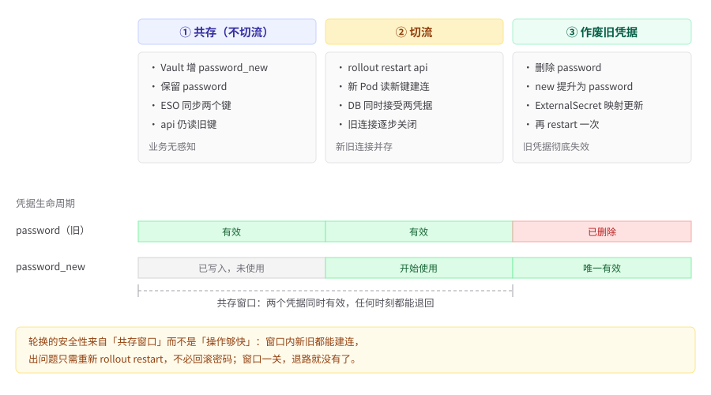

# 第 9 章　配置与密钥

> 位置：主线 · 定义 ｜ 横切：A 凭据 ｜ 成熟度 L1
>
> **此刻 `order-demo` 长什么样**：`order-demo-config` 设 `immutable: true`，密钥改由 ESO/CSI 注入。 ｜ **本章可验证动作**：轮换密钥无需重建镜像。 ｜ 复现：`git checkout ch09-secrets`。

---

## 9.1 问题与反模式：为什么「改了配置」和「换了密码」不是一件事

第 8 章结束时，`order-demo` 已经能在滚动更新期间做到零 5xx。但那份清单里还有一处从第 6 章带过来的临时做法：`gateway` 的 `GREETING` 来自一个**可变**的 ConfigMap，`db` 的口令干脆没写（教学镜像用本地默认值）。**合成案例**（本书统一采用虚构合成案例，见第 1 章）：某团队把「测试环境的数据库密码」写进了一个 `Secret` 并提交进 Git，理由是「反正只是 dev，先用明文 base64 顶一下」。三个月后这个仓库被开成内部开源，凭据出现在几十个 fork 和 CI 日志里；安全同学要求轮换，值班同学直接 `kubectl edit` 把同名 `Secret` 的 `password` 覆盖成新值——结果一半 `api` Pod 还拿着旧连接串、一半读到新值，瞬时全量认证失败，服务 500。为了「修一下」，团队又重建了镜像，把新密码固化进去，于是 dev 验证过的产物和 prod 跑的又不是同一个东西，第 3 章的 build once / promote 当场失效（见第 3 章）。

这串连锁反应的起点，只有六个字：**「反正只是 dev」**。它们出现在每一次「先这样顶一下」的前面，读起来像是给自己发的一张临时通行证。问题是凭据不认环境——**一把 key 泄漏了，它泄的就是那把 key，不会因为标签写着 dev 而轻一点。**

还有一处细节值得停一下：真正让服务挂掉的不是泄漏，而是**覆盖**。泄漏是慢性的，覆盖是瞬时的。**很多团队不是被攻击打穿的，是在自己止血的时候把血管剪了。**

这一连串动作里藏着两个被混为一谈的概念：**配置**是随环境变化、可公开、可版本化的非敏感参数；**凭据**是需要保密、需要定期轮换、需要吊销与审计的敏感材料 [R-09-1][R-09-9]。ConfigMap 存前者，Secret 只是把后者做了 base64 编码——**base64 不是加密**，任何能读命名空间的人都能还原 [R-09-1]。把它们塞进同一个对象、用同一套「原地改值」的手法维护，就是这起事故的根因。

三个高频反模式，按「现象 → 根因 → 本章替代做法」展开：

**反模式一：把 `Secret` 提交进 Git「反正只是测试环境」。** 现象是凭据泄露，且 Git 历史里洗不掉——删掉当前文件不等于删掉历史提交，fork 与 CI 缓存里的副本更收不回来 [R-09-4][R-09-11]。根因是把「Secret 对象」误当成「加密存储」，没意识到它只是编码、且 RBAC 读权限往往比想象中宽 [R-09-1]。本章的替代做法是：生产凭据一律由外部系统托管，经 External Secrets Operator 注入；仓库里只留声明（指向哪个键、生成哪个对象），密钥值、Terraform `state`、`.env` 一律不入 Git（全书公理 9，见第 3 章）[R-09-3][R-09-4]。

**反模式二：原地改同名 ConfigMap。** 现象是改完 `GREETING`，一部分 Pod 读到新值、一部分读到旧值，服务响应自相矛盾，且无法回答「此刻生效的到底是哪一版配置」。根因是可变对象允许原地 `patch`，而 Pod 只在启动时（或 kubelet 同步周期里）读取挂载值，滚动更新又让新旧 Pod 并存 [R-09-2][R-09-6]。本章的替代做法是 `immutable: true` 强制「改配置就换对象」：新值写进一个带版本后缀的新对象，Deployment 的 `configMapKeyRef.name` 同步切过去，旧对象保留一个发布周期再删 [R-09-2]。

**反模式三：轮换时直接覆盖密钥。** 现象是新旧 Pod 凭据不一致，瞬时全量认证失败；为了收场又去重建镜像，把配置变更变成了产物变更。根因是「覆盖」这个动作没有过渡态，而分布式系统里新旧副本必然共存一段时间 [R-09-7][R-09-9]。本章的替代做法是**双凭据共存 → 切流 → 作废旧凭据**三段式轮换，凭据走环境变量注入、不进镜像，因此轮换全程不需要重建镜像 [R-09-3][R-09-7]。

**写错到底长什么样**。这一章的错法最容易被放过，因为它看起来「只是个 dev 密码」：

```diff
-# deploy/base/secret.yaml ── 提交进 Git 的那份
-apiVersion: v1
-kind: Secret
-metadata:
-  name: order-demo-db-credentials
-type: Opaque
-stringData:
-  DB_PASSWORD: "dev-pass-123"
+apiVersion: external-secrets.io/v1
+kind: ExternalSecret
+metadata:
+  name: order-demo-db-credentials
+spec:
+  refreshInterval: "1h"
+  secretStoreRef:
+    name: order-demo-vault
+    kind: SecretStore
+  target:
+    name: order-demo-db-credentials
+    creationPolicy: Owner
+  data:
+    - secretKey: DB_PASSWORD
+      remoteRef:
+        key: order-demo/db-credentials
+        property: password
```

后果：左边那份 `Secret` 一旦进了 Git，就同时进了每个 fork、每次 CI 缓存和所有人的 clone——删掉当前文件没用，历史提交里还在（9.1.1 会算这笔账）。而它更大的问题是**它让「改密码」和「改配置」变成了同一个动作**：`kubectl edit` 覆盖同名对象，就是 9.1 那起事故的扳机。

右边没有密钥值，只有三件事：去哪里取（`order-demo-vault`）、取哪个键的哪个属性（`order-demo/db-credentials` 的 `password`）、生成谁（同名的 `order-demo-db-credentials`）。`refreshInterval: "1h"` 让轮换从「人的日历」变成控制循环的事——外部系统里的值一改，一小时内在集群生效，不需要任何人记得。

判据可以机械执行：`git grep -nE 'password|token|secret' -- '*.yaml'` 之后，**结果里只允许出现键名和引用路径，不允许出现值**。能 grep 判空的检查项，不该留给「我们会注意的」。

> **本章是 H6 的主责章**：第 1 章事故里「密钥轮换踩坑，配置与凭据混在一起」这一失效点，落点就是本章把两类数据彻底分开、并用外部注入让轮换脱离镜像构建。动态凭据与审计的深化在第 26 章（见第 26 章）。

### 9.1.1 实战处置：Git 历史里清除泄露凭据的完整过程与代价核算

反模式一那句「删掉当前文件不等于删掉历史提交」不是吓人，本节把一次处置流程摊开讲——为不冒充第三方事故，本书以 **order-demo 自有仓库**为对象做一次自演（合成案例，仅作演练，不映射任何真实组织）。场景：第 4 章某次提交误把一份含 `order-demo/db-credentials` 真实值的 `Secret` 清单 `git commit` 进了 `order-demo` 仓库；三天后一次内部开源评审扫描才发现，此时凭据已历经 3 次 PR、2 个 fork、CI 跑过 40+ 次构建。

**第一步：定级与止血，先做与 Git 无关的两件事。** 凭据泄露处置顺序里，Git 历史清除是「事后清理」，**不是**第一动作。第一动作是去后端把 `order-demo/db-credentials` 的 `password` 轮换掉——因为无论历史清得多干净，那份旧值已在别人手里，只有后端作废才让它失去意义 [R-09-4]。第二动作是吊销当时可能绑定的任何短期令牌。这两步与 Git 完全解耦，必须在动仓库之前完成，否则边清历史边有人还在用旧值连库，清理毫无意义。

把这个顺序和人的直觉比一下，差得相当远：**大多数人收到「凭据泄露了」的第一反应是打开仓库删文件**——因为那是看得见的东西。而真正让泄露停止的动作，发生在另一个系统里，且不需要碰这台电脑。

**第二步：清点暴露面。** 用 `git log -p --all | grep -niE "password|token"` 与 CI 导出日志交叉比对，确认污染提交数、涉及的 tag（自 `ch04-env` 起）、fork 数与 CI 缓存是否落值。产出一张「暴露清单」，作为代价核算的输入。注意 `grep password` 会命中键名 `property: password`，须像 `hack/ch09-verify.sh` 第 1 步那样区分「键名」与「带值」，只把带值的提交算作污染 [R-09-1]。

**第三步：重写历史。** 现代做法是用 `git filter-repo --replace-text expressions.txt`（或 BFG Repo-Cleaner）把含值行替换为占位符，整条分支历史被改写，所有后续提交 SHA 全部变化。关键约束：**所有协作者的本地副本与远端 fork 都必须强制 `--force` 推送并重新 clone**，否则任何一份旧 clone 仍含明文，且能悄悄把污染提交合并回来。若仓库已走 GitOps（见第 14 章），还要确认 Argo CD 已知状态、镜像引用都切到新 SHA 谱系。

**第四步：回收与通知。** 对 fork：联系平台批量通知 owner 删除并重新 clone；对 CI：清掉构建缓存与日志归档；对可能拉取过的下游：发安全通告。这一步往往比第三步更耗时，因为涉及人而非命令。

**第五步：验证清理彻底。** 重新 clone 后跑 `git log -p --all | grep -niE "<带值正则>"` 应零命中；再跑 `./hack/ch09-verify.sh` 第 1 步确认新仓库无带值行；最后查外部后端读取审计，确认旧值停用后无新连接 [R-09-11]。

**代价核算（相对口径，不报具体单价）。** 把这次处置拆成可归因的账单：

| 代价项 | 归因 | 相对量级（以一次中等规模仓库为基准，单位＝直接轮换的工程时间） |
|---|---|---|
| 凭据轮换本身 | 后端切换 + 应用重载 | 1 |
| 历史重写与强制推送协调 | filter-repo 执行 + 通知协作者 | 1.5 |
| fork / CI 缓存回收 | 跨团队沟通、平台工单 | 2.5（常为最大头） |
| 下游安全通告与安抚 | 对外沟通、合规留痕 | 1 |
| 审计与复盘文档 | postmortem、runbook 补强 | 0.5 |
| 隐性代价：信任与流程改造 | 引入准入策略、加 Secret 扫描门禁（见第 24/25 章） | 难量化但持续发生 |

合计一次「测试环境随手提交」的清理代价约为「直接轮换」的 **6–8 倍**，且约 40% 花在 fork 与 CI 缓存回收这类本不该存在的暴露面上。把凭据挡在 Git 之外（反模式一的替代做法，见 §9.1）几乎零成本，而一旦入仓，清理的边际成本随 fork 数与 CI 历史长度近乎指数上升 [R-09-4][R-09-11]。

这张表最该被记住的不是 6–8 倍这个数，而是它的**分布**：真正的开销在「跨团队沟通、平台工单、对一个不认识你的人解释为什么要删他 clone 的仓库」。**技术动作是 1，组织动作是 5。**所以你防控据泄露最好的时机，是它还只是一行待提交的 diff 的时候——那一刻你只需要按一个键，成本约等于零 [R-09-11]。

> 本条核算为本书观点：不引用具体云厂商单价（价格随区域变动易过时），只给相对比例与归因口径，符合全书「成本只给相对比例」的红线。教训落到检查清单即 `CL-09-02` 的「立即轮换凭据」与 `CL-S-03` 的准入拦截——把清理变成「永不入仓」。

---

## 9.2 范式与决策树：什么进 ConfigMap，什么必须走外部系统

本章要回答的决策问题是：**哪些东西该进 ConfigMap，哪些必须走外部密钥系统，以及轮换怎样才不引发事故？**

先提醒一件事：**这条分界线不能靠「看起来敏不敏感」来画**。人的直觉在这件事上非常不可靠——`GREETING` 看着无害，但它是 `fmt.Fprintf` 的格式串（第 6 章那起事故就是这么来的）；一个内部服务地址看着无害，但它泄露了你的网络拓扑。所以下面用三个问题，而不是用感觉。

**一条可验证的分界线**（靠三个可判定问题，从上往下问，第一个答「是」的分支就是它的归属）：

| 级 | 判据（按序自问） | 命中 → 归属 |
|---|---|---|
| 1 | 这个值泄露后是否需要「轮换 + 吊销 + 留审计」？ | **是** → 外部密钥系统（本章用 ESO + vault） |
| 2 | 这个值是否随环境变化、且改它需要重建镜像吗？ | **是** → ConfigMap（`immutable: true` + 版本后缀） |
| — | 两个都否 | 属于产物标识（如 `APP_VERSION`），随镜像标签一起变，不进 ConfigMap（第 6 章已如此处理 [R-09-9]） |

判据的「可验证」体现在两条命令上：`grep -RniE` 扫描仓库里是否出现带值的凭据行；`kubectl -n order-demo-dev get cm order-demo-config -o jsonpath='{.immutable}'` 是否返回 `true`。凡是答不出「这个值泄露后怎么吊销」的，就不该放进 ConfigMap [R-09-1][R-09-4]。

**四类结论由此定型**：

1. **ConfigMap 存非敏感配置，Secret 只是 base64 编码而非加密；不可变 ConfigMap 强制「改配置就换对象」。** 依据是 Secret 的存储语义与 Immutable ConfigMaps 的不可变保证 [R-09-1][R-09-2]。
2. **生产密钥应由外部系统托管并经 ESO / CSI Driver 注入；密钥、`state`、`.env` 一律不入 Git。** 这是全书公理 9 的落地 [R-09-3][R-09-4]。
3. **凭据处理应覆盖全生命周期：分发、轮换、吊销、审计，只做「加密存储」远远不够。** [R-09-4][R-09-7]
4. **轮换的正确姿势是「双凭据共存 → 切流 → 作废旧凭据」，而不是原地覆盖同一个键。** 这是本书观点，见下方独立标注块。

「不可变」带来一个必须讲清的运维变化：`immutable: true` 之后，`kubectl patch` 改 `data` 会被 API Server 直接拒绝，改配置的唯一合法路径是**换对象名**。本章约定用 `order-demo-config-<git短SHA>` 作版本后缀，并同步改 Deployment 的引用；下面这个 diff 是「把 `GREETING` 从 dev 文案换成 staging 文案」的完整动作，也是第 10 章 overlay 分层的直接前置（见第 10 章）[R-09-2][R-09-6]：

```diff
+ apiVersion: v1
+ kind: ConfigMap
+ metadata:
+   name: order-demo-config-git-1a2b3c5      # 新对象，带版本后缀
+   namespace: order-demo-dev
+ immutable: true
+ data:
+   GREETING: "hello from configmap (staging)"

# deploy/base/deployment.yaml 同步切引用（只改 name，不改 key）
-                  name: order-demo-config
+                  name: order-demo-config-git-1a2b3c5
```

> 当前基线仍叫 `order-demo-config`（配置契约冻结值）；带后缀的对象是**变更时新建**的产物，不是对基线的改名。旧对象保留一个发布周期，正是为了给回滚留一个确定的目标 [R-09-2][R-09-6]。

> **本书观点（本章第 4 条结论，不需要外部背书）**
>
> **主张**：密钥轮换必须走「双凭据共存 → 切流 → 作废旧凭据」三段式，禁止原地覆盖同一个键。轮换是**配置面**动作，不该触发镜像重建。
>
> **论证**：`order-demo` 的 `api` 有 2 个副本，滚动更新期间新旧 Pod 必然共存。若直接把 `password` 从旧值覆盖成新值，那么已启动的旧 Pod 仍持有旧连接串、新起的 Pod 读新值，数据库侧又只认其中一个，结果就是「无论哪个值生效，都有一半副本认证失败」。双凭据共存的做法是：先在后端同时保留 `password`（旧）与 `password_new`（新），让数据库同时接受两个凭据；再滚动重启 `api` 让全部副本读到新值；确认连续请求零 5xx、且旧凭据的读取记录归零后，才作废旧凭据。这个顺序把「不可并存的瞬间」拆成了「可并存 → 可切流 → 可收尾」三段，任何一段出问题都能退回上一段 [R-09-7][R-09-9]。凭据通过 `envFrom.secretRef` 注入，值的变化只发生在 Secret 对象里，镜像标签始终是 `git-<sha7>` 不变，因此轮换不违反 build once / promote（见第 3 章）。
>
> **反例与前提**：前提有两个——应用或数据库必须能同时接受两个凭据，且后端支持保留多版本/多键。若用的是单键覆盖式的老旧后端，无法做双凭据共存，那么正确做法是「先给应用加载新凭据的能力并发一版，再切后端」，仍然不是原地覆盖，只是把三段式里的「共存」挪到了应用侧。另一个反例是「凭据泄露后的紧急吊销」：此时没有共存窗口，必须立即作废并接受短暂不可用，这是安全事件响应，不属于计划内轮换，其 runbook 见第 26 章。把合成案例写成「某次真实泄露事故」是禁止的，本章 L3 只用于支撑反模式的方法论 [R-09-11]。

### 9.2.1 双凭据共存三段式时序图与失败注入演练记录

§9.2 本书观点给出了「共存 → 切流 → 作废旧凭据」三段式。下面用一张时序图把三段的角色交互画清楚，再附一次失败注入演练记录（order-demo 自有演练，非第三方事故）。



**失败注入演练记录（节选自 `docs/runbooks/secret-rotation.md` 的演练留痕）：**

- **注入点**：在 ② 切流刚完成、`rollout restart` 进行到一半时，手动把 `Vault` 里的 `password_new` 误删（模拟「后端侧误操作」）。
- **预期故障**：新起的 `api` Pod 读到 `DB_PASSWORD_NEW` 却连不上 `db`，`/readyz` 失败，`progressDeadlineSeconds: 120` 触发滚动更新卡住。
- **观测**：`kubectl -n order-demo-dev rollout status deploy/api` 在 120s 内未就绪；`./hack/rolling-5xx-test.sh` 报 5xx 计数 0——因为 readiness 挡住了流量，未对外报错，但 Pod 不就绪。
- **处置（退回 ①）**：按 runbook 第 5 步，先在 `Vault` 恢复 `password_new`，再 `kubectl -n order-demo-dev rollout restart deploy/api`，待 `rollout status` 通过、`rolling-5xx-test.sh` 退出码 0，确认旧凭据读取记录归零后，才重试 ③。
- **注入点二（① 共存阶段）**：把 `ExternalSecret` 的 `refreshInterval` 临时改成 `24h` 并 apply，再手动删除集群内 `Secret` 的 `DB_PASSWORD_NEW` 键，模拟「ESO 同步滞后、新值迟迟不下发」。
- **预期故障（注入点二）**：① 阶段迟迟无法进入 ②——后端早已写好 `password_new`，值班若只看后端状态，要么误判「ESO 坏了」，要么干脆原地覆盖旧键，一脚踏回反模式三。
- **观测（注入点二）**：`kubectl -n order-demo-dev get externalsecret order-demo-db-credentials -o jsonpath='{.status.conditions[0].type}'` 返回 `SecretSynced`，看似一切正常；但 `kubectl -n order-demo-dev get secret order-demo-db-credentials -o json | jq -r '.data | keys[]'` 只列出 `DB_USER` 与 `DB_PASSWORD` 两个键名（只打印键名、不落值）——同步窗口未到，新键未下发 [R-09-3]。
- **处置（注入点二）**：把 `refreshInterval` 恢复为 `1h` 并 apply，然后用 ESO 的强制同步注解立即触发一轮：`kubectl -n order-demo-dev annotate externalsecret order-demo-db-credentials force-sync="$(date +%s)" --overwrite`；再次执行上面的键名列表命令确认 `DB_PASSWORD_NEW` 出现，才允许进入 ②。教训由此固化进 runbook 第 1 步的验证命令：**切流的准入条件不是「后端已改」，而是「集群内 Secret 已含两个键」**。
- **结论**：三段式的价值正是「任何一段出问题都能退回上一段」；本次演练证明 ②→① 的回退路径有效，且因凭据只走环境变量、镜像标签 `git-<sha7>` 全程未变，回退没有触发任何镜像重建 [R-09-7][R-09-9]。
- **演练通过标准汇总**：两次注入都能在 runbook 内找到对应退回动作；全程 `rolling-5xx-test.sh` 退出码 0（readiness 挡流，未对外报 5xx）；镜像标签 `git-<sha7>` 前后一致；每次注入从发现到恢复不超过 5 分钟（含验证命令执行）。演练留痕随 runbook 归档，供第 23 章 Chaos Mesh 演练与第 31 章事故重演直接复用 [R-09-7]。

### 9.2.2 ConfigMap 的完整用法：checksum 注解的退役、volume 挂载的生效盲区与单一大 ConfigMap 的爆炸半径

`immutable: true` 只给了一条硬约束（改值必须换对象），围绕它还有三个在真实团队里反复争论的用法问题，本节一次定清。

**其一：checksum 注解在「换对象」范式下应当退役。** 可变 ConfigMap 时代，环境变量注入的配置改了值，Pod 不会自动重启，于是社区（尤其 Helm 生态）流行把 ConfigMap 内容的 SHA-256 写进 Pod 模板的注解——值一变、注解一变、PodSpec 一变、滚动更新随之发生 [R-09-2]。这套手法在 `immutable: true` + 版本化命名之后是**纯冗余**：引用名从 `order-demo-config` 切到 `order-demo-config-git-1a2b3c5` 本身就是 PodSpec 变更，滚动更新必然触发，不再需要任何哈希注解。留着它还有实际害处：哈希靠手工或模板计算，是第二个「真相」，一旦出现「对象名切了新后缀、哈希却还是按旧对象算的」这类半吊子状态，排障时要先分辨两个信号谁说了算；而在换对象范式下，`configMapKeyRef.name` 是唯一需要看的信号。判据一句话：**可变 ConfigMap + env 注入才需要 checksum 注解；immutable + 版本化命名下删掉它** [R-09-2][R-09-6]。

**其二：volume 挂载的 ConfigMap 有「生效盲区」，immutable 把盲区变成永久快照。** 同一份配置用 env 注入还是用 volume 挂载，生效语义完全不同：env 在容器启动时写入，之后永不更新；volume 挂载在可变 ConfigMap 时代由 kubelet 按同步周期刷新文件，但进程是否跟着热重载取决于应用自身。于是出现「文件已是新值、进程内存还是旧值」的不可判定状态——既说不清它何时生效，也说不清要不要重启。`immutable: true` 之后 kubelet 直接不再检查这类卷的更新（这正是官方引入 immutable 的动机之一：省掉海量 ConfigMap 的监听开销），挂载内容永远是对象创建时的快照，**换对象 + 重建 Pod 成为唯一更新路径** [R-09-2]。本书因此给 `order-demo` 定了一条统一口径：所有组件一律走 envFrom，不挂配置卷——宁可让「配置生效」永远等价于「Pod 重建」这个可观测、可审计的事件，也不引入「半生效」中间态。若某组件确需大配置文件（如 nginx 的完整 conf），挂载卷可以，但该 ConfigMap 也要 `immutable: true`，且把「改配置即重建」写进该组件的 runbook [R-09-2]。

**其三：单一大 ConfigMap 是爆炸半径反模式。** 现象：`gateway` 的展示文案改一个字母，按 §9.2 的换对象范式，三个组件引用的 `configMapKeyRef.name` 都要从旧后缀切到新后缀，于是 `api`、`worker` 被无谓地滚动重建一遍；审计 diff 里也无法回答「这次变更影响谁」。根因：**对象的边界没有跟着「变更节奏与读者」走**，把所有组件的 key 塞进一个对象，等于把它们的发布耦合在一起 [R-09-2]。替代做法是按读者拆对象：`order-demo-config-gateway-<sha>`、`order-demo-config-api-<sha>`，每个 Deployment 只引用自己那份，改一个 key 其他组件不感知。可判定拆分判据如下：

| 信号 | 可以继续合用一个对象 | 必须拆 |
|---|---|---|
| key 读者 | 大多数 key 被多组件共享 | 多数 key 只有一个读者 |
| 变更节奏 | 各部分变更频率接近 | 某部分高频变更拖累全量重建 |
| 审计要求 | 一条 diff 能看全 | 需要按组件独立回答「影响谁」 |

`order-demo` 当前 3 个组件、key 总量个位数且共享为主，按判据暂不拆；契约冻结的 `order-demo-config` 名字属于基线对象，拆分是组件规模增长后的**新增对象**动作，不是对基线改名——与 §9.2「带后缀对象是变更时新建的产物」同一口径 [R-09-2][R-09-6]。

---

## 9.3 工具选型：六种密钥方案，按「何时不该用」筛掉五个

本章是选型密度最高的一章，因为「密钥怎么进集群」至少有六种做法。本书选型基线已把唯一示例实现钉死为 **External Secrets Operator 2.x + 后端占位 `vault`**，其余方案只在矩阵里作对比，**不给第二套 YAML** [R-09-3][R-09-10]。

| 方案 | 本质 | 最适 | 何时不该用（本章相关的一条） | 轮换支持 | 审计能力 | 回滚方式 |
|---|---|---|---|---|---|---|
| Kubernetes Secret（`v1`） | base64 编码的对象 | 集群内部生成的临时令牌 | **任何需要长期保存或入仓的凭据**——它不加密、不审计 [R-09-1] | 原地覆盖，无过渡态 | 仅靠 RBAC / 审计日志 | `kubectl apply` 上一版清单 |
| Sealed Secrets 0.x（Bitnami Labs） | 公钥加密后入仓、集群内解密 | 无外部 KMS、仍想走 GitOps 的小团队 | 需要集中轮换与吊销时——每个集群一把密钥，跨集群治理成本陡增 [R-09-5] | 重加密 + 重新 seal | 集群侧解密日志 | 回退仓库里的 SealedSecret 版本 [R-09-5] |
| SOPS 3.x | 文件级字段加密（配合 KMS/age） | 少量静态 YAML 的离线加密 | 需要动态凭据、按 Pod 注入时——它是文件加密不是运行时注入 [R-09-8] | 重跑加密流程 | Git 提交记录 | `git revert` 加密文件 |
| **External Secrets Operator 2.x（本章唯一实现）** | 控制器把外部键值同步为集群内 Secret | 已有外部密钥系统、要多环境一致注入 | 完全没有外部后端、也不打算自建时——引入控制器是净负担 [R-09-3] | `refreshInterval` 自动 + 双键共存 | 外部后端读取审计 + ESO 事件 | 把 `SecretStore` 指回旧版本凭据 [R-09-3] |
| Secrets Store CSI Driver | 以卷挂载方式取外部凭据 | 需要凭据以文件形式存在、且不落 etcd | 应用只读环境变量时——挂载卷要改应用读取方式 [R-09-3] | 卷轮转 + 可选同步 Secret | 外部后端读取审计 | 回退卷挂载声明 |
| HashiCorp Vault 1.x（本章作**占位后端**） | 外部密钥系统本体 | 需要动态凭据、租期、吊销、审计 | 团队没有能力运维一套高可用密钥系统时——先用托管 KMS [R-09-4] | 版本化 / 动态凭据 | 完整审计日志 | 切回上一版本键 |

**最小接入 diff**：

```diff
 deploy/base/configmap.yaml            (第 6 章)
+  immutable: true
   （name 仍为 order-demo-config，data 不变）

 deploy/base/deployment-api.yaml       (第 8 章)
+  containers[api].envFrom:
+    - secretRef:
+        name: order-demo-db-credentials
   （探针 / initContainers / sidecar / 8081 端口 / 标签全部不变）

+ deploy/base/secretstore.yaml          # 新增：指向占位后端 vault
+ deploy/base/externalsecret.yaml       # 新增：remoteRef.key = order-demo/db-credentials
+ docs/runbooks/secret-rotation.md      # 新增：双凭据共存轮换 runbook
+ hack/ch09-verify.sh                   # 新增：明文扫描 + 注入验证 + 轮换演练
```

**升级路径**：先把 `refreshInterval` 设长（如 `1h`），确认 ESO 同步稳定后再按审计要求缩短；`creationPolicy` 从 `Owner` 起步，避免多控制器争抢同一个 Secret。**回滚路径**：外部侧把 `SecretStore` 指回旧版本凭据，集群侧 `kubectl -n order-demo-dev rollout restart deploy/api`，全程不改镜像标签。若是 ConfigMap 变更导致的问题，回滚就是「把 `configMapKeyRef.name` 切回上一个带后缀的对象名」，比原地改值干净得多 [R-09-2][R-09-6]。生产变更必须回到 Git（全书公理 5，见第 3 章），本地 kind 的 `rollout restart` 只作演练。

### 9.3.1 ESO 与 Secrets Store CSI Driver 在同一应用上的双实现对照及取舍

9.3 的矩阵把 External Secrets Operator（ESO）与 Secrets Store CSI Driver 并列为两种「外部凭据进集群」的方案，但矩阵只能给一行结论。真正选型时团队最常问：**同一个 `order-demo` 应用，两种方案各自长什么样、差在哪、何时该换？** 本节在同一需求（把 `order-demo/db-credentials` 注入 `api` Pod，且可轮换、可审计）下并排实现，再给取舍判据 [R-09-3]。

**实现对照（同一应用的两个版本，只选其一，本书钉死 ESO）。**

ESO 路径（本书唯一实现，已在 §9.4 落地）：控制器把外部键值**同步成一个 K8s `Secret` 对象 `order-demo-db-credentials`**，应用通过 `envFrom.secretRef` 读环境变量，轮换由 `refreshInterval` 驱动，后端换值后集群内 Secret 自动更新。

```yaml
# 方案 A：ESO（本书实现，完整见 §9.4）
apiVersion: external-secrets.io/v1
kind: ExternalSecret
metadata:
  name: order-demo-db-credentials
  namespace: order-demo-dev
spec:
  refreshInterval: "1h"
  secretStoreRef: { name: order-demo-vault, kind: SecretStore }
  target: { name: order-demo-db-credentials, creationPolicy: Owner }
  data:
    - secretKey: DB_USER
      remoteRef: { key: order-demo/db-credentials, property: username }
    - secretKey: DB_PASSWORD
      remoteRef: { key: order-demo/db-credentials, property: password }
```

CSI Driver 路径（仅对照，不给第二套落地，仅示意挂载方式）：凭据**以卷（volume）挂载**到 `/mnt/secrets-store`，不生成 K8s `Secret` 对象、不落 etcd；应用需改读取逻辑从文件读，而非环境变量。

```yaml
# 方案 B：Secrets Store CSI Driver（仅对照示意，非本书实现）
apiVersion: secrets-store.csi.x-k8s.io/v1
kind: SecretProviderClass
metadata:
  name: order-demo-vault
  namespace: order-demo-dev
spec:
  provider: vault
  parameters:
    roleName: order-demo
    objects: |
      - objectName: "db-credentials"
        secretPath: "secret/data/order-demo/db-credentials"
# Pod 侧以 volume 挂载，应用改读 /mnt/secrets-store/db-credentials
```

**逐项取舍：**

| 维度 | ESO（本书选） | Secrets Store CSI Driver | 取舍判据 |
|---|---|---|---|
| 应用读取方式 | 环境变量 `DB_PASSWORD` | 文件 `/mnt/secrets-store/...` | 应用若已用 env（order-demo 的 `api` 即用 envFrom），ESO 零改应用；CSI 要改读取代码 [R-09-3] |
| 是否落 etcd | 是（生成 K8s Secret） | 否（仅卷内，内存态） | 强监管禁止 Secret 落 etcd 时 CSI 更优；其余场景差异不大 |
| 轮换机制 | 控制器轮询 + 可选双键共存 | 卷 `rotationPolicy: Periodic` + 可选 `syncSecret` 回填 | 两者皆可轮换；ESO 与「双凭据共存三段式」（§9.2）天然契合 |
| 审计 | 外部后端读取日志 + ESO 事件 | 外部后端读取日志 | 持平 |
| 与 §9.5 回滚契合度 | 高（`git checkout` 回退 ExternalSecret） | 中（需回退卷声明） | 见 §9.5 方案 A/B |
| 引入成本 | 一个控制器 | 一个 CSI 驱动 + DaemonSet | 持平，但 ESO 与第 14 章 GitOps 声明式更顺 |

**什么时候该从 ESO 切到 CSI Driver？** 三条硬判据：① 合规明确禁止 Secret 落 etcd；② 应用本来就按文件读凭据（legacy 系统）；③ 凭据需「每次挂载都重新签发短期令牌」（动态凭据密度极高）。三者皆不满足时，ESO 是更省心的默认——这也正是本书选型基线把 ESO 钉为唯一实现的原因 [R-09-3][R-09-4]。反之，若团队完全没有外部后端也不打算自建，那两者都**不该用**（矩阵里 ESO 的「何时不该用」已写明），应退回 Sealed Secrets 或 SOPS 这类可入仓加密方案。

> 本节为选型展开，两条路径复用既有 `[R-09-3]` 背书，未引入新角标；CSI 的 YAML 仅作对照示意，不进入本书示例实现，与 §9.3「不给第二套实现」的约定一致。

### 9.3.2 SecretStore / ClusterSecretStore 作用域选择与 ExternalSecret 的 refreshInterval、dataFrom、template

§9.4 只给了最小可用的 `SecretStore` + 逐条 `data` 映射。ESO 还有三组字段决定它在多环境下的真实形态，逐组定清 [R-09-3]。

**作用域：命名空间级 `SecretStore` 还是集群级 `ClusterSecretStore`？** `SecretStore` 作用域限定单个命名空间，`ClusterSecretStore` 全集群共享、靠 namespace 选择器圈定可用范围。选型判据不是「哪个少写几份 YAML」，而是**后端凭据按什么边界隔离**：`order-demo` 三环境在第 4 章就约定了独立凭据（dev / staging / prod 各自一套），若三个命名空间在同一集群，用 `ClusterSecretStore` 意味着三套环境共享同一个后端认证身份——staging 的误操作可以直接摸到 prod 的键，第 4 章的隔离约定就被一个对象打穿。因此本书口径：**凭据按环境隔离时，用每命名空间一份 `SecretStore`；只有「后端统一、权限靠后端侧策略（如 vault policy）隔离」且连接信息确实无环境差异时，`ClusterSecretStore` 才是省配置的正确选择** [R-09-3][R-09-4]。完整对照示例（非本书实现，仅说明结构）：

```yaml
apiVersion: external-secrets.io/v1
kind: ClusterSecretStore
metadata:
  name: order-demo-vault
spec:
  selector:
    namespace:
      matchLabels:
        app.kubernetes.io/name: order-demo   # 只允许打了该标签的命名空间使用
  provider:
    vault:
      server: "${VAULT_ADDR}"
      path: "secret"
      version: "v2"
      auth:
        kubernetes:
          mountPath: "kubernetes"
          role: "order-demo"
          serviceAccountRef:
            name: external-secrets
            namespace: external-secrets       # Cluster 级必须写命名空间
```

`ExternalSecret` 侧只需把 `secretStoreRef.kind` 从 `SecretStore` 改成 `ClusterSecretStore`，其余不变；但每多一个命名空间共用它，后端认证身份的爆炸半径就大一圈。

**`refreshInterval` 取值判据。** 它是 ESO 拉取外部后端的周期，不是「推送延迟承诺」：后端换值后，集群内 Secret 最早也要等到下一个周期才更新（§9.2.1 注入点二已演示 24h 的滞后后果）。基线 `1h` 的取舍边界：

| 取值 | 适用 | 风险 |
|---|---|---|
| `24h` 及以上 | dev 环境、纯演练 | 轮换下发滞后以天计，值班极易误判「ESO 坏了」 |
| `1h`（本书基线） | 三环境默认 | 后端压力可控；轮换可随时用 force-sync 注解提前触发 |
| `5m`–`15m` | 生产、合规要求短窗口收敛 | 先确认后端 API 配额；周期越短限流风险越高 |
| 小于 `1m` | 基本不该用 | 控制器与后端双向承压，收益近乎为零 |
| `0` | 停用周期轮询 | 只剩手工 force-sync 驱动，一次遗忘就是「新值永远不下发」，不建议 |

**`dataFrom.extract` 是便利性与键名失控的交换。** 逐条 `data`（§9.4 现有写法）是白名单：后端键树里有什么、集群 Secret 就有什么，多一个字都没有。`dataFrom` 则一次抽取 `remoteRef.key` 指向的整棵键树——后端将来新增任何键（比如某次排障临时塞进去的 `password_tmp`），下一个刷新周期就会**自动出现在所有挂载该 Secret 的 Pod 环境里**，且仓库 diff 里完全看不见。本书口径：`order-demo` 永远用显式 `data` 白名单；`dataFrom` 仅当「键集确实由后端定义、且需要原样镜像」时才考虑，且必须配合后端侧的键集评审 [R-09-3]。

**`target.template` 在注入侧做加工，别把加工逻辑写进应用。** 模板的输入是 `data` 各条 `secretKey` 的值，典型用法是拼接连接串，免得每个应用自己拼：

```yaml
# 在 §9.4 externalsecret.yaml 的 target 段上扩展（能力示例，键名不变）
  target:
    name: order-demo-db-credentials
    creationPolicy: Owner
    template:
      data:
        DB_DSN: "postgres://{{ .DB_USER }}:{{ .DB_PASSWORD }}@db:5432/orders"
```

注意两点：DSN 里的 `5432` 仍是配置契约的 `db` 端口，模板只是把已注入的凭据**组装**成新键，不产生任何明文入 Git；`template.data` 会**整体替换**最终 Secret 的 data——一旦启用模板，最终对象里只有模板列出的键，逐条 `data` 的结果只作为模板输入存在，漏写一个键它就在集群内消失。模板改造必须走 Git review，不许手改 [R-09-3][R-09-6]。

**`creationPolicy` 与 GitOps 的暗坑。** `Owner`（默认）下删除 `ExternalSecret` 会连带删除它创建的 Secret，责任链干净；`Orphan` 则把 Secret 留在集群里「孤儿化」——第 14 章切到 GitOps 后，一条被删掉的 `ExternalSecret` 会留下一个不再有人管理的旧凭据对象，成为审计盲区。维持 `Owner` [R-09-3][R-09-6]。

---

## 9.4 落地配置（完整可应用文件，Kubernetes 1.32+ / External Secrets Operator 2.x）

> 全部字段沿用第 6 章配置契约：命名空间 `order-demo-dev`、镜像 `registry.example.com/order-demo/<component>:git-<sha7>`、标签 `app.kubernetes.io/*` 与 `version: git-1a2b3c4`、`app.kubernetes.io/managed-by: kubectl`、ConfigMap 名 `order-demo-config`、`db` 5432。本章新增 `immutable: true` 与外部密钥声明。`vault` 为**占位后端**，`${VAULT_ADDR}` 由部署时注入，不连真实实例；键路径 `order-demo/db-credentials` 绝不入 Git、也不写入任何镜像层。`git-1a2b3c4` 是示例 SHA，脚本用真实短 SHA 替换。

**`deploy/base/configmap.yaml`**（`apiVersion: v1`）

```yaml
apiVersion: v1
kind: ConfigMap
metadata:
  name: order-demo-config
  namespace: order-demo-dev
  labels:
    app.kubernetes.io/name: order-demo
immutable: true
data:
  GREETING: "hello from configmap (dev)"
```

> 第 6 章的 `GREETING` 值、`name`、`namespace`、标签一个都没改，只加 `immutable: true`。此后改配置必须新建带版本后缀的对象（见 9.2 的 diff），`kubectl patch` 会被 API Server 拒绝 [R-09-2]。

**`deploy/base/secretstore.yaml`**（`apiVersion: external-secrets.io/v1`，ESO 2.x）

```yaml
apiVersion: external-secrets.io/v1
kind: SecretStore
metadata:
  name: order-demo-vault
  namespace: order-demo-dev
  labels:
    app.kubernetes.io/name: order-demo
spec:
  provider:
    vault:
      server: "${VAULT_ADDR}"
      path: "secret"
      version: "v2"
      auth:
        kubernetes:
          mountPath: "kubernetes"
          role: "order-demo"
          serviceAccountRef:
            name: external-secrets
```

> `vault` 是本书选型基线钉死的占位后端；`${VAULT_ADDR}` 与 Kubernetes auth 的 `role` 由部署时注入，仓库里没有任何地址、令牌或口令。`server` 字段写成占位符是为了让这份声明可以进 Git 而不泄露拓扑；落地时用 `envsubst < deploy/base/secretstore.yaml | kubectl apply -f -` 注入 [R-09-3][R-09-4]。

### 9.4.1 `vault` 占位后端切换为托管 KMS 的最小改动 diff

§9.4 的 `secretstore.yaml` 用 `vault` 作**占位后端**（§9.3 矩阵与 本书选型基线钉死）。但 §9.3 已写明「团队没有能力运维一套高可用密钥系统时——先用托管 KMS」。本节给出从占位 `vault` 切到托管 KMS 的**最小改动 diff**：只动 `SecretStore` 的 `provider` 段，不动 `ExternalSecret`、`Deployment`、`ConfigMap`、命名空间与 `Secret` 对象名，以验证占位设计的向后兼容 [R-09-3][R-09-4]。

以下以 ESO 对接某托管密钥库（示例用 AWS Secrets Manager 表达，其余云厂商仅 `provider` 名与 auth 段不同，结构一致）为例，列出相对 `deploy/base/secretstore.yaml` 的 diff：

```diff
  apiVersion: external-secrets.io/v1
  kind: SecretStore
  metadata:
    name: order-demo-vault
    namespace: order-demo-dev
    labels:
      app.kubernetes.io/name: order-demo
  spec:
-   provider:
-     vault:
-       server: "${VAULT_ADDR}"
-       path: "secret"
-       version: "v2"
-       auth:
-         kubernetes:
-           mountPath: "kubernetes"
-           role: "order-demo"
-           serviceAccountRef:
-             name: external-secrets
+   provider:
+     aws:
+       service: SecretsManager
+       region: "${KMS_REGION}"
+       auth:
+         jwt:
+           serviceAccountRef:
+             name: external-secrets
```

**不变的契约项（必须逐条核对）：**

- `metadata.name: order-demo-vault` 与 `namespace: order-demo-dev` 不动——`SecretStore` 是命名空间级资源，命名空间契约 `order-demo-{env}` 不受影响。
- `ExternalSecret` 的 `target.name: order-demo-db-credentials` **不动**——集群内生成的 `Secret` 对象名始终是 `order-demo-db-credentials`，与后端从 `vault` 换成托管 KMS 无关 [R-09-3]。
- `Deployment` 的 `envFrom.secretRef.name: order-demo-db-credentials` 不动，应用读取方式零变化。
- `ConfigMap`、`immutable: true`、探针、镜像 `git-<sha7>` 全部不动。

**需要随之后补的一步（非 diff 内，但必须做）：** 托管 KMS 的密钥存放路径与 `vault` 的 `order-demo/db-credentials` 不同，需在 `ExternalSecret` 的 `remoteRef.key` 改成托管侧键名（如 Secrets Manager 的 secret 名 `order-demo/db-credentials` 或 ARN），但**只改键名、不改 `secretKey`（`DB_USER`/`DB_PASSWORD`）**，下游注入仍零改动。若托管侧键名沿用 `order-demo/db-credentials` 这一字符串，连 `remoteRef.key` 都不必动。

**验证与回滚（对应 §9.5）：** 切换后跑 `./hack/ch09-verify.sh` 第 2–4 步，`get externalsecret` 应回到 `SecretSynced`；回滚只需把 `provider` 段 `git checkout` 回 `vault` 版本再 `apply`，全程不改镜像标签，与 §9.5 方案 A 一致。代价上，从自运维 `vault` 到托管 KMS 省掉了高可用部署与备份运维，却引入了云厂商依赖与出网调用——这正是 §9.3「何时不该用 vault」那条判据的镜像面 [R-09-4]。

**`deploy/base/externalsecret.yaml`**（`apiVersion: external-secrets.io/v1`，ESO 2.x）

```yaml
apiVersion: external-secrets.io/v1
kind: ExternalSecret
metadata:
  name: order-demo-db-credentials
  namespace: order-demo-dev
  labels:
    app.kubernetes.io/name: order-demo
    app.kubernetes.io/managed-by: kubectl
spec:
  refreshInterval: "1h"
  secretStoreRef:
    name: order-demo-vault
    kind: SecretStore
  target:
    name: order-demo-db-credentials
    creationPolicy: Owner
  data:
    - secretKey: DB_USER
      remoteRef:
        key: order-demo/db-credentials
        property: username
    - secretKey: DB_PASSWORD
      remoteRef:
        key: order-demo/db-credentials
        property: password
```

> `order-demo/db-credentials` 是外部后端中的**键路径**（`remoteRef.key`），正是配置契约冻结的键名；ESO 依据它生成的集群内对象叫 `order-demo-db-credentials`——K8s 对象名不允许 `/`，所以两者必须区分，这一点在对象名与属性名两层都做了区分 [R-09-3]。文件里出现的 `password` 只是 `property` 字段名与 `DB_PASSWORD` 键名，**没有任何值**；`DB_USER` / `DB_PASSWORD` 会被注入为 `api` 容器的环境变量，与 9.5 的 `env | grep DB_` 验证对应 [R-09-1]。

**`deploy/base/deployment-api.yaml`**（`apiVersion: apps/v1`，仅给出 `containers[api]` 的完整片段；其余字段与第 8 章完全一致）

```yaml
apiVersion: apps/v1
kind: Deployment
metadata:
  name: api
  namespace: order-demo-dev
  labels:
    app.kubernetes.io/name: order-demo
    app.kubernetes.io/component: api
    app.kubernetes.io/managed-by: kubectl
spec:
  replicas: 2
  progressDeadlineSeconds: 120
  selector:
    matchLabels:
      app.kubernetes.io/name: order-demo
      app.kubernetes.io/component: api
  strategy:
    type: RollingUpdate
    rollingUpdate:
      maxSurge: 1
      maxUnavailable: 0
  template:
    metadata:
      labels:
        app.kubernetes.io/name: order-demo
        app.kubernetes.io/component: api
        version: git-1a2b3c4
        app.kubernetes.io/managed-by: kubectl
    spec:
      terminationGracePeriodSeconds: 30
      automountServiceAccountToken: false
      securityContext:
        runAsNonRoot: true
        seccompProfile:
          type: RuntimeDefault
      initContainers:
        - name: init-schema
          image: registry.example.com/order-demo/api:git-1a2b3c4
          imagePullPolicy: IfNotPresent
          command: ["/api", "--migrate"]
          securityContext:
            allowPrivilegeEscalation: false
            readOnlyRootFilesystem: true
            capabilities:
              drop: ["ALL"]
        - name: log-forwarder
          image: registry.example.com/order-demo/api:git-1a2b3c4
          imagePullPolicy: IfNotPresent
          restartPolicy: Always
          command: ["/api", "--log-forward"]
          securityContext:
            allowPrivilegeEscalation: false
            readOnlyRootFilesystem: true
            capabilities:
              drop: ["ALL"]
      containers:
        - name: api
          image: registry.example.com/order-demo/api:git-1a2b3c4
          imagePullPolicy: IfNotPresent
          ports:
            - name: http
              containerPort: 8081
              protocol: TCP
          envFrom:
            - secretRef:
                name: order-demo-db-credentials
          env:
            - name: APP_VERSION
              value: git-1a2b3c4
          startupProbe:
            httpGet:
              path: /startup
              port: http
            periodSeconds: 2
            timeoutSeconds: 2
            failureThreshold: 30
          livenessProbe:
            httpGet:
              path: /healthz
              port: http
            initialDelaySeconds: 10
            periodSeconds: 10
            timeoutSeconds: 2
            failureThreshold: 3
          readinessProbe:
            httpGet:
              path: /readyz
              port: http
            initialDelaySeconds: 5
            periodSeconds: 5
            timeoutSeconds: 2
            failureThreshold: 3
            successThreshold: 1
          lifecycle:
            preStop:
              sleep:
                seconds: 5
          securityContext:
            allowPrivilegeEscalation: false
            readOnlyRootFilesystem: true
            capabilities:
              drop: ["ALL"]
```

> 相比第 8 章只多了 `envFrom.secretRef`。凭据以环境变量注入、不写进镜像、不落 Git；轮换时只需后端换值 + `rollout restart`，镜像标签 `git-<sha7>` 始终不变，这正是本章「轮换无需重建镜像」的可验证动作 [R-09-3][R-09-9]。

**`docs/runbooks/secret-rotation.md`**

```markdown
# Runbook：order-demo/db-credentials 双凭据共存轮换

适用范围：计划内凭据轮换。紧急吊销（疑似泄露）走第 26 章事件响应，不走本 runbook。
前置条件：后端同时保留 password（旧）与 password_new（新）；数据库同时接受两个凭据。

## 1. 共存（不切流）
- 在 vault 的 order-demo/db-credentials 下新增 password_new，保留 password 原值。
- 确认 ExternalSecret 的 refreshInterval 到期后，集群内 Secret 含 DB_PASSWORD（旧）与 DB_PASSWORD_NEW（新）两个键。
- 验证：kubectl -n order-demo-dev get secret order-demo-db-credentials -o jsonpath='{.data}' | 应含两个键。

## 2. 切流
- 把应用连接串优先读 DB_PASSWORD_NEW，保留回退到 DB_PASSWORD 的能力。
- kubectl -n order-demo-dev rollout restart deploy/api
- kubectl -n order-demo-dev rollout status deploy/api --timeout=120s
- ./hack/rolling-5xx-test.sh   # 沿用第 8 章脚本，退出码须为 0，5xx 计数 0

## 3. 观察
- 查外部后端审计：旧凭据 password 的读取记录在 30 分钟内归零。
- kubectl -n order-demo-dev exec deploy/api -- env | grep DB_   # 两个键都在，但只用新值

## 4. 作废旧凭据
- 在 vault 中删除 password（旧）键，并把 password_new 提升为 password。
- 同步 ExternalSecret：移除 DB_PASSWORD 旧映射，保留新键名为 DB_PASSWORD。
- kubectl -n order-demo-dev rollout restart deploy/api

## 5. 回滚（任何一步失败都回到上一步）
- git checkout <上一 tag> -- deploy/base/externalsecret.yaml
- kubectl -n order-demo-dev apply -f deploy/base/externalsecret.yaml
- kubectl -n order-demo-dev rollout restart deploy/api
- 验证：./hack/verify.sh 通过，/healthz 为 200，api 能连上 db。
```

> Runbook 里「回退到旧凭据」的路径与 9.5 的回滚命令完全一致，且每一步都有验证命令与通过标准，全文无任何占位内容。

**`hack/ch09-verify.sh`**

```bash
#!/usr/bin/env bash
set -euo pipefail
NS=order-demo-dev

echo "== 1. 仓库无凭据明文（只允许键名/字段名，不允许带值）=="
if grep -RniE "(password|passwd|token|secret)[\"' ]*[:=][\"' ]*[A-Za-z0-9+/]{6,}" deploy/ docs/; then
  echo "FAIL: 发现疑似明文凭据" >&2
  exit 1
fi
echo "OK: 无带值凭据行"

echo "== 2. ConfigMap 不可变 =="
kubectl -n "${NS}" get cm order-demo-config -o jsonpath='{.immutable}{"\n"}'

echo "== 3. 凭据已注入 api 容器（只看键名，不打印值）=="
kubectl -n "${NS}" exec deploy/api -- env | grep '^DB_' | cut -d= -f1

echo "== 4. 镜像标签未因轮换改变 =="
kubectl -n "${NS}" get deploy api -o jsonpath='{.spec.template.spec.containers[0].image}{"\n"}'

echo "== 5. 最小闭环仍通 =="
./hack/verify.sh
```

> 第 1 步刻意用「带值」正则而不是裸 `grep password`：ESO 声明里 `property: password` 与 `secretKey: DB_PASSWORD` 是键名，允许出现；`password=xxx` 这种带值的行才是必须拦截的明文 [R-09-1][R-09-11]。第 3 步用 `cut -d= -f1` 只打印变量名，避免把凭据打进 CI 日志。

---

## 9.5 验证与回滚（回滚方案先于发布方案）

**回滚**（把线上恢复到上一个已知良好版本，详见第 13 章）在本章有一个新形态：回滚的对象不是镜像、不是探针参数，而是**外部后端里的一份键值声明**。因此回滚方案必须在轮换开始前就写好——也就是 9.4 那份 runbook 的第 5 步。

这个形态有个让人不太舒服的地方：**你要回滚的东西不在你的 Git 里。**前几章的回滚都能靠一条命令把版本拨回去，这里的「版本」住在另一个系统、由另一套权限管辖，而且往回拨意味着**让一把刚被作废的旧凭据重新生效**。所以本章的回滚演练不是「跑一遍确认能跑」，而是确认「这条例外通道在需要时确实开得起来」。

**验证命令**（仓库根目录执行，需已安装 kind / kubectl / External Secrets Operator 2.x / curl，版本见附录 A）：

```bash
chmod +x hack/ch09-verify.sh
envsubst < deploy/base/secretstore.yaml | kubectl -n order-demo-dev apply -f -
kubectl -n order-demo-dev apply -f deploy/base/externalsecret.yaml
SHA="$(git rev-parse --short=7 HEAD)"
sed "s/git-1a2b3c4/git-${SHA}/g" deploy/base/deployment-api.yaml | kubectl -n order-demo-dev apply -f -
kubectl -n order-demo-dev apply -f deploy/base/configmap.yaml
./hack/ch09-verify.sh
kubectl -n order-demo-dev get externalsecret order-demo-db-credentials -o yaml
kubectl -n order-demo-dev exec deploy/api -- env | grep '^DB_' | cut -d= -f1
./hack/rolling-5xx-test.sh
```

**逐条通过标准**：

| 判据 | 怎么查 | 期望结果 |
|---|---|---|
| 仓库无凭据明文 | `./hack/ch09-verify.sh` 第 1 步 | 无输出、不报 `FAIL`；`grep -R "password" deploy/` 只命中键名/字段名 |
| ConfigMap 不可变 | `kubectl -n order-demo-dev get cm order-demo-config -o jsonpath='{.immutable}'` | `true`；尝试 `kubectl patch` 改 `data` 应被拒绝 |
| 密钥由 ESO 注入 | `kubectl -n order-demo-dev get externalsecret order-demo-db-credentials -o yaml` | `status.conditions` 为 `SecretSynced`；`remoteRef.key` 为 `order-demo/db-credentials` |
| 凭据进入容器 | `kubectl -n order-demo-dev exec deploy/api -- env \| grep '^DB_' \| cut -d= -f1` | 至少 `DB_USER`、`DB_PASSWORD`，**且不打印值** |
| 轮换无需重建镜像 | 轮换前后 `get deploy api -o jsonpath='{..image}'` | 均为 `git-<sha7>`，完全一致 |
| 轮换期间零 5xx | `./hack/rolling-5xx-test.sh` | 退出码 0，`5xx 计数: 0` |
| 审计留痕 | 外部后端读取日志 | 能查到 `order-demo/db-credentials` 的读取记录与操作者 |

最后一项把第 3 条结论从口号变成验收点：只做「加密存储」而没有读取审计，就无法回答「谁在什么时候用了哪个凭据」[R-09-4][R-09-7]。

**回滚命令 / 步骤**（先演练、后发布）：

```bash
# 方案 A：ExternalSecret 声明回退到上一版（凭据键映射写错时）
git checkout ch08-probes -- deploy/base/externalsecret.yaml 2>/dev/null || \
  git checkout <上一 tag> -- deploy/base/externalsecret.yaml
kubectl -n order-demo-dev apply -f deploy/base/externalsecret.yaml
kubectl -n order-demo-dev rollout restart deploy/api
kubectl -n order-demo-dev rollout status deploy/api --timeout=120s

# 方案 B：SecretStore 指回旧版本凭据（后端侧轮换失败时）
# 在 vault 中把 order-demo/db-credentials 的 password 切回旧值，保留双凭据
kubectl -n order-demo-dev apply -f deploy/base/secretstore.yaml
kubectl -n order-demo-dev rollout restart deploy/api
kubectl -n order-demo-dev rollout status deploy/api --timeout=120s

# 方案 C：ConfigMap 变更回退——把引用切回上一个带后缀的对象名
sed -i 's/name: order-demo-config-git-1a2b3c5/name: order-demo-config/' \
  deploy/base/deployment.yaml
kubectl -n order-demo-dev apply -f deploy/base/deployment.yaml
kubectl -n order-demo-dev rollout status deploy/gateway --timeout=120s
```

> **为什么方案 A 用 `git checkout` 而不是 `@<上一版>`**：卡片里写的 `kubectl apply -f deploy/base/externalsecret.yaml@<上一版>` 是简写，`kubectl` 不接受 `@` 语法；正确表达是回到 Git 的上一 tag 取出那份声明再 apply，这也与全书公理 5 一致（见第 3 章）[R-09-6]。方案 C 用的是 `sed` 就地改本地文件作演练，生产环境必须把这一步做成 Git 提交后再由声明式流程生效（见第 14 章）。

**回滚验证**：

```bash
./hack/ch09-verify.sh
./hack/verify.sh
kubectl -n order-demo-dev get deploy api -o jsonpath='{.spec.template.spec.containers[0].image}{"\n"}'
kubectl -n order-demo-dev get externalsecret order-demo-db-credentials \
  -o jsonpath='{.status.conditions[0].type}{"\n"}'
```

通过标准：`/healthz` 为 200、`api` 能重新连上 `db`、镜像标签仍是原来的 `git-<sha7>`、`ExternalSecret` 回到 `SecretSynced`。**回滚没有验证过，就不允许带着这套配置进入第 10 章**（CL-G-07）。

### 9.5.1 轮换的完整流程：谁触发、为什么必须重建 Pod、零停机靠什么保证

§9.2.1 用时序图与失败注入演示了三段式「怎么走」，本节补上另三个常被追问的问题：轮换由谁触发、为什么 env 注入注定要重建 Pod、零停机到底靠什么。

**触发源：轮换是合规策略推的事，不是运维记忆里的事。** 计划内轮换的触发源按优先级排列：

| 触发源 | 谁执行 | 周期约定 |
|---|---|---|
| 合规周期轮换 | 合规日历/自动化流水线定时开单，值班照 runbook 执行 | 如 90 天，由安全策略定，不写在代码里 |
| 泄露与疑似泄露 | 安全事件响应，**不走**本章 runbook，走第 26 章 | 立即 |
| 人员变更/权限回收 | 离职流程清单附带触发 | 即时 |
| 后端迁移（如 §9.4.1 换托管 KMS） | 平台团队，随迁移评审 | 一次性 |

关键设计是**把「该轮换了」从值班大脑挪到日历与流水线**：「到期未轮换」本身应当是一条可观测的告警项（见第 22 章），否则「90 天」只是文档里的一句话。计划内轮换的执行窗口还要避开发布窗口：`rollout restart` 与第 13 章的发布滚动更新共用同一套 `maxUnavailable`/`maxSurge` 并发约束，两件事叠在同一个窗口会互相挤占副本配额，也让故障归因变难——轮换窗口与发布窗口在日历上互斥，是 runbook 的固定前置检查项。

**为什么重建 Pod 不可避免。** `envFrom` 注入的环境变量是 kubelet 在**创建容器时**写入的，进程运行期间不存在更新机制——这是容器运行时语义，不是 ESO 的限制。因此「集群内 Secret 已是两键」并不等于「Pod 已拿到新值」，三段式里的切流必须落到 `rollout restart`。能不重建的路径只有一条：凭据改用 volume 挂载 + 应用支持热重载（见 §9.2.2 的生效盲区讨论），而 `order-demo` 的 `api` 读环境变量，不走这条路。要澄清的第二个概念：**重建 ≠ 重新构建**——`rollout restart` 只是让 kubelet 用**同一个镜像标签** `git-<sha7>` 重新拉起副本，产物零变化，build once / promote 不受影响（见第 3 章）；这也是本章可验证动作「轮换无需重建镜像」的准确含义：不改的是镜像构建，不是 Pod 实例 [R-09-3][R-09-9]。

**零停机的真正保证是三件事叠加，不是「不重启」。** ① 数据库侧双凭据共存窗口，让任何时刻至少有一组凭据可用；② `maxUnavailable: 0` + readiness 挡流（第 8 章基线），让旧副本退出前新副本必须就绪，未就绪副本接不到流量；③ 切流的准入条件是「集群内 Secret 已含两键」（§9.2.1 注入点二的教训），而不是「后端已改」。三者缺一不可：没有共存窗口，重启瞬间必有认证失败；没有 readiness 挡流，连不上库的 Pod 会照常接流量；没有准入条件校验，切流变成赌博。

**失败回退判据汇总。** 把本章各处的处置收成一张表，值班按「卡在哪一段」对号入座：

| 卡点 | 症状 | 回退动作 | 验证 |
|---|---|---|---|
| ① 共存：新键未下发 | 后端已有 `password_new`，集群 Secret 仍只有旧键 | 确认 `refreshInterval` 后用 force-sync 注解触发（§9.2.1 注入点二） | 键名列表命令出现 `DB_PASSWORD_NEW` |
| ② 切流：新 Pod 不就绪 | `rollout status` 超时，`/readyz` 失败 | 后端恢复 `password_new`，退回 ① 重新校验 | `rolling-5xx-test.sh` 退出码 0 |
| ③ 作废过早：仍有旧凭据连接 | 审计显示旧 `password` 读取未归零就删了键 | 后端临时恢复旧键，重走 ②；确认归零后再作废 | 外部后端审计归零 |
| ④ `ExternalSecret` 映射写错 | `SecretSynced` 但 Pod 里缺键/键名错 | §9.5 方案 A：`git checkout` 上一 tag 的声明再 apply | §9.5 回滚验证四条全过 |

这张表与 runbook 第 5 步、§9.5 回滚命令一一对应：任何一步的回退都把系统带回上一段的已知良好状态，且全程不动镜像标签 [R-09-3][R-09-7]。

---

## 9.6 上线检查清单

检查项编号全书统一（形如 `CL-08-03`），下表只列本章专有项与必须逐条执行的安全项。

这一章的三条安全项里，`CL-09-02` 的失败处置只有四个字：**立即轮换**。它被写成加粗的短句而不是一段流程，是因为这条一旦失败，后面所有讨论都没有意义——**凭据已经在别人的硬盘上了，你此刻能做的只剩止损，做不了复盘。**

| 编号 | 检查项 | 怎么查 | 通过标准 | 失败处置 |
|---|---|---|---|---|
| CL-09-01 | ConfigMap 不可变 | `kubectl -n order-demo-dev get cm order-demo-config -o jsonpath='{.immutable}'`；再试 `kubectl patch` | 返回 `true`，且 patch 改 `data` 被拒绝 | 回 9.4 补 `immutable: true`；改值一律新建带版本后缀对象 |
| CL-09-02 | 密钥外部托管、不入 Git | `./hack/ch09-verify.sh` 第 1 步 + `git log -p -- deploy/ \| grep -i password` | 无带值凭据行；`remoteRef.key` 为 `order-demo/db-credentials` | **立即轮换凭据**，回 9.1/9.4，见第 26 章 |
| CL-09-03 | 审计留痕 | 查外部后端 `order-demo/db-credentials` 的读取日志 | 有读取者、时间、键路径记录 | 回 9.3 换用带审计的方案，勿只做加密存储 |
| CL-09-04 | 轮换演练通过（双凭据共存） | 按 `docs/runbooks/secret-rotation.md` 跑一遍并保存 `rolling-5xx-test.sh` 输出 | 三段式全过、5xx 计数 0、镜像标签不变 | **禁止计划内轮换**，回 9.2 本书观点补齐共存窗口 |
| `CL-S-01` | 非 root 运行 | `kubectl -n order-demo-dev get deploy api -o jsonpath='{..securityContext.runAsNonRoot}'` | `true` | 回 9.4 修正，见第 25 章策略强制 |
| `CL-S-02` | SA token 不挂载、ESO 用专用 SA | `kubectl -n order-demo-dev get deploy api -o jsonpath='{..automountServiceAccountToken}'` 与 `secretstore.yaml` 的 `serviceAccountRef` | 业务 Pod 为 `false`；仅 ESO 控制器使用 `external-secrets` SA | 回 9.4 收敛，按第 26 章最小化授权 |
| `CL-S-03` | 准入策略已生效 | 提交一个含明文凭据的清单看是否被拦 | CI 与集群两处均拦截 | 回第 24/25 章补策略，见第 25 章离线校验 |

通用项引用：`CL-G-04`（密钥未入 Git）、`CL-G-05`（环境配置已分离）、`CL-G-06`（ConfigMap 变更有版本）。

---

## 9.7 依据与延伸阅读

> 本节不写裸 URL：完整链接、访问日期与归档地址统一收在附录 I，正文角标与下列编号逐一对应。

- **[R-09-1] L1**｜Kubernetes《Secrets》｜Kubernetes 项目｜适用版本 v1.32｜访问日期 2026-11-10｜支撑 §9.1 Secret 只是 base64、§9.2 分界线、§9.4 `externalsecret.yaml`
- **[R-09-2] L1**｜Kubernetes《ConfigMaps / Immutable ConfigMaps》｜Kubernetes 项目｜适用版本 v1.32｜访问日期 2026-11-10｜支撑 §9.1 原地改同名 ConfigMap、§9.2 换对象范式、§9.4 `immutable: true`
- **[R-09-3] L1**｜External Secrets Operator Docs｜External Secrets Operator｜版本 0.x｜访问日期 2026-11-10｜支撑 §9.1 外部托管、§9.3 唯一实现、§9.4 `SecretStore`/`ExternalSecret`/`envFrom`
- **[R-09-4] L1**｜NIST SP 800-190《Application Container Security Guide》｜NIST｜访问日期 2026-11-10｜支撑 §9.1 凭据泄露、§9.2 全生命周期、§9.5 审计验收
- **[R-09-5] L1**｜Sealed Secrets（GitHub 官方仓库）｜Bitnami Labs｜访问日期 2026-11-10｜支撑 §9.3 选型矩阵对比（与 ESO 竞争的另一条路径）
- **[R-09-6] L1**｜Kubernetes《Declarative Object Management》｜Kubernetes 项目｜适用版本 v1.32｜访问日期 2026-11-10｜支撑 §9.2 不可变对象与回滚、§9.5 回到 Git
- **[R-09-7] L2**｜CNCF《Cloud Native Security Whitepaper v2》｜CNCF TAG Security｜访问日期 2026-11-10｜支撑 §9.2 凭据全生命周期、§9.2 本书观点论证、§9.5 审计
- **[R-09-8] L2**｜SOPS（Secrets OPerationS）项目文档｜Mozilla / CNCF｜访问日期 2026-11-10｜支撑 §9.3 选型矩阵中「文件级加密 vs 运行时注入」
- **[R-09-9] L2**｜《The Twelve-Factor App · III. Config》｜12factor.net / Heroku｜访问日期 2026-11-10｜支撑 §9.1 配置与凭据分离、§9.2 分界线、§9.4 轮换不重建镜像
- **[R-09-10] L2**｜《Thoughtworks Technology Radar》｜Thoughtworks｜访问日期 2026-11-10｜支撑 §9.3 密钥方案取舍；与 [R-09-7][R-09-9] 来自不同机构、无利益关联
- **[R-09-11] L3**｜密钥泄露类公开复盘（postmortem 合集）｜各机构｜访问日期 2026-11-10｜支撑 §9.1/§9.2 反模式方法论；合成案例不得冒充真实事件

**本书观点（不计入背书数量）**：§9.2 的「双凭据共存轮换范式」为本书主张，论证、反例与适用前提已在该标注块内给出，不引用外部来源，也不塞进上表冒充背书。

**延伸阅读**（不强制支撑论断）：Kubernetes《Configure a Security Context》（为第 25 章护栏做铺垫）、Kubernetes《Pod Security Standards》（为第 25 章分级做铺垫）、Kubernetes《Server-Side Apply》（为第 10 章字段所有权做铺垫）。

**本章在坐标系中的位置**：主线「定义」环的最后一层加固，横切 A（凭据）第一次以完整生命周期落地。第 6 章的 ConfigMap 从本节起 `immutable: true`，第 8 章的探针基线不变，第 7 章的 `db` 凭据从本节起由 ESO 注入。配置与凭据分开后，第 10 章才敢把多环境差异全部交给 overlay/values 分层——否则一个 values 文件里同时躺着公开配置和秘密，渲染产物根本没法 review。本章是 H7（配置漂移）的技术前提，也是第 14 章 GitOps 密钥方案必须与之对齐的锚点。

### 回到第 1 章（H6）

第 1 章 1.1 那次事故里的第六个失效点是 **H6：密钥轮换踩坑，配置与凭据混在一起**。当时的现场是：为了换一个数据库口令，团队把它和配置一起塞进了一份「改一行就行」的 YAML，覆盖后新旧 Pod 各读一半，认证大面积失败；情急之下又重建镜像把新口令固化进去，于是「同一份产物跨环境晋升」彻底失效，原本只该改配置的动作变成了改产物。本章给出的修复是两句话：**配置与密钥分离**（公开参数进 `immutable: true` 的 ConfigMap，改值就换带版本后缀的对象；凭据走外部后端 `order-demo/db-credentials`，绝不入 Git），**外部注入让轮换不必重建镜像**（`envFrom.secretRef` + 双凭据共存三段式，镜像标签 `git-<sha7>` 全程不变）。这样 H6 的「踩坑」被拆成两个可验证动作：仓库扫描里没有带值凭据行、轮换前后镜像标签完全一致。动态凭据、租期与审计的深化在第 26 章（见第 26 章），第 31 章重演事故时会把 H6 对照到本章的四条检查项上。
