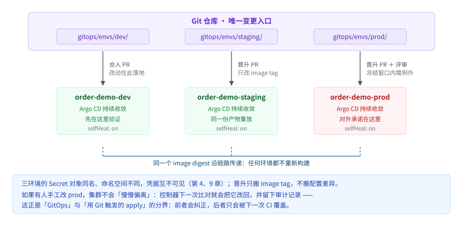

# 第 14 章　GitOps 引擎与多环境晋升

> 位置：主线 · 晋升 ｜ 横切：A 可审计 ｜ 成熟度 L2
>
> **此刻 `order-demo` 长什么样**：三环境 GitOps 晋升。 ｜ **本章可验证动作**：合并 PR 后自动同步；手工改动被纠正。 ｜ 复现：`git checkout ch14-gitops`。

---

## 14.1 问题与反模式：集群和 Git 对不上，真相到底在哪

第 12 章把 CI 的边界钉死在「产出制品、写入 Git 引用」，第 13 章把发布策略与回滚方案写成了可打勾的清单。但这两章都留了一个没回答的问题：**谁、通过什么入口，把 Git 里的声明真的变成集群里的状态？** 如果答案还是「值班同学敲 `kubectl apply`」，那么前面所有关于唯一真相的努力都会在一次应急操作后归零。

**合成案例**（基于多起公开事故的合成，非真实事件）：某天下午 `order-demo` 的 `gateway` 报警，值班同学登上跳板机，用 `kubectl -n order-demo-prod edit deploy gateway` 把副本数从 4 改到 9，服务恢复了。这个改动没有进 Git。第二天上午，另一次例行发布按 Git 里的清单渲染并应用，副本数被悄悄打回 4，流量高峰下再次出现 5xx；复盘会上，两拨人分别拿着「Git 里写的 4」和「昨天明明改成 9 才好的」争执，谁也拿不出「现在集群到底该以哪份为准」的证据。更糟的是，有人为了让 GitOps 仓库「自包含」，把 `order-demo/db-credentials` 的明文密码写进了一份 Secret 清单并提交，密钥从此躺在 Git 历史里，轮换都删不干净 [R-14-1][R-14-4][R-14-12]。

这就是本章要根治的**漂移**（集群实际状态与 Git 声明状态不一致，多由手工变更或控制器副作用产生，正式定义见本章）。可验证形态：`argocd app diff <app>` 非空，或 `kubectl get deploy -o yaml` 与 `kustomize build` 输出 diff 非空。

先把这个案例里最不公平的一点说清：**值班同学那次 `scale` 是正确的处置。**凌晨报警、流量打满、扩容十分钟就把服务救回来了——这在任何一个标准里都是好操作。事故不是由这个动作造成的，而是由「这个动作没有第二个人知道」造成的。这也是本章和前面几章气质不同的地方：前面几章在防「做错」，这一章在防「**做对了，但没留痕**」。

### 14.1.1 一次漂移的完整时间线：把合成案例摊开到 48 小时

上面的合成案例值得逐小时拆开看，因为漂移从来不是「改坏的那一下」单独造成的，而是「改了没留痕」与「次日发布无人知晓」两步叠加的结果。下表按时间线还原（合成案例，时间与数值为示意）：

| 时间 | 动作 | Git 里的声明 | 集群里的实际 | 谁知道 |
|---|---|---|---|---|
| D1 14:00 | `gateway` 5xx 报警，值班接手 | `replicas: 4` | 4 | 所有人 |
| D1 14:10 | 值班同学在跳板机 `kubectl -n order-demo-prod scale deploy gateway --replicas=9` | `replicas: 4`（不变） | 9 | 只有值班同学 |
| D1 14:15 | 服务恢复，报警解除；无 PR、无审计告警 | `replicas: 4` | 9 | 只有值班同学 |
| D1 18:00 | 交接班，口头提了一句「副本数我调过」 | `replicas: 4` | 9 | 值班两人，无书面记录 |
| D2 10:00 | 例行晋升 PR 合并（diff 里只有 image tag 一行） | `replicas: 4`、新 tag | 9 | 评审者无从注意副本数 |
| D2 10:02 | 自动同步把 Git 声明 apply 到集群 | `replicas: 4` | **4（9 被悄悄覆盖）** | 无人察觉 |
| D2 10:40 | 早高峰流量上来，4 副本容量不足，5xx 再现 | — | 4 | 所有人，但没人知道为什么 |

两个关键细节值得指出。其一，D1 那次手工改动之所以能存活过夜，是因为当时该 Application 的 `selfHeal` 还没打开——团队刚迁到 GitOps，只有 push 触发一次同步，这正是 14.2 决策树第二问「控制器是否周期性比对」尚未达标的状态；若自愈已开启，9 会在一个同步周期内被改回 4，容量不足会在 D1 当天复现并被立刻归因，而不是拖到 D2 撞上早高峰变成「无来由的 5xx」。其二，D2 的同步本身「完全正确」：它忠实执行了 Git 里的声明，坏的不是同步，而是 Git 里那份 `replicas: 4` 已经过时，却没有任何机制在合并前提醒评审者「集群里现在不是这个值」。

如果团队在 D2 10:00 合并 PR 之前跑过一次 diff，事故链在第一环就会断掉：

```text
$ argocd app diff order-demo-prod

===== apps/Deployment order-demo-prod/gateway ======
59c59
<   replicas: 9              # live：集群实际状态
---
>   replicas: 4              # target：Git 声明（渲染产物）
```

（以上为命令行形态；Argo CD UI 截图应包含同样三要素：Application 卡片右上角的 **`OutOfSync`** 徽标与「1 Modified」资源计数、Diff 页签的 **LIVE / TARGET 左右分栏**、高亮差异行及其 JSON 路径 `spec.replicas`。留档时把这三样放进复盘文档，胜过任何口头描述。）

把 diff 输出归档进复盘是纪律的一部分：`argocd app diff order-demo-prod > drift-$(date +%Y%m%d).diff`。复盘时它回答了那个原本无解的问题——「现在集群到底该以哪份为准」：以 Git 为准，同时立即评估那次未留痕的 9 是否反映了真实容量需求，若是，补一个改 `replicas` 的 PR 再同步。这就是 14.2「应急止血必须先提交 PR、后同步」的全过程。另注意 14.4 示例里 `ignoreDifferences` 排除了 `/spec/replicas`——那是第 18 章接入 HPA 后的形态；本章时间线的项目尚未接 HPA，副本数由 Git 持有，手工改 9 属于漂移而非合法副作用。14.5 的 `hack/drift-check.sh` 把这条链路固化成可重复执行的演练 [R-14-2][R-14-9][R-14-12]。

**复盘会上的那二十分钟**（依同类事故共性还原，非原话）：

> **值班**：我昨天下午把副本改成 9 才好的，今天早上又崩了，是不是有人改回去了？
> **发布者**：我只动了镜像 tag，diff 里就一行。
> **值班**：那副本怎么就变回 4 了？
> **发布者**：Git 里本来就是 4。
> **值班**：可我昨天明明改过。
> **发布者**：改哪儿了？
> （沉默）
> **主持人**：先别争了，谁能给我看一眼现在的 diff？

最后这句才是技术问题，前面全是信息对不齐带来的消耗。请注意这段对话里**没有人说错话**：值班确实改过，发布者确实只动了 tag，Git 里确实写的是 4。三条都真，三条无法拼接成一个解释——**因为缺的不是任何一个人的记忆，而是一个所有人共用的坐标系。**那个坐标系就是 diff。

三个高频反模式：

**反模式一：GitOps 控制器与手工 `kubectl edit` 并存。** 现象是同一个字段被改来改去、故障复盘时无法指认真相源；根因不是工具没装好，而是**团队同时保留了两个写入口**。只要生产 kubeconfig 还能写，Git 就只是「其中一份意见」。替代做法是收回人的集群写权限（RBAC 与审计见第 26 章），把 PR 设为唯一变更入口，并让控制器把任何偏离自动改回 [R-14-1][R-14-4]。

这一条最容易被误解成「工具问题」，于是解法变成了「再装一个更强的 GitOps 控制器」。但**再强的控制器也管不了一条 `kubectl edit`**——它只能在事后把改动改回去，而改回去这件事本身，在真正的容量危机里就是二次事故。所以这条的解法不在工具里，在权限里：**能不能写，比能不能同步重要得多。**

**反模式二：把密钥直接提交进 GitOps 仓库。** 现象是明文凭据进入 Git 历史、镜像层或 CI 日志；根因是把「Git 是唯一真相」误读成「所有东西都必须进 Git」。替代做法是与第 9 章保持同一套方案：`External Secrets Operator` 从后端注入，Git 里只放「去哪里取」的引用，不放值；SOPS 3.x 与 Sealed Secrets 0.x 只在选型矩阵里作对比 [R-14-7][R-14-8]。

**反模式三：开了自愈却没设排除项与冻结窗口。** 现象是紧急扩容被控制器立刻改回去、HPA 改的 `replicas` 与 Git 里的值永远打架；根因是把「持续收敛」当成了不区分来源的强制覆盖。替代做法是给合法的控制器副作用定义自愈白名单（`ignoreDifferences`），并给应急场景定义一个**有有效期、有责任人、必须 revert** 的冻结窗口，而不是让人去 `kubectl edit` Application [R-14-9][R-14-10]。

以上反模式的**方法论**参照公开的手工变更事故复盘 [R-14-12]；配置漂移的判定口径见 14.2 的三要素；该来源只支撑「这类失效模式确实存在」，不证明合成案例真实发生。

### 14.1.2 GitOps 反模式负面清单：五种「装了引擎但不是 GitOps」的形态

上面三条反模式之外，落地评审中还反复出现一批更隐蔽的形态——它们都有 Git 仓库、都装了引擎、UI 也能打开，但 14.2 三要素至少缺一个。负面清单比正面范式更实用：逐条对照，命中任何一条就先修复，再谈多环境晋升。下表合成自多起团队迁移 GitOps 的常见卡点（形态为合成归纳，方法论支撑同 [R-14-12]）：

| # | 反模式 | 典型现象 | 坏在哪 | 替代做法 |
|---|---|---|---|---|
| 1 | Git 里只存源码不存声明 | 仓库只有 `deploy/` 模板与 CI 配置，集群状态由 CI 在 push 时推一次 `kubectl apply` | 缺「控制器持续收敛」：CI 挂了、漏触发或分支推错环境，Git 与集群从此分叉且无人察觉；这正是 14.2 决策树第二问不通过的形态 | 补齐引擎接入（14.3 最小接入 diff）；补齐前明确口径：这只是「Git 触发的部署」，不冒称 GitOps [R-14-1] |
| 2 | 渲染产物与源混存同一目录 | `kustomization.yaml` 与渲染出的 `all.yaml` 放在同一目录，Application 的 `path` 指向这里 | 引擎把 Kustomize 定义文件也当清单加载，apply 直接报错，或同一资源出现两份来源导致 diff 永远对不上 | 渲染产物独立目录（`gitops/rendered/<env>/`），`path` 只指产物目录（14.4） |
| 3 | 手工 `argocd app sync` 常态化 | 自动同步明明开着，但「怕出事」的习惯性手动点 Sync，甚至加 `--force` 或 `--prune=false` | 同步语义被悄悄改掉：`--force` 会用 target 强制覆盖集群字段，`--prune=false` 会让 Git 里已删除的资源永久滞留集群——两者都在绕过漂移检测的既定语义 | 删掉手动习惯；异常时先 `argocd app diff` 归因，确需干预走 14.5 路径 C 的带有效期冻结窗口 |
| 4 | `automated` 常年关闭，GitOps 退化成「好看的部署按钮」 | 每个 Application 的 `automated` 为空，发布靠人在 UI 点按钮，鼠标点完还要盯着日志 | 缺持续收敛与漂移纠正，14.2 判据第二、三条全部不达标；按钮形态只是把 `kubectl apply` 换了个界面 | 打开 `automated + selfHeal`；「不敢自动同步」的顾虑应当转成第 13 章的发布策略问题与第 15 章的灰度问题，而不是靠人盯着 |
| 5 | 一个 Application 指向仓库根目录 | `path: .`，任何目录任何人的改动都触发这个应用的全量同步 | 无法按环境切片评审与授权：diff 噪音淹没晋升变更，权限也只能整体放开或整体收紧 | 按环境分目录 + ApplicationSet 按目录生成（14.4.1）；Application 边界同时是权限边界，见 14.4.3 |

五条里第 3 条最容易被忽视：它通常**不产生漂移**——手动 sync 的内容与 Git 一致——却让漂移治理失明，因为团队习惯了「sync 是个可以随手操作的按钮」，14.5 回滚路径 A 里「合并即同步」的前提随之失效。第 5 条在第 26 章多租户语境下会再出现一次：Application 的边界决定权限的粒度，边界画得越粗，误授权的爆炸半径越大。

这张清单的用法是**季度自检**而非一次性的迁移验收：每季度对照五条逐项打勾（第 2 条用目录结构可机器检查，第 1、4 条查 Application 定义，第 3 条查同步历史中手动 sync 的占比，第 5 条查 Application 的 path 值）。任何一条复发都说明流程在某个环节被「为了快」悄悄放宽了——漂移治理的退化几乎从不发生在大事故之后，而发生在一次又一次「这次特殊」的小便利里。自检记录按第 26 章审计要求留档。

**写错到底长什么样**。第 4 条最容易在评审里过关，因为那份 Application 看上去**是开着的**：

```diff
 spec:
   syncPolicy:
-    automated: {}
+    automated:
+      prune: true
+      selfHeal: true
```

后果：`automated: {}` 表示「Git 变了就同步」——但没有 `selfHeal`，集群里被 `kubectl edit` 改掉的东西既不会被发现、也不会被告警、更不会被改回来。它照样绿、照样有 UI、照样能满足「仓库里有声明」这一关，唯一缺的正是「控制器持续比对并纠正」。按 14.2 的定义，这不算 GitOps，只是「用 Git 触发的 apply」——而 14.1 那场事故的全部前提，就是一次手工改动能安静地活过一整夜。

判据有两条，一静一动：查定义，`kubectl -n argocd get application <name> -o jsonpath='{..syncPolicy.automated}'` 必须同时看到 `prune` 与 `selfHeal` 为 `true`；验行为，手工把一个 Deployment 的副本数改掉，**五分钟内它应当自己变回去**，且 `argocd app history` 里能查到这次 SelfHeal。只做前一条的团队里，通常有一半的 Application 通不过第二条。

> 边界声明：本章解决**变更怎么进集群**，是底座；第 15 章解决**流量怎么灰度**。因果不倒置。本章提到「渐进式交付」时只作边界标注：先给一小部分流量、指标没问题再继续（白话，详见第 15 章），不拿它当推理前提。

---

## 14.2 范式与决策树：GitOps 的正式定义

本章是 **GitOps 的正式定义章**。给一个可测量、可验证、不是同义反复的定义：

> **GitOps = Git 中声明期望状态 + 控制器持续比对并收敛 + 对偏离做纠正（漂移纠正）；Git 是唯一变更入口。三要素缺一不可，尤其「缺持续收敛不算 GitOps」。**

这个定义值得先做一次压力测试：**如果你装了 Argo CD，但 `selfHeal` 没开，你算不算 GitOps？**按定义不算——那只是「用 Git 触发的 apply」。这个区分不是学术洁癖，它决定了 14.1 那起事故会不会发生：**没有持续收敛的系统里，一次手工改动能安静地活过一整夜。**

三个要素各自对应一条能用命令证伪的判据：

| 要素 | 可验证判据 | 反例（不算 GitOps） |
|---|---|---|
| Git 声明期望状态（声明式、版本化、不可变） | 每次变更对应一个 commit；清单或渲染产物可 `git show` 复现 | 只把 YAML 放进 Git，实际靠人 `kubectl apply` |
| **控制器持续收敛** | 关掉 Webhook 后，控制器仍周期性比对；`argocd app get` 显示周期性 `Reconcile` | CI 在 push 时推一次 `kubectl apply`；或只靠手动 `argocd app sync`，没有周期性比对 [R-14-2] |
| **漂移纠正** | 手工改副本数后，在同步周期内被改回，或至少被标记 `OutOfSync` 并阻断 | 只发一条告警、集群状态保持被改坏的样子 |
| Git 为唯一变更入口 | 生产无 `kubectl edit` / `set image` 审计记录；应急改动也有对应 PR | 保留「先手工止血、后补 Git」的灰色通道 |

OpenGitOps 四原则（声明式、版本化且不可变、自动拉取、持续收敛）与上式一致 [R-14-1]；本书额外单列「漂移纠正」，因为它是 H7 的解药。声明式对象管理与 Server-Side Apply 是地基：控制器是反复把实际状态收敛到声明状态 [R-14-4]。

**决策树**——用来判断一个团队「到底有没有上 GitOps」，而不是「装没装 Argo CD」：

```
这次生产变更，Git 里是否有一个对应的 commit？      否 → 不是 GitOps，回到 14.5 应急流程
        │ 是
控制器是否周期性比对 Git 与集群（非仅 Webhook 触发一次）？
                                                  否 → 只是「Git 触发的部署」，不算 GitOps
        │ 是
有人在 prod 手工改一个字段，是否会被纠正或标记 OutOfSync？
                                                  否 → 缺漂移纠正，H7 风险仍在
        │ 是
PR 里能否直接 diff 出「最终提交给集群的那份清单」？
                                                  否 → 选 14.3 的仓库内渲染模式
        │ 是
→ GitOps 成立。此时方可进入第 15 章讨论流量怎么灰度
```

> **本书观点（本章第 4 条结论，不需要外部背书）**
>
> **主张**：生产变更只允许走 Git（PR 即变更）；应急止血必须走「先提交 PR、后同步」，而不是 `kubectl edit`。这是本书不可协商项，不是一条可权衡的建议。
>
> **论证**：可回滚、可审计、可复现三件事，都建立在「任意时刻的状态能由某个 commit 精确重建」之上。一次手工 `edit` 会在不产生 commit 的情况下改变集群，于是此后任何一次发布、回滚、复盘都失去了确定的基线：你不知道这次 diff 是「业务变更」还是「有人上周手动改过」。有人会说「应急时走 PR 太慢」——但真正慢的是复盘时找不回那个值、以及下一次发布把它悄悄覆盖掉。把应急路径也收进 PR，慢的只是多一次提交与自动同步的几十秒，换回的是真相源唯一；而速度问题应当用「预授权的应急 PR 模板 + 自动同步」解决，不是用绕过 Git 解决。PR 即变更还顺带把审批、审计、回滚（`git revert`）统一到了同一套机制里 [R-14-11]。
>
> **反例与适用前提**：这不等于「任何紧急操作都不允许临时放开自动同步」。集群整体不可用、Git 仓库本身不可访问时，允许按第 23 章的 runbook 走带外处置，但必须写明例外前提（Git 不可用）、补偿措施（恢复后第一个动作是把带外改动落成一个等价 PR 并核对 `app diff` 为空）、例外有效期（以小时计，窗口结束必须 revert 临时放开的同步策略）。常态下任何「先改集群、后补 Git」都是被禁止的。跳过此步的典型代价就是 14.1 合成案例；权限收紧的具体做法见第 26 章。

> **本书观点（本章第 3 条结论的延伸，不需要外部背书）**
>
> **主张**：自愈必须配白名单与冻结窗口，否则「持续收敛」会与合法的控制器副作用、以及紧急止血互相打架。
>
> **论证**：收敛的目标是「Git 声明的期望状态」，但集群里有些字段本就不该由 Git 持有——HPA 管理的 `replicas`、云控制器写的 `node` 字段、Server-Side Apply 的托管标记。若对这些字段也做强制自愈，控制器之间会无限互相覆盖。因此白名单（`spec.ignoreDifferences`）不是给手工变更开后门，而是划清「谁拥有这个字段」。冻结窗口同理：它必须是一个**带有效期、带责任人、以 PR 形式存在、到期自动 revert** 的临时状态，而不是某人在集群里把 `selfHeal` 一关了之。
>
> **反例与适用前提**：白名单不宜过宽，把整个 `Deployment.spec` 都排除掉等于关掉漂移检测；只应列出确有合法所有者的具体 JSONPath。前提是有审计能记录谁在何时放开了窗口（见第 26 章），否则冻结窗口会退化成永久的手工通道。

### 14.2.1 字段所有权判据表：哪些漂移该自愈，哪些必须让路

「自愈必须配白名单」落到具体字段，需要一张可判定的所有权表。判据只有一条：**这个字段的合法写入者是谁？** Git、某个控制器、还是人？一个字段在同一时刻只能有一个所有者——两个写入者会以同步周期为节拍无限互相覆盖，表现就是「副本数震荡」「字段每分钟被改一次」这类诡异故障。逐字段判定：

| 字段 | 合法所有者 | 是否 `ignoreDifferences` | 不排除的后果 | 排除了的误用后果 |
|---|---|---|---|---|
| `.status.*` | 各资源的控制器 | 不需要（Argo CD 默认忽略 status） | — | 配了也属冗余，徒增维护面 |
| `metadata.annotations` 的 `deployment.kubernetes.io/revision` | Deployment 控制器（滚动历史标记） | 建议排除 | 每次滚动后该字段变化，Application 常驻 `OutOfSync`，噪音淹没真漂移 | 无实质风险，属合理排除 [R-14-2] |
| `/spec/replicas`（**已接 HPA**，见第 18 章） | HPA | **必须排除** | Git 与 HPA 每个同步周期互相改写，副本数在两值间震荡 | 无风险；但**未接 HPA 的环境排除它 = 手工扩容被永久合法化**，14.1 时间线的 9 副本将不再是漂移而是「合法状态」 |
| `/spec/template/spec/containers[].image` | Git（唯一） | **禁止排除** | — | CI 或个人可绕过 Git 换镜像，「build once + SHA 标签」链路（公理 1、2）从根上断掉 |
| 整个 `/spec/template` | Git | **禁止排除** | — | 等于对该工作负载关闭漂移检测，H7 整条口子重新打开 |

第二行是最常见的「假漂移噪音」来源——它不危险，但足以让团队对 `OutOfSync` 徽标麻木，从而错过真正的漂移；第三行与第五行分别对应「必须让路」与「绝不能让路」两个极端。第 18 章给 `order-demo` 接入 HPA 时，将按本表把 `/spec/replicas` 从「Git 持有」改为「HPA 持有 + 排除」，改动本身也要走 PR。

白名单的第三种误用最隐蔽：**用 `ignoreDifferences` 掩盖长期无法收敛的配置**。典型过程：某环境的渲染产物与集群实际持续不一致，修复需要动 overlay 结构，团队嫌麻烦，索性把差异字段加进白名单让界面变绿——从此这个字段既不受 Git 管、也不受自愈管，成为三不管地带，而 UI 上一切「Synced」的绿灯暗示一切正常。判别方法很简单：**白名单的每一条都必须能回答「谁拥有这个字段、为什么」，回答不出来就是掩盖**。配套纪律是把白名单本身纳入评审：改动 `ignoreDifferences` 的 PR 必须在描述里写明字段路径与所有者归属，CI 对白名单条目数设置告警阈值（超过 5 条须在 PR 里逐条说明）；这与 14.6 的 CL-14-03「白名单只含确有合法所有者的字段」一一对应。当前 `order-demo` 三个环境的白名单都只有 `/spec/replicas` 一条，且第 18 章接入 HPA 前该条目实际不生效——副本数由 Git 持有，手工改动一律按漂移纠正 [R-14-2][R-14-9]。

`ignoreDifferences` 之外还有一个更精细的所有权机制值得知道：Server-Side Apply 的 `managedFields`（见第 2 章控制循环与第 3 章声明式地基 [R-14-4]）。Kubernetes 原生记录了「每个字段最后被哪个 manager 写过」，Argo CD 在比对时利用它把「别人管理的字段」从 diff 中分离。它与白名单的关系是互补而非替代：`managedFields` 回答「现在谁在写」，白名单回答「我们决定让谁拥有」——前者是事实，后者是决策。实践中仍建议把关键决策显式写进 `ignoreDifferences`，因为 `managedFields` 会随 manager 变化而漂移（换一个部署工具，所有权记录就换了主），而白名单是 Git 里可评审、可审计的显式声明。

---

## 14.3 工具选型：Argo CD 3.x 是唯一示例实现

按本书选型基线与配置契约，**Argo CD 3.x 为 GitOps 引擎的唯一示例实现，Flux 2.x 仅在选型矩阵作对比** [R-14-3]；配置打包以 Kustomize 5.x overlay 为多环境基线、Helm 4.x 为对外分发 Chart；密钥注入以 `External Secrets Operator` 为唯一实现，后端占位 `vault`。下表每列都含「何时不该用」。

| 维度 | Argo CD 3.x（示例实现） | Flux 2.x（仅对比） |
|---|---|---|
| 架构 | 中心化控制器 + Application/ApplicationSet CRD，自带 UI 与 `app diff` | 一组职责分离的控制器（source / kustomize / helm / notification），无中心 UI |
| 渲染模式 | 内置 Kustomize / Helm 插件，也可消费已渲染好的清单目录 | 以 Kustomization / HelmRelease 资源声明，天然集群内渲染 |
| 多集群 / 多环境 | ApplicationSet 生成器一次生成 dev / staging / prod | 通过多个 Kustomization 与租户隔离组织 |
| 密钥方案 | 本身不解密，交给 ESO / SOPS / Sealed Secrets 外部方案 | 内置 `sops` 解密支持较顺手 |
| 漂移与自愈 | `automated.selfHeal` + `app diff` + `ignoreDifferences` | 持续 reconcile + `flux diff` |
| 升级与回滚 | 升级走 Helm/清单 PR；回滚 `argocd app rollback` 或 `git revert` | 升级走控制器版本；回滚 `flux reconcile` + `git revert` |
| **何时不该用** | 只需要「CI 推一次清单」、不打算交出集群写权限时；团队不接受引入 Application CRD 时 | 已选定 Argo CD 3.x 作全书唯一示例时（单一示例实现，避免两章各选一套） |

**rendered manifests 的两种渲染模式**（与第 10 章的渲染产物衔接）：

| 模式 | Git 里存什么 | PR 里 diff 的是什么 | 优点 | 何时不该用 |
|---|---|---|---|---|
| **仓库内渲染**（本章示例实现） | `gitops/rendered/<env>/` 下已 `kustomize build` / `helm template` 完的完整清单 | 最终提交给集群的那份清单本身 | review 所见即所得；渲染工具版本差异不会在同步时发作；可离线校验 | 环境极多、渲染产物巨大导致仓库膨胀时 |
| 集群内渲染 | `deploy/overlays/<env>` 模板与 values | 模板 / values 的改动 | Git 干净，只有源 | 需要「在 PR 里确认最终清单」时；渲染插件版本漂移会让同一 PR 在不同时刻同步出不同结果时 |

判据只有一条：**评审者能不能在合并前看到「真正会被 apply 的字节」**。能，两种都可用；不能，就必须选仓库内渲染。卡片把「渲染产物可 review」列为专有检查项（CL-14-02），正是这条判据的落地 [R-14-5][R-14-6]。

这条判据在环境数增长后会遇到什么？下表给一个量级对照（基准：14.4 渲染产物实测约 150 行 / 6 KB 每环境；估算口径为每环境每周 1 次环境内变更、每月 1 次全量基础变更；数字为量级示意，随应用复杂度浮动，非承诺值）：

| 环境数 | 模式 | 清单部分的仓库体积（快照） | 单次环境内晋升 PR 的 diff | 单次全量基础变更 PR 的 diff | 评审体验 | 成本拐点 |
|---|---|---|---|---|---|---|
| 10 | 仓库内渲染 | 约 60 KB | 数行（仅 image tag） | 约几十行 | 所见即所得，10 分钟内读完 | 无 |
| 10 | 集群内渲染 | 约 20 KB（base + overlay） | 数行（模板改动） | 数行 | 需本地 `kustomize build` 脑内验证 | 渲染插件版本漂移 [R-14-6] |
| 30 | 仓库内渲染 | 约 180 KB | 数行 | 数百行 | 建议按环境分目录 + CODEOWNERS 分片评审 | 全量基础变更开始产生评审噪音 |
| 30 | 集群内渲染 | 约 30 KB | 数行 | 数行 | 与 10 环境体感相同 | 同上 |
| 100 | 仓库内渲染 | 约 600 KB 快照；git 历史年增数十 MB | 数行 | 上千行 | 人工逐行评审不可行，必须靠工具过滤 | 全量基础变更的评审是硬瓶颈 |
| 100 | 集群内渲染 | 约 40 KB + 每环境 values 数十行 | 数行 | 数行 | 仓库最轻，但「真正会被 apply 的字节」不可见 | 评审的不是最终产物，判据失守 |

三点解读。第一，仓库内渲染的体积增长是**线性且可接受的**——600 KB 的清单快照对任何 Git 服务器都不是负担，真正的瓶颈是**全量基础变更时 PR diff 的行数随环境数线性放大**：评审者扫到第 40 个环境的重复片段后就会开始「扫一眼就批」，评审名存实亡。第二，集群内渲染的仓库体积几乎不随环境数变化、PR diff 恒为数行，但这恰恰意味着评审者看到的从来不是最终产物；环境越多、各处渲染插件版本分叉越久，同一份模板在不同时刻渲染出不同结果的风险越大 [R-14-5][R-14-6]。第三，环境数超过 30 后，仓库内渲染必须配套三个手段才能守住评审质量：① 渲染产物按环境分目录，PR 按环境切片，禁止一个 PR 同时动多个环境；② CI 对渲染 diff 做语义过滤——晋升 PR 只允许 image tag 行变化，其余行变化必须拆成独立的基础变更 PR 单独评审；③ 每次基础变更后跑一次全环境 `kustomize build` 快照归档，保证任意 commit 可离线复现全部产物。

> **本书观点（不需要外部背书）**：30 个环境左右是评审体验的实际拐点，而不是仓库体积——仓库体积线性增长从不致命，评审注意力被线性稀释才致命。适用前提：单环境渲染产物在 150 行量级；若单环境产物上千行（如带完整 CRD 与中间件清单），拐点会提前到 10 个环境以内，此时应先做清单瘦身（拆分 Application、合并重复资源），而不是简单换成集群内渲染——那会把问题从「评审太吵」变成「评审失明」。

**密钥方案对照**（须与第 9 章选定方案逐字一致）：

| 方案（主版本） | 值是否入 Git | 依赖 | 轮换方式 | 何时不该用 |
|---|---|---|---|---|
| `External Secrets Operator` + 后端 `vault`（**唯一实现**） | 否，Git 只有 `ExternalSecret` 引用 | 集群内 ESO 控制器 + 后端 | 后端轮换，Pod 重启或同步后生效 | 没有可用的外部密钥后端时 |
| SOPS 3.x（对比） | 密文入 Git，明文永不入 | CI/控制器有解密密钥 | 重新加密并提交 | 解密密钥的分发与回收没管好时；团队协作门槛高 |
| Sealed Secrets 0.x（对比） | 密文入 Git | 集群内控制器持有私钥 | 重新 seal 并提交 | 需要跨集群复用同一份密文时；集群灾备后私钥丢失即无法解密 |

**晋升链路表**（PR 类型 / 审批 / diff 范围 / 同步策略 / 回滚方式）：

| PR 类型 | 审批 | diff 范围 | 同步策略 | 回滚方式 |
|---|---|---|---|---|
| dev 新 SHA | 1 人 | `gitops/rendered/dev/` | 自动同步 + 自愈 | `git revert` |
| dev → staging 晋升 | 1 人 + CI 绿 | `gitops/rendered/staging/` 仅 image tag | 自动同步 + 自愈 | `git revert` |
| staging → prod 晋升 | 2 人（CODEOWNERS）+ 第 13 章回滚方案已附 | `gitops/rendered/prod/` 仅 image tag | 自动同步 + 自愈；审批发生在 Git 侧 | `git revert <PR>`，或临时 `argocd app rollback` 后补 PR |
| 应急止血 | 预授权模板，事后补审 | 单个字段 | 先 PR 后同步；必要时带有效期的冻结窗口 | 窗口结束必须 revert |

**最小接入 diff** 与升级 / 回滚路径：

```diff
+ gitops/applicationset.yaml       # ApplicationSet 一次生成三环境 Application
+ gitops/appproject.yaml           # AppProject 限定可写命名空间与资源白名单
+ gitops/rendered/{dev,staging,prod}/all.yaml   # 仓库内渲染产物，PR 中可 diff
+ gitops/secrets/externalsecret.yaml            # 只放引用，不放值
+ hack/render.sh                   # 生成渲染产物
+ hack/drift-check.sh              # 漂移演练
+ docs/adr/0001-gitops-engine.md   # 引擎与密钥方案 ADR
~ deploy/overlays/*/kustomization.yaml          # managed-by: kustomize → argocd（第 14 章起）
```

升级 Argo CD 3.x 走独立 PR，先升 staging 观察一个同步周期再升 prod；回滚是 `git revert` 并重新 `argocd app sync`。逐级晋升也可用 Kargo 1.x 的 `Stage` / `PromotionTask` 表达，但它不是登记的唯一示例实现，本章只列为可选项、不展开。工具小版本锁附录 A。

### 14.3.1 一次 staging → prod 晋升的完整闭环：生成、守卫、审批与失败重试

晋升链路表给出了规则，这一小节给一次完整执行：从 staging 验证通过，到 prod PR 生成、机器守卫、人工审批，再到同步失败后的重新晋升。四个环节缺一个，晋升就从「流程」退化成「仪式」。

**第一步：staging 达标后生成晋升 PR。** 复用 14.4 的 `hack/render.sh`，把 staging 当前验证过的那个 SHA **原样**渲染到 prod 目录——同一个 SHA、只换目录不换镜像（公理 1）：

```bash
# 前提：order-demo-staging 为 Synced + Healthy，且 verify.sh 通过
argocd app get order-demo-staging | grep -E 'Status|Health'
# 通过标准：Status: Synced；Health: Healthy——不达标禁止生成 prod PR

./hack/render.sh prod 1a2b3c4
git diff -- gitops/rendered/prod/all.yaml
# 通过标准：diff 只含 image tag 一行（以及本 PR 明确要做的基础变更），无 latest
git checkout -b promote/prod-1a2b3c4
git add gitops/rendered/prod/all.yaml
git commit -m "promote(order-demo): staging -> prod, git-1a2b3c4"
```

注意晋升 PR 的描述里必须写两样东西：本次带到 prod 的 SHA 与对应的 staging 验证结论（时间、验证人、`verify.sh` 输出摘要），以及**回滚方案**（`git revert <本 PR merge commit>` + 14.5 的验证步骤）——这是公理 6「回滚方案先行」在晋升链路的落点，也是 14.6 CL-G-07 的检查对象。

**第二步：CODEOWNERS 让「谁能批哪个环境」成为仓库配置而非口头约定。**

```text
# .github/CODEOWNERS（Git 服务需开启 code owner 审批强制）
/gitops/rendered/dev/        @order-demo/platform
/gitops/rendered/staging/    @order-demo/platform
/gitops/rendered/prod/       @order-demo/platform @order-demo-oncall-leads
/gitops/applicationset.yaml  @order-demo/platform
/gitops/appproject.yaml      @order-demo/platform
/gitops/secrets/             @order-demo/platform @order-demo-security
```

prod 目录要求两组会签，对应晋升链路表「2 人（CODEOWNERS）」一行；ApplicationSet 与 AppProject 属「改变边界本身」的文件，只允许平台组审批——业务团队即使要新增环境，也必须经平台组评审，因为这两个文件同时是 14.4.3 权限边界的载体。

**第三步：CI 环境守卫。** 人眼守不住的规则交给机器。三项自动检查：晋升 PR 的渲染产物 diff 只允许 image tag 行变化、staging 当前健康且为同一 SHA、PR 描述已附回滚方案。Runner 需预装 `argocd` CLI 并具备只读 API 凭据（示例占位）：

```yaml
# .github/workflows/promotion-guard.yaml（完整工作流，CI 配置非 K8s 清单）
name: promotion-guard
on: pull_request
jobs:
  guard:
    runs-on: ubuntu-latest
    steps:
      - uses: actions/checkout@v4
        with: { fetch-depth: 0 }
      - name: 晋升 PR 只允许 image tag 行变化
        run: |
          BASE="${{ github.event.pull_request.base.sha }}"
          HEAD="${{ github.sha }}"
          for f in $(git diff --name-only "$BASE" "$HEAD" -- gitops/rendered/); do
            NON_TAG="$(git diff "$BASE" "$HEAD" -- "$f" | grep -E '^[+-][^+-]' | \
              grep -vE '^[+-]\s*image:.*:git-[0-9a-f]{7}' || true)"
            [ -z "$NON_TAG" ] || { echo "::error::$f 含非 image-tag 变更，须拆成独立基础变更 PR"; exit 1; }
          done
      - name: prod 晋升前提——staging 当前即为 Synced/Healthy
        run: |
          STATE="$(argocd app get order-demo-staging -o json | \
            python3 -c 'import sys,json;d=json.load(sys.stdin);print(d["status"]["sync"]["status"],d["status"]["health"]["status"])')"
          [ "$STATE" = "Synced Healthy" ] || { echo "staging 未达标: $STATE"; exit 1; }
      - name: prod PR 描述必须已附回滚方案（公理 6）
        env:
          PR_BODY: ${{ github.event.pull_request.body }}
        run: echo "$PR_BODY" | grep -q 'git revert' || { echo "PR 描述缺少回滚方案"; exit 1; }
```

通过标准：三项检查全绿，PR 才允许请求 prod CODEOWNERS 审批；任何一项红，PR 在进入人工评审前就被拦下。这个守卫正是 14.3 对照表里「30 个环境后评审噪音」问题的机器防线——评审者不再需要在几百行 diff 里找那一行 image tag。

**第四步：失败后的重新晋升。** prod PR 合并后同步失败，先归因再动手，按错误类型二选一，**不存在第三种「直接在集群上改一下」**：

| 失败现象 | 归因 | 处置 | 为什么不是回滚 |
|---|---|---|---|
| `ComparisonError` 或镜像拉取失败（tag 打错、镜像未推送成功） | 制品侧错误 | 修复镜像推送后，**用同一个 SHA 重新渲染、提交一个新 PR** 重走全流程 | 错误声明从未成功 apply 进集群，Git 无需回退 |
| 渲染产物与集群差异巨大、sync 长时间卡在 `Progressing`、Healthy 超时 | 声明侧错误 | `git revert` 该晋升 PR（14.5 路径 A）恢复已知良好，修复后重新走全流程 | 错误声明已 apply，必须先把 Git 拉回已知良好版本再谈修复 |
| 修复期间线上持续受损 | 紧急程度超过修复周期 | 先按 14.5 路径 B `argocd app rollback` 止血，**随后立即补等价 PR**，再走重新晋升 | 止血只买时间，不解决 Git 与集群的分歧 |

两条处置的共同点是：重新晋升的仍然是**同一个 SHA**——失败不触发重新构建，镜像早在第 12 章 CI 就已产出且不可变，「build once, promote」在异常路径上同样成立。CI 守卫会在新 PR 上原样执行全部检查，不会因为「上次已经批过」而放行。若失败根因是渲染工具版本变更导致产物突变，先在 dev 复现并锁定工具版本（附录 A），再重试晋升 [R-14-2][R-14-5][R-14-11]。

**何时不该照搬这套闭环。** 四步闭环的每一步都有成本（CODEOWNERS 维护、守卫脚本维护、双组会签的等待时间），适用前提要写清楚。其一，团队规模：3 人以下、只有 dev 与 prod 两套环境的小团队，双组会签会退化成「两个人互相批对方的 PR」，此时 prod 审批放宽到「1 人 + CI 守卫全绿」即可，但渲染产物可 diff 与回滚方案先行两条不可放宽——它们是底线而非流程税。其二，环境数量：单环境项目没有「晋升」可言，14.3.1 只保留守卫与回滚两项。其三，变更频率：若每天几十次 dev 晋升，每次都人工批会反向催生「扫一眼就批」，此时 dev 层的审批应降级为「CI 绿即自动合并」（分支保护 + 自动 merge），把人的注意力集中到 staging 与 prod 两级——审批带宽是稀缺资源，要花在爆炸半径大的那一级上。反过来，有一条例外绝不允许：**任何规模、任何频率下，prod 晋升 PR 的回滚方案检查都不能省**，因为省掉它的代价是公理 6 落空 [R-14-11]。

---

## 14.4 落地配置（完整可应用文件，Kubernetes 1.32+ / Argo CD 3.x）

> 全部字段沿用配置契约：命名空间 `order-demo-dev` / `order-demo-staging` / `order-demo-prod`、镜像 `registry.example.com/order-demo/gateway:git-<sha7>`、Service 名 `gateway` 端口 8080、公共标签 `app.kubernetes.io/name=order-demo` / `app.kubernetes.io/component=gateway` / `version=git-<sha7>` / **`app.kubernetes.io/managed-by=argocd`（第 14 章起由 `kustomize` 改为 `argocd`）**、ConfigMap `order-demo-config`（`immutable: true`）、Secret 键名 `order-demo/db-credentials` 由 ESO 注入且不入 Git。示例 SHA `git-1a2b3c4`。`repoURL` 与 `server` 为示例占位地址，非引用来源链接。



**`gitops/appproject.yaml`** —— 先划边界：只允许写三个命名空间，禁止集群级资源。

```yaml
apiVersion: argoproj.io/v1alpha1
kind: AppProject
metadata:
  name: order-demo
  namespace: argocd
spec:
  description: "order-demo 三环境晋升边界"
  sourceRepos:
    - "https://git.example.com/order-demo/gitops.git"
  destinations:
    - server: "https://kubernetes.default.svc"
      namespace: order-demo-dev
    - server: "https://kubernetes.default.svc"
      namespace: order-demo-staging
    - server: "https://kubernetes.default.svc"
      namespace: order-demo-prod
  clusterResourceWhitelist: []
  namespaceResourceBlacklist:
    - group: ""
      kind: ResourceQuota
    - group: ""
      kind: LimitRange
  roles:
    - name: promoter
      description: "只允许同步，不允许改 Application 定义"
      policies:
        - "p, proj:order-demo:promoter, applications, sync, order-demo/*, allow"
      groups:
        - "order-demo-promoters"
```

**`gitops/applicationset.yaml`** —— ApplicationSet 一次生成 dev / staging / prod 三个 Application。`automated` 即持续收敛，`selfHeal` 即漂移纠正，两者是 14.2 定义里「缺一不可」的那两行 [R-14-2]。

```yaml
apiVersion: argoproj.io/v1alpha1
kind: ApplicationSet
metadata:
  name: order-demo
  namespace: argocd
  labels:
    app.kubernetes.io/name: order-demo
    app.kubernetes.io/managed-by: argocd
spec:
  generators:
    - list:
        elements:
          - env: dev
            namespace: order-demo-dev
          - env: staging
            namespace: order-demo-staging
          - env: prod
            namespace: order-demo-prod
  template:
    metadata:
      name: "order-demo-{{env}}"
      labels:
        app.kubernetes.io/name: order-demo
        app.kubernetes.io/managed-by: argocd
    spec:
      project: order-demo
      source:
        repoURL: "https://git.example.com/order-demo/gitops.git"
        targetRevision: main
        path: "gitops/rendered/{{env}}"
        directory:
          recurse: false
      destination:
        server: "https://kubernetes.default.svc"
        namespace: "{{namespace}}"
      syncPolicy:
        automated:
          prune: true
          selfHeal: true
          allowEmpty: false
        syncOptions:
          - CreateNamespace=false
          - PruneLast=true
          - ApplyOutOfSyncOnly=true
        retry:
          limit: 5
          backoff:
            duration: 5s
            factor: 2
            maxDuration: 3m
      ignoreDifferences:
        - group: apps
          kind: Deployment
          jsonPointers:
            - /spec/replicas
      revisionHistoryLimit: 10
```

> `ignoreDifferences` 只排除了 `/spec/replicas`：该字段由第 18 章的 HPA 拥有，Git 不应与之争夺所有权；这是 14.2「自愈白名单」的具体形态，不是给手工变更留后门。`selfHeal: true` 保证其余任何字段被手工改动后，都会在一个同步周期内被改回 [R-14-2]。

### 14.4.1 ApplicationSet 进阶：Git 生成器、Matrix 生成器与多集群注册

上面示例用的 List 生成器适合「一个集群 + 固定三个环境」的起点；环境开始按目录增删、或像第 30 章那样扩到双集群时，就该换生成器了。选型一句话：**环境清单想在 Git 里维护 → Git 生成器；要与集群清单交叉出「每环境 × 每集群」→ Matrix 生成器** [R-14-2]。

**Git 生成器（directories 模式）**——环境数量由仓库目录决定，新增环境 = 新增一个目录 + 一个 PR，不改 ApplicationSet 本身：

```yaml
apiVersion: argoproj.io/v1alpha1
kind: ApplicationSet
metadata:
  name: order-demo-git-gen
  namespace: argocd
  labels:
    app.kubernetes.io/name: order-demo
    app.kubernetes.io/managed-by: argocd
spec:
  goTemplate: true
  goTemplateOptions: ["missingkey=error"]
  generators:
    - git:
        repoURL: "https://git.example.com/order-demo/gitops.git"
        revision: main
        directories:
          - path: "gitops/envs/*"
  template:
    metadata:
      name: "order-demo-{{.path.basename}}"
      labels:
        app.kubernetes.io/name: order-demo
        app.kubernetes.io/managed-by: argocd
    spec:
      project: order-demo
      source:
        repoURL: "https://git.example.com/order-demo/gitops.git"
        targetRevision: main
        path: "gitops/rendered/{{.path.basename}}"
      destination:
        server: "https://kubernetes.default.svc"
        namespace: "order-demo-{{.path.basename}}"
      syncPolicy:
        automated:
          prune: true
          selfHeal: true
        syncOptions:
          - CreateNamespace=false
          - ApplyOutOfSyncOnly=true
```

配套约定：`gitops/envs/<env>/config.yaml` 放该环境参数（命名空间、副本基线、所属集群名）；环境的存在性由目录决定，删除目录即下线环境，`prune: true` 会同步清理对应 Application。

**Matrix 生成器**——把「Git 里的环境参数」与「Argo CD 已注册的集群」做笛卡尔积，是第 30 章双集群黄金路径的生成器基础：

```yaml
spec:
  goTemplate: true
  goTemplateOptions: ["missingkey=error"]
  generators:
    - matrix:
        generators:
          - git:
              repoURL: "https://git.example.com/order-demo/gitops.git"
              revision: main
              files:
                - path: "gitops/envs/*/config.yaml"
          - clusters:
              selector:
                matchLabels:
                  order-demo/enabled: "true"
  template:
    metadata:
      name: "order-demo-{{.path.basename}}-{{.name}}"
    spec:
      project: order-demo
      source:
        repoURL: "https://git.example.com/order-demo/gitops.git"
        targetRevision: main
        path: "gitops/rendered/{{.path.basename}}"
      destination:
        server: "{{.server}}"
        namespace: "order-demo-{{.path.basename}}"
```

**多集群注册**。Argo CD 不感知 kubeconfig 上下文，远程集群必须先注册为 `argocd` 命名空间里的 Cluster Secret。命令式一次注册并打标：

```bash
argocd cluster add cluster-prod --name cluster-prod --label order-demo/enabled=true
kubectl -n argocd get secret -l argocd.argoproj.io/secret-type=cluster
# 通过标准：能列出 cluster-prod，且其 data.server 指向该集群 API 地址
```

声明式做法（与本章其余配置同等可 apply，地址与凭据为示例占位，真实凭据由凭证管理流程注入，不入 Git——公理 9）：

```yaml
apiVersion: v1
kind: Secret
metadata:
  name: cluster-prod
  namespace: argocd
  labels:
    argocd.argoproj.io/secret-type: cluster
    order-demo/enabled: "true"
type: Opaque
stringData:
  name: cluster-prod
  server: "https://apiserver.cluster-prod.example.com"
  config: |
    {"bearerToken":"<由凭证管理流程注入>","tlsClientConfig":{"insecure":false,"caData":"<base64 CA>"}}
```

两处边界必须同步收紧：`AppProject` 的 `destinations` 要把远程集群的 `server` 加入白名单（否则同步被项目边界拒绝，见 14.4 开头的 `appproject.yaml`）；Matrix 的 `clusters.selector` 用标签圈定参与发布的集群，避免「随手注册了一个测试集群，golden path 就把它一起发了」。环境与集群的对应关系、跨集群发布编排与故障切换见第 30 章；多环境隔离的前提由本章的目录约定承担 [R-14-2]。

**`deploy/overlays/prod/kustomization.yaml`** —— 第 14 章起把 `managed-by` 从 `kustomize` 改为 `argocd`；`includeSelectors: false` 避免把标签塞进不可变的 selector。

```yaml
apiVersion: kustomize.config.k8s.io/v1beta1
kind: Kustomization
namespace: order-demo-prod
resources:
  - ../../base
patches:
  - path: rolling-strategy.yaml
  - path: pdb.yaml
images:
  - name: registry.example.com/order-demo/gateway
    newTag: git-1a2b3c4
labels:
  - pairs:
      app.kubernetes.io/managed-by: argocd
    includeSelectors: false
```

**`hack/render.sh`** —— 仓库内渲染：把 `kustomize build` 的完整输出写进 `gitops/rendered/<env>/all.yaml`，让 PR 能直接 diff 最终清单 [R-14-5]。

```bash
#!/usr/bin/env bash
set -euo pipefail

ENV="${1:?用法: $0 <dev|staging|prod> <sha7>}"
SHA="${2:?用法: $0 <dev|staging|prod> <sha7>}"
case "${ENV}" in dev|staging|prod) ;; *) echo "未知环境: ${ENV}" >&2; exit 2 ;; esac
case "${SHA}" in ???????) ;; *) echo "SHA 必须为 7 位: ${SHA}" >&2; exit 2 ;; esac

OVERLAY="deploy/overlays/${ENV}"
OUT="gitops/rendered/${ENV}/all.yaml"
mkdir -p "gitops/rendered/${ENV}"

# 只改 tag，不重建镜像；配置差异仍留在各自 overlay
(
  cd "${OVERLAY}"
  kustomize edit set image "registry.example.com/order-demo/gateway=:git-${SHA}"
)
kustomize build "${OVERLAY}" > "${OUT}"

# 渲染产物门禁：完整、可追溯、无 latest、managed-by 已切换
test -s "${OUT}"
grep -q "image: registry.example.com/order-demo/gateway:git-${SHA}" "${OUT}"
! grep -qE 'image:.*:latest' "${OUT}"
grep -q "app.kubernetes.io/managed-by: argocd" "${OUT}"
kubeconform -strict -summary "${OUT}"

echo "已生成 ${OUT}；请 review git diff 后提交 PR："
echo "  git add ${OUT} && git commit -m 'promote(order-demo): ${ENV} -> git-${SHA}'"
```

**`gitops/rendered/prod/all.yaml`** —— 渲染产物示例（完整可应用，节内不省略任何字段）：

```yaml
apiVersion: v1
kind: ConfigMap
metadata:
  name: order-demo-config
  namespace: order-demo-prod
  labels:
    app.kubernetes.io/name: order-demo
    app.kubernetes.io/managed-by: argocd
immutable: true
data:
  GREETING: "hello from configmap (prod)"
---
apiVersion: apps/v1
kind: Deployment
metadata:
  name: gateway
  namespace: order-demo-prod
  labels:
    app.kubernetes.io/name: order-demo
    app.kubernetes.io/component: gateway
    app.kubernetes.io/managed-by: argocd
spec:
  replicas: 4
  progressDeadlineSeconds: 300
  strategy:
    type: RollingUpdate
    rollingUpdate:
      maxSurge: 1
      maxUnavailable: 0
  selector:
    matchLabels:
      app.kubernetes.io/name: order-demo
      app.kubernetes.io/component: gateway
  template:
    metadata:
      labels:
        app.kubernetes.io/name: order-demo
        app.kubernetes.io/component: gateway
        version: git-1a2b3c4
        app.kubernetes.io/managed-by: argocd
    spec:
      automountServiceAccountToken: false
      terminationGracePeriodSeconds: 30
      securityContext:
        runAsNonRoot: true
        seccompProfile:
          type: RuntimeDefault
      containers:
        - name: gateway
          image: registry.example.com/order-demo/gateway:git-1a2b3c4
          imagePullPolicy: IfNotPresent
          ports:
            - name: http
              containerPort: 8080
          lifecycle:
            preStop:
              exec:
                command: ["/bin/sh", "-c", "sleep 5"]
          readinessProbe:
            httpGet: { path: /readyz, port: 8080 }
            initialDelaySeconds: 3
            periodSeconds: 5
          livenessProbe:
            httpGet: { path: /healthz, port: 8080 }
            initialDelaySeconds: 10
            periodSeconds: 10
          resources:
            requests:
              cpu: 100m
              memory: 128Mi
            limits:
              cpu: 500m
              memory: 256Mi
          securityContext:
            allowPrivilegeEscalation: false
            readOnlyRootFilesystem: true
            capabilities:
              drop: ["ALL"]
---
apiVersion: v1
kind: Service
metadata:
  name: gateway
  namespace: order-demo-prod
  labels:
    app.kubernetes.io/name: order-demo
    app.kubernetes.io/component: gateway
    app.kubernetes.io/managed-by: argocd
spec:
  type: ClusterIP
  selector:
    app.kubernetes.io/name: order-demo
    app.kubernetes.io/component: gateway
  ports:
    - name: http
      port: 8080
      targetPort: http
      protocol: TCP
---
apiVersion: policy/v1
kind: PodDisruptionBudget
metadata:
  name: gateway
  namespace: order-demo-prod
  labels:
    app.kubernetes.io/name: order-demo
    app.kubernetes.io/managed-by: argocd
spec:
  minAvailable: 3
  selector:
    matchLabels:
      app.kubernetes.io/name: order-demo
      app.kubernetes.io/component: gateway
```

**`gitops/secrets/externalsecret.yaml`** —— 唯一密钥实现：Git 里只有「去哪取」的引用，值永不入 Git [R-14-7]。

```yaml
apiVersion: external-secrets.io/v1
kind: SecretStore
metadata:
  name: order-demo-vault
  namespace: order-demo-prod
spec:
  provider:
    vault:
      server: "http://vault.vault.svc:8200"
      path: "secret"
      version: "v2"
      auth:
        kubernetes:
          mountPath: "kubernetes"
          role: "order-demo-prod"
          serviceAccountRef:
            name: "order-demo-eso"
---
apiVersion: external-secrets.io/v1
kind: ExternalSecret
metadata:
  name: order-demo-db-credentials
  namespace: order-demo-prod
  labels:
    app.kubernetes.io/name: order-demo
    app.kubernetes.io/managed-by: argocd
spec:
  refreshInterval: "1h"
  secretStoreRef:
    name: order-demo-vault
    kind: SecretStore
  target:
    name: order-demo-db-credentials
    creationPolicy: Owner
  data:
    - secretKey: username
      remoteRef:
        key: "order-demo/db-credentials"
        property: username
    - secretKey: password
      remoteRef:
        key: "order-demo/db-credentials"
        property: password
```

> `target.name` 是 ESO 将创建的 **Kubernetes Secret 对象名**，用连字符 `order-demo-db-credentials`（K8s 对象名不得含 `/`，见第 26 章）。真正的 Vault 键路径写在 `remoteRef.key`（`order-demo/db-credentials`，含 `/`），二者不可混淆。SOPS 3.x 的对比配置放在 `gitops/secrets/sops/.sops.yaml`（如下），它只在选型矩阵里出现，不是本书示例实现 [R-14-13]。

```yaml
creation_rules:
  - path_regex: gitops/secrets/.*\.yaml$
    encrypted_regex: "^(data|stringData)$"
    kms: ""
    pgp: ""
    age: "age1exampleplaceholder000000000000000000000000000000000000"
```

### 14.4.2 三套密钥方案的轮换演练与灾备处置

选型矩阵之外，密钥方案的真正分野在两件低频但致命的事上：**轮换演练**与**私钥/后端丢失后的灾备**。演练建议每季度一次，写进第 23 章的 runbook 并留档；轮换操作本身的权限与审计见第 26 章。以下命令均可复制执行（后端为占位 `vault`）。

**ESO（唯一示例实现）的轮换演练**——值的真相源在后端，轮换即「后端换值 → 触发同步 → 验证 Secret 对象 → 滚动消费方」：

```bash
# 1) 后端写入新值；这是 Vault 键路径（含 /），不是 K8s 对象名
vault kv put secret/order-demo/db-credentials username=order_app password='<新密码>'

# 2) 触发 ESO 立即刷新，不等 refreshInterval（本例 1h）
kubectl -n order-demo-prod annotate externalsecret order-demo-db-credentials \
  force-sync=$(date +%s) --overwrite

# 3) 验证集群内 Secret 对象（连字符对象名）已拿到新值
NEW_PWD="$(vault kv get -field=password secret/order-demo/db-credentials)"
kubectl -n order-demo-prod get secret order-demo-db-credentials \
  -o jsonpath='{.data.password}' | base64 -d | grep -qx "${NEW_PWD}" && echo "SYNCED"

# 4) 滚动重启消费方，让运行中的进程重新读凭据
kubectl -n order-demo-prod rollout restart deploy/api deploy/worker
kubectl -n order-demo-prod rollout status deploy/api --timeout=120s
```

通过标准：第 3 步输出 `SYNCED`、`rollout status` 为 `successfully rolled out`、`/readyz` 恢复 200。数据库侧必须配合两阶段：先让 db 同时接受新旧密码（或先改 `api` 的连接账号），再吊销旧值——否则滚动窗口内旧 Pod 拿新密码连不上库，轮换本身制造一次故障。

**SOPS 3.x 的轮换演练**——密文在 Git 里，轮换数据密钥意味着**全量重新加密**：

```bash
sops rotate -i gitops/secrets/sops/order-demo-secrets.enc.yaml
git add gitops/secrets/sops/ && git commit -m "rotate(secrets): re-encrypt with new data key"
# 验证：CI 容器内可解，且明文为新值
sops -d gitops/secrets/sops/order-demo-secrets.enc.yaml | grep -c 'password:'
```

同时吊销旧 age/PGP 私钥，并从 CI 凭据、员工机器、备份三处回收。**灾备**：解密私钥丢失 = 全部密文不可恢复；唯一处置是从明文真源（密码管理器/后端）重新加密提交。前提是明文真源存在且独立于 Git 密文——这正是公理 9 的另一层含义：密文可以入 Git，但**解密能力绝不能只押在 Git 里那份密文上** [R-14-13]。

**Sealed Secrets 0.x 的轮换与灾备**——控制器持有私钥，轮换分两层：单条密钥轮换 = 改明文重新 `kubeseal` 后提交；控制器主密钥轮换 = 导出旧证书 → 备份 → 删除控制器持有的密钥 Secret 并重启控制器 → 全量重新 seal。**灾备是它的死穴**：集群灾备或主密钥丢失后，Git 里全部密文作废，且没有「从后端重放」的后路，只能逐条找回明文重新加密。预防动作必须前置：`kubeseal --fetch-certs` 导出主证书、离线异地双份保管，并把「恢复主密钥」写成 runbook。这也是 14.3 矩阵中「跨集群复用密文受限」「集群灾备后私钥丢失即无法解密」两条「何时不该用」的由来 [R-14-8]。

**ESO 的灾备优势**——值的真相源在 Vault 而非集群或 Git：集群整体重建时，新集群里的 ESO 会在首个同步周期内从后端重新拉值、生成 `order-demo-db-credentials` 对象，密文与私钥都无需迁移；需要保障的是 Vault 自身的 unseal 凭据分片与快照备份（备份恢复范式见第 16 章），而不是「把 Secret 从旧集群搬出来」。三方案灾备对比汇总：

| 方案 | 私钥/后端丢失的后果 | 能否仅凭 Git 恢复 | 处置动作 | 预防措施 |
|---|---|---|---|---|
| ESO + vault | Vault 不可用则新同步失败，已生成的 Secret 仍在 | 否（Git 里本就没有值） | 恢复 Vault（unseal / 快照还原），ESO 自动收敛 | Vault 灾备快照 + unseal 分片异地保管 [R-14-7] |
| SOPS 3.x | 全部密文不可解 | 否 | 从明文真源重新加密并提交；期间凭据不可自动下发 | 解密私钥离线双份 + 明文真源独立存放 [R-14-13] |
| Sealed Secrets 0.x | 全部密文不可解，集群重建后无法再生成 Secret | 否 | 导入离线备份的主证书；否则逐条重 seal | `kubeseal --fetch-certs` 导出并异地双份 [R-14-8] |

无论哪套方案，演练记录（时间、操作人、恢复耗时）都要按第 26 章的审计要求留档；「明文永不入 Git」在轮换与灾备两个场景同样适用，这是全书公理 9 的完整形态。

**`hack/drift-check.sh`** —— 漂移演练：手工改一个字段，观察它被纠正，并留下可归档的输出。

```bash
#!/usr/bin/env bash
set -euo pipefail

APP=order-demo-dev
NS=order-demo-dev
REPORT="/tmp/drift-check-$(date +%Y%m%d%H%M%S).log"
log() { echo "[$(date -u +%FT%TZ)] $*" | tee -a "${REPORT}"; }

log "同步前基线"
argocd app diff "${APP}" | tee -a "${REPORT}"

log "手工把副本数改为 9（仅演练，生产禁止此操作）"
kubectl -n "${NS}" scale deployment/gateway --replicas=9
kubectl -n "${NS}" get deploy gateway -o jsonpath='{.spec.replicas}{"\n"}' | tee -a "${REPORT}"

log "等待自愈（最多 180s）"
for i in $(seq 1 36); do
  REPLICAS="$(kubectl -n "${NS}" get deploy gateway -o jsonpath='{.spec.replicas}')"
  [ "${REPLICAS}" = "4" ] && break
  sleep 5
done

log "自愈后副本数: $(kubectl -n "${NS}" get deploy gateway -o jsonpath='{.spec.replicas}')"
[ "$(kubectl -n "${NS}" get deploy gateway -o jsonpath='{.spec.replicas}')" = "4" ] || {
  log "失败：漂移未被纠正"; exit 1;
}
DIFF="$(argocd app diff "${APP}")"
[ -z "${DIFF}" ] || { log "失败：仍有漂移 ${DIFF}"; exit 1; }
log "漂移检测与自愈通过，报告: ${REPORT}"
```

**`docs/adr/0001-gitops-engine.md`**：

```markdown
# ADR 0001：GitOps 引擎与密钥方案

状态：已接受（2026-11-10）

## 决策
1. GitOps 引擎采用 Argo CD 3.x 为唯一示例实现；Flux 2.x 仅在选型矩阵作对比。
2. 采用仓库内渲染（rendered manifests）：PR 中 diff 的是最终清单。
3. 多环境由 ApplicationSet 的 List 生成器一次生成，晋升只改各环境渲染产物里的
   image tag，不改产物本身。
4. 密钥采用 External Secrets Operator + 后端 vault，键名 order-demo/db-credentials；
   SOPS 3.x 与 Sealed Secrets 0.x 仅作对比。
5. 生产变更一律走 Git PR；应急止血「先提交 PR、后同步」，自愈配白名单与冻结窗口。

## 理由
单一示例实现：避免两章各选一套导致示例跑不通。
rendered manifests：评审者必须能在合并前看到真正会被 apply 的字节。
密钥不入 Git：全书公理 9，且与第 9 章方案一致。

## 后果
- 正向：漂移自动纠正、晋升可 diff、回滚统一为 git revert。
- 负向：渲染产物随环境数增长；需维护 hack/render.sh 与工具版本（附录 A）。
- 约束：第 14 章起 app.kubernetes.io/managed-by 由 kustomize 改为 argocd。
```

### 14.4.3 AppProject 之外的 RBAC：谁有权改哪个环境的 Application

14.4 开头的 AppProject 画的是**资源与目的地边界**——哪些命名空间可写、哪些集群级资源禁止；它不回答「谁能改 Application 定义本身」。这一层由 Argo CD 自身的 RBAC 承担，二者是两道独立的墙：AppProject 是同步执行时的硬校验，RBAC 是 API/UI 层的准入，缺任何一道都不是完整的多租户闭环 [R-14-2]。

先列威胁模型。若某个开发者持有全局通配权限 `applications, *, */*`，他可以：把 `order-demo-prod` Application 的 `source.path` 改成任意目录甚至任意仓库——**整个晋升链被绕过，真相源被静默替换**；关掉 `automated.selfHeal` 然后手工 sync（14.1 反模式一的 GitOps 版变体）；删除 Application 并连带 prune 掉生产资源。这些操作全部有审计记录，但审计只能事后追责，不能事前拦截。所以角色拆分的原则是：**改 Application 定义的权限只给平台组；晋升组只拿 sync 级权限；业务开发组按 Application 名字精确到单个环境**。这依赖 ApplicationSet 模板固定的命名 `order-demo-{{env}}`——名字规范是权限精确化的前提，名字乱了通配符就会误授权：

```yaml
apiVersion: v1
kind: ConfigMap
metadata:
  name: argocd-rbac-cm
  namespace: argocd
  labels:
    app.kubernetes.io/part-of: argocd
data:
  # 默认全员只读；任何写权限都必须显式 allow，未列出即拒绝
  policy.default: "role:readonly"
  policy.csv: |
    # 平台组：Application 定义（增删改/override）与项目边界，仅限平台团队
    p, role:platform, applications, *, order-demo/*, allow
    p, role:platform, projects, get, order-demo, allow
    p, role:platform, projects, update, order-demo, allow
    # 晋升组：只可查看与触发同步，不可改定义（与 14.4 AppProject 的 promoter 角色互补）
    p, role:promoter, applications, get, order-demo/*, allow
    p, role:promoter, applications, sync, order-demo/*, allow
    # 业务开发组：dev 可 sync，staging/prod 仅只读（readonly 不含 sync，无需 deny 行）
    p, role:dev, applications, get, order-demo/*, allow
    p, role:dev, applications, sync, order-demo/order-demo-dev, allow
    # 组映射（OIDC/SSO 组名，身份源见第 26 章）
    g, order-demo-platform, role:platform
    g, order-demo-promoters, role:promoter
    g, order-demo-developers, role:dev
```

与 14.4 `appproject.yaml` 内 `roles` 块的关系：那里的 `proj:order-demo:promoter` 是**项目级策略**（只作用于本项目，随 AppProject 一起被 Git 管理、走 PR 评审），这里的 `role:promoter` 是**全局策略**（Argo CD 运维侧维护）。两者命名同名是有意的：项目级负责「能对 order-demo 的资源做什么」，全局级负责「是不是这个组的成员」，二者取交集生效。`projects, update` 权限尤其要收紧——把 Application 的 `spec.project` 改到别的项目，等于把它从全部项目边界里摘出去。

授权生效前必须用 Argo CD 自带的 RBAC 模拟器逐角色验证，而不是上线后靠人试：

```bash
argocd admin settings rbac can --policy-file rbac-policy.csv \
  role:dev sync applications order-demo/order-demo-prod
# 通过标准：输出 No —— dev 角色对 prod Application 无 sync 权限

argocd admin settings rbac can --policy-file rbac-policy.csv \
  role:promoter sync applications order-demo/order-demo-prod
# 通过标准：输出 Yes —— 晋升组可触发 prod 同步

argocd admin settings rbac can --policy-file rbac-policy.csv \
  role:promoter update applications order-demo/order-demo-prod
# 通过标准：输出 No —— 晋升组不可改 Application 定义（含 source.path / selfHeal）
```

最后是与第 26 章 K8s RBAC 的分层：人（通过 OIDC 登录 Argo CD）在这套 policy 里拿到的权限，决定了**经由 Argo CD** 能做什么；Argo CD 控制器自己用一个专用 ServiceAccount 写集群，人的 kubeconfig 在 K8s 侧收紧到只读（CL-S-04）。两套权限互相独立、都要收紧——只收 K8s 侧不收 Argo CD 侧，等于把手工通道从 `kubectl` 平移到了 Argo CD UI，自愈与审计照旧失守；只收 Argo CD 侧不收 K8s 侧，控制器自愈照常工作，但绕过控制器直连 apiserver 的口子仍然敞开。谁在何时 sync / 改了哪个 Application 的审计要求同样见第 26 章 [R-14-2]。

**何时不该拆这么多角色。** 三角色模型（platform / promoter / dev）适合本书贯穿的「平台组 + 业务组」形态；如果一个项目就是同一个团队的 3–5 个人从头管到尾，强行拆三组会让每次授权都变成自娱自乐的仪式。此时的收敛底线只有两条不可再压：一是 `policy.default` 保持 `role:readonly`、写权限一律显式 allow（拒绝「默认全员 admin」）；二是 `applications, update` 全局只给一个组、人数以能开会为上限——因为 update 是唯一能改写真相源指向的权限，它扩散到几个人，「Git 是唯一变更入口」就只在 Git 服务器的设置里成立，在 Argo CD 这一层已经空转。团队长大、环境变多后再按 14.4.3 的三角色逐步细分，细分动作本身也走 PR（AppProject 内 roles 块）留痕。第 26 章的 K8s RBAC 检查项会把「Argo CD 全局 policy 评审」列为配套审计对象。

---

## 14.5 验证与回滚（回滚方案先于发布方案）

**验证命令**（仓库根目录，需 `argocd` / `kubectl` / `kustomize` / `kubeconform`，版本见附录 A）：

```bash
chmod +x hack/render.sh hack/drift-check.sh
./hack/render.sh prod 1a2b3c4
git diff -- gitops/rendered/prod/all.yaml
git add gitops/rendered/prod/all.yaml && git commit -m "promote(order-demo): prod -> git-1a2b3c4"
git push origin main
argocd app get order-demo-prod
argocd app diff order-demo-dev
./hack/drift-check.sh
argocd app diff order-demo-prod
./hack/verify.sh
```

**通过标准**：

| 判据 | 期望结果 |
|---|---|
| 持续收敛 | PR 合并后无需人手敲同步，三个 Application 在一个同步周期内变为 `Synced` / `Healthy` [R-14-2] |
| 漂移纠正 | `hack/drift-check.sh` 显示手工改的 `replicas=9` 在 180s 内被改回 4，且 `argocd app diff` 为空 |
| 三环境一致性 | dev / staging / prod 的 `image` 字段相同，仅 ConfigMap 等配置不同（CL-G-02） |
| 渲染产物可 diff | PR 的 diff 就是 `gitops/rendered/prod/all.yaml` 的最终清单，无 `latest`，`managed-by: argocd` |
| 密钥未入 Git | `git grep -n 'password:' -- gitops/` 无明文值；只有 `ExternalSecret` 引用 [R-14-7] |
| 权限边界 | `AppProject` 拒绝向 `order-demo-prod` 之外写入；审计窗口内无 `kubectl edit` 记录（CL-S-04） |
| 回滚方案 | 晋升 PR 描述里已写明 `git revert` 命令与验证方式，否则禁止合并（CL-G-07） |

**回滚命令 / 步骤**。生产回滚必须回到 Git（全书公理 5，见第 3 章）；`argocd app rollback` 只是临时止血，之后**必须**补一个等价 PR，否则 Git 与集群再次不一致，就是新的漂移。

```bash
# 路径 A（推荐，生产唯一合法路径）：回退 Git 声明，再让控制器同步
git revert <晋升 PR 的 merge commit>
git push origin main
argocd app sync order-demo-prod
argocd app wait order-demo-prod --health --timeout 120s

# 路径 B（临时止血）：按 Argo CD 历史回滚，之后必须补路径 A
HISTORY_ID="$(argocd app history order-demo-prod -o json | \
  python3 -c 'import sys,json; d=json.load(sys.stdin); print(d[1]["id"])')"
argocd app rollback order-demo-prod "${HISTORY_ID}"
argocd app wait order-demo-prod --health --timeout 120s
# 立即补：把上一版 SHA 重新渲染成 PR，见 hack/render.sh prod <上一个 sha7>

# 路径 C（冻结窗口，带有效期）：临时关掉自愈，必须以 PR 形式且到期 revert
# 在 gitops/applicationset.yaml 把 selfHeal 置 false，PR 描述写明责任人与有效期（≤ 2h）
git checkout -b freeze/order-demo-prod
# ... 提交后由控制器同步；窗口结束 git revert 该 PR
```

> 路径 B 与 C 改变的是「控制器当下的行为」，不是「真相源」；用完不补 Git，等于把 14.1 的手工变更换个形式重演。`git revert` 把状态、审计与后续发布拉回同一条声明链 [R-14-11]。回滚方案必须在晋升 PR 合并**之前**写好，这是公理 6 在本链路的形态。

**回滚验证**：

```bash
argocd app diff order-demo-prod
argocd app get order-demo-prod -o json | python3 -c 'import sys,json; print(json.load(sys.stdin)["status"]["sync"]["status"])'
kubectl -n order-demo-prod get deploy gateway \
  -o jsonpath='{.spec.template.spec.containers[0].image}{"\n"}'
./hack/verify.sh
```

通过标准：`argocd app diff` 输出为空（Git 与集群一致）、`sync.status` 为 `Synced`、`image` 回到 `git-<上一个 sha7>`、`/healthz` 为 200；若走了路径 B/C，须确认已补等价 PR 且冻结窗口已 revert。**没有在 staging 演练过 `git revert` 回退，就不允许合并 prod 晋升 PR**（CL-G-07）。

---

## 14.6 上线检查清单

检查项编号全书统一（形如 `CL-08-03`），下表只列本章专有项与必须逐条执行的安全项。

这一章的清单有一条和别处不一样：它要你去**确认一件「不该存在」的事**——生产上没有人能直接写集群。这类检查在实操上有点别扭，因为你无法用一条命令证明「没人偷偷改过」，只能证明「最近没有」：查审计日志、查 `kubectl` 的执行记录、查还有谁的 kubeconfig 能连上。**它是本章唯一无法一次通过、只能持续守住的项**，也是最有价值的一项。

| 编号 | 检查项 | 怎么查 | 通过标准 | 失败处置 |
|---|---|---|---|---|
| CL-14-01 | PR 即变更 | 审计日志检索近窗口内 `kubectl edit` / `set image` / `scale` | 生产零手工写记录，每次变更都有对应 PR | 收回写权限并补 PR，回 14.2「本书观点」与第 26 章 |
| CL-14-02 | 渲染产物可 diff | `git show <PR>` 查看 `gitops/rendered/<env>/all.yaml` 的 diff | diff 只含预期变更，且是最终清单而非模板 | 改用 `hack/render.sh` 仓库内渲染，回 14.3 |
| CL-14-03 | 自愈白名单与冻结窗口 | 查 `ignoreDifferences` 的 JSONPath 列表与冻结 PR 的有效期 | 白名单只含确有合法所有者的字段；冻结 PR 有责任人、≤2h、已按期 revert | 收窄白名单、补 revert，回 14.4 |
| CL-14-04 | 密钥方案一致 | `git grep -n 'password:' -- gitops/` 与 `kubectl -n order-demo-prod get externalsecret` | 无明文值；ESO 引用与第 9 章一致，键名 `order-demo/db-credentials` | 立即轮换凭据并改回 ESO，回第 9、26 章 |
| CL-14-05 | 晋升链路可回退 | 在 staging 执行一次 `git revert` + `argocd app sync` 演练 | `app diff` 为空、`verify.sh` 通过、有演练记录 | **禁止合并 prod 晋升 PR**，先补演练 |
| `CL-S-02` | 权限最小化 | 查 `AppProject` 的 `destinations` 与 promoter Role | 只写三个 `order-demo-*` 命名空间、无 `cluster-admin` | 收紧 AppProject 与 RBAC，回第 26 章 |
| `CL-S-03` | 准入策略已生效 | 提交一份含明文 Secret 的清单看是否被拦 | CI 与准入两处均拦截 | 回第 24、25 章补齐策略 |
| `CL-S-04` | 生产无手工变更通道 | `kubectl` 写权限审计 + `CL-14-01` 结果 | 无写权限、无手工记录 | 收回 kubeconfig 写权限，回第 14、26 章 |

通用项引用：`CL-G-03`（渲染产物已 review）、`CL-G-04`（密钥未入 Git）、`CL-G-07`（回滚方案已验证）。

---

## 14.7 依据与延伸阅读

> 本节不写裸 URL：完整链接、访问日期与归档地址统一收在附录 I，正文角标与下列编号逐一对应。标注「原站已下线」者保留文献信息、不提供链接。

- **[R-14-1] L1**｜OpenGitOps Principles v1.0（声明式 / 版本化且不可变 / 自动拉取 / 持续收敛）｜GitOps Working Group / CNCF App Delivery TAG｜v1.0｜访问日期 2026-11-10｜支撑 §14.1 漂移反模式、§14.2 GitOps 正式定义与四原则
- **[R-14-2] L1**｜Argo CD Documentation（Declarative Setup / ApplicationSet / Sync Options / Automated Sync Policy / app diff）｜Argo CD｜2.x｜访问日期 2026-11-10｜支撑 §14.1 漂移可验证形态、§14.2 持续收敛与漂移纠正判据、§14.4 ApplicationSet 与 selfHeal、§14.5 同步与回滚
- **[R-14-3] L1**｜Flux Documentation｜Flux CD｜2.x｜访问日期 2026-11-10｜支撑 §14.3 竞争引擎选型矩阵；与 [R-14-2] 为互相竞争的 GitOps 引擎官方文档
- **[R-14-4] L1**｜Kubernetes《Declarative Object Management》｜Kubernetes 项目｜适用版本 v1.32｜访问日期 2026-11-10｜支撑 §14.1 两个写入口冲突、§14.2 声明式与 Server-Side Apply 地基
- **[R-14-5] L1**｜Kustomize Documentation｜Kustomize｜5.x｜访问日期 2026-11-10｜支撑 §14.3 仓库内渲染、§14.4 `hack/render.sh` 与 `kustomization.yaml`
- **[R-14-6] L1**｜Helm Documentation｜Helm｜3.x｜访问日期 2026-11-10｜支撑 §14.3 集群内渲染的 `helm template` 路径与渲染插件版本漂移
- **[R-14-7] L1**｜External Secrets Operator Docs｜ESO｜在线版（版本锁附录 A）｜访问日期 2026-11-10｜支撑 §14.1 密钥反模式、§14.3 密钥方案对照、§14.4 `ExternalSecret` 配置
- **[R-14-8] L1**｜Sealed Secrets（GitHub 官方仓库）｜Bitnami Labs｜在线版｜访问日期 2026-11-10｜支撑 §14.3 密钥方案对照（对比项）
- **[R-14-9] L2**｜《GitOps - Operations by Pull Request（Weaveworks 2017）》｜Weaveworks（已停止运营）｜2017 年 8 月｜访问日期 2026-11-11｜支撑 §14.1 自愈是价值也是风险、§14.2 白名单与冻结窗口（原站已下线，按名称引用）
- **[R-14-10] L2**｜《CNCF App Delivery TAG 工作组与产出索引》｜CNCF TAG App Delivery｜持续更新｜访问日期 2026-11-11｜支撑 §14.2 持续收敛共识、§14.3 晋升链路；与 [R-14-9] 来自不同机构、无利益关联
- **[R-14-11] L2**｜Continuous Delivery｜Martin Fowler｜bliki 条目｜访问日期 2026-11-10｜支撑 §14.2 PR 即变更与可追溯、§14.5 `git revert` 统一回滚
- **[R-14-12] L3**｜AWS S3 2017 年 2 月 28 日事件摘要（运维执行既定剧本时输入参数错误）｜Amazon Web Services｜访问日期 2026-11-10｜支撑 §14.1 反模式的**方法论**；合成案例不冒充真实事件
- **[R-14-13] L1**｜SOPS（Secrets OPerationS）Documentation｜CNCF / SOPS｜3.x｜访问日期 2026-11-10｜支撑 §14.3 密钥方案对照、§14.4 `.sops.yaml` 对比配置

**本书观点（不计入背书数量）**：§14.2 的两处「本书观点」——「生产变更只允许走 Git、应急先提交 PR」与「自愈须配白名单与冻结窗口」——均为本书主张，论证、反例与适用前提已在各自标注块内给出，不引用外部来源，也不塞进上表冒充背书。

**延伸阅读**（不强制支撑论断）：Argo CD《ApplicationSet Progressive Syncs》、Flux《Kustomization / HelmRelease》、Kubernetes《Server-Side Apply》。

---

## 回到第 1 章：H7「配置漂移，有人手工 `kubectl edit` 改了生产」

第 1 章的事故里有一条不起眼却最难收口的失效点：为了止血，有人在生产上手工改了一个字段，从此**集群里同时存在两份真相**——Git 写的一份、人手改的一份。后续每一次发布都可能在不知情的情况下把那次止血覆盖掉，复盘时再也没人能说清「当时到底改了什么、现在应该以哪份为准」。本章把这条口子堵上：**Git 唯一真相 + 漂移检测与自愈**。14.2 把 GitOps 定义成「Git 声明 + 控制器持续收敛 + 漂移纠正」三要素，明确「只把 YAML 放进 Git」不算 GitOps；14.4 的 ApplicationSet 让 `automated.selfHeal` 把手工改动在一个同步周期内改回；14.6 的 CL-14-01 与 `CL-S-04` 把「收回写权限」写成可查的门禁。

第 1 章 H2「改了配置却不生效、或被控制器改回去」的心智模型在这里有了工程对应：被改回去不是 bug，是收敛。而应急场景并没有被一刀切禁止——14.2 给出「先提交 PR、后同步」与带有效期的冻结窗口，14.5 要求任何临时 `argocd app rollback` 之后必须补等价 PR。完整的漂移处置手册与 runbook 见第 23 章；权限与审计落地见第 26 章。第 31 章重演事故时，H7 将由本章与这两章共同收口。

回头看 H7 有个特别之处：**它不是一次「错误操作」，而是一次「正确的操作没有被记录下来」。**第 1 章那个深夜改副本数的人，和 14.1 案例里的值班同学做的是同一件事——在最急的时候用最快的手段止血。这套机制要防的从来不是这个动作，而是**让这个动作只存在于一个人的记忆里**。所以本章真正的成果不是一个控制器，而是一条规则：**任何落到生产的改动，都必须在一个所有人都能看见的地方留下痕迹；如果没有，那就先改那个地方。**
